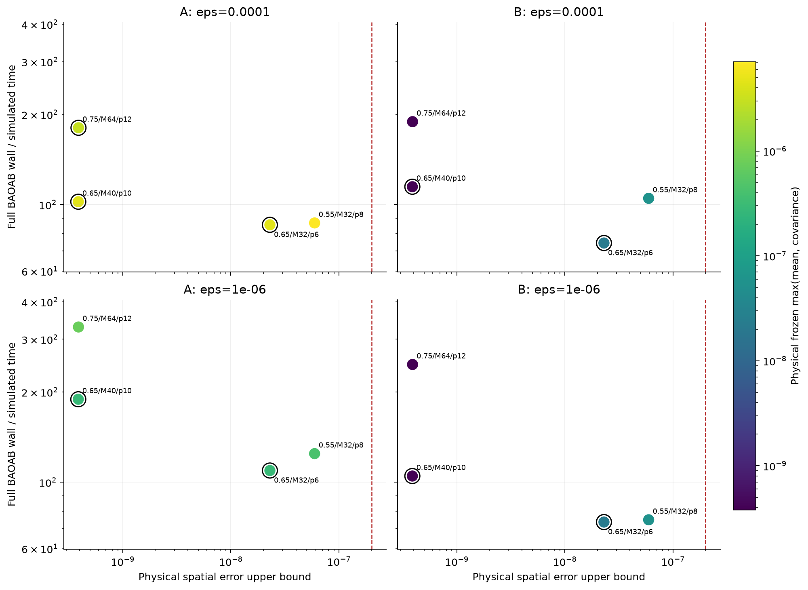
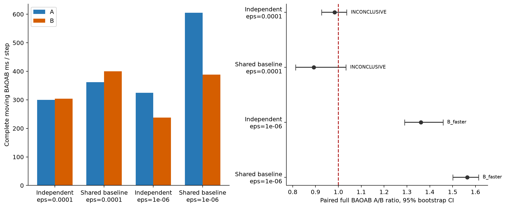
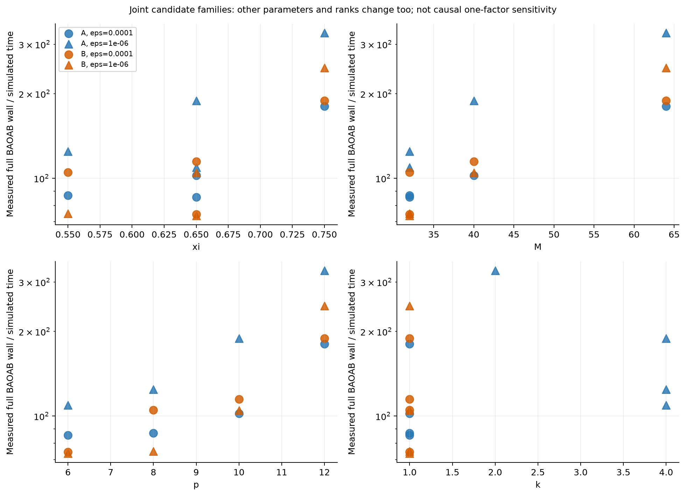
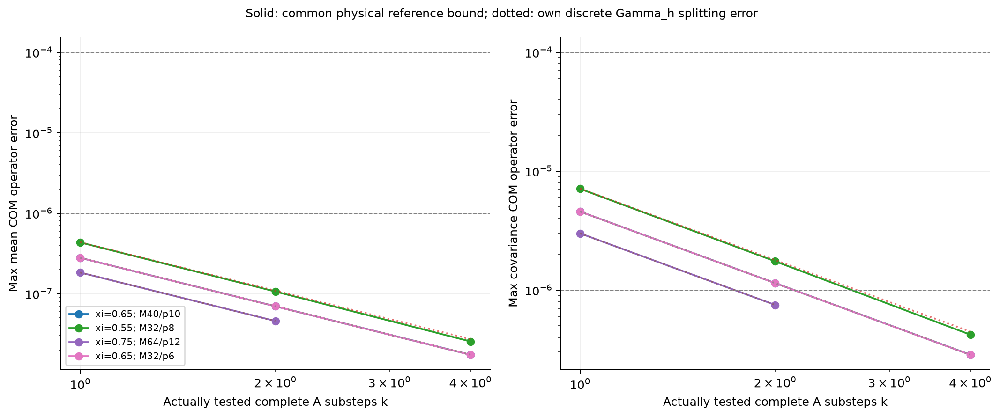
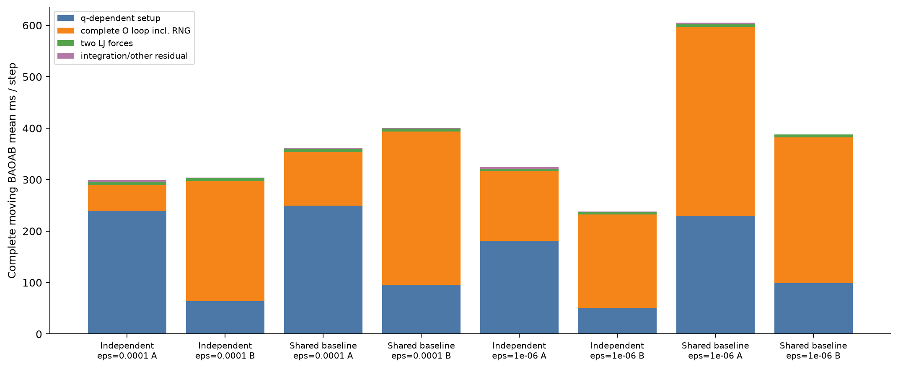

# 本地 BAOAB A/B 联合选参实验

本报告由本次保存的原始结果生成。研究目标是在固定 `dt=.005`、共同物理空间预算和两档冻结 OU 精度约束下，比较本地候选中真正移动粒子的完整 BAOAB 成本。结论限于本轮有限候选与有限几何；尚未认证物理观测量等精度或不同 `dt` 的最优方案。

基线提交：`891994a02b611833848839b5de9880f9dabc7a1d`。实际目录：`/Users/wfy666/Documents/New project/ass1_joint`；分支：`codex/baoab-ab-joint-selection`；执行环境：local Mac only。

## 实测结论

- `epsilon_frozen=0.0001`，A/B 各自独立选参：A 299.513 ms/完整移动步，B 303.986 ms/步；A/B=0.983，配对 bootstrap 95% CI [0.927, 1.037]；判定 `INCONCLUSIVE`，精度门控通过。
- `epsilon_frozen=0.0001`，共同空间旧基线对照：A 362.211 ms/完整移动步，B 399.789 ms/步；A/B=0.892，配对 bootstrap 95% CI [0.812, 1.033]；判定 `INCONCLUSIVE`，精度门控通过。
- `epsilon_frozen=1e-06`，A/B 各自独立选参：A 324.362 ms/完整移动步，B 238.108 ms/步；A/B=1.361，配对 bootstrap 95% CI [1.290, 1.458]；判定 `B_faster`，精度门控通过。
- `epsilon_frozen=1e-06`，共同空间旧基线对照：A 605.146 ms/完整移动步，B 388.281 ms/步；A/B=1.564，配对 bootstrap 95% CI [1.501, 1.614]；判定 `B_faster`，精度门控通过。

正式结论的末端精度总门控：**通过**。若任何空间、physical mean/covariance 或实际噪声路径核查失败，速度数字仅保留为原始观测，不作为合格等冻结精度胜负。A/B 比值大于 1 表示 B 的 wall time 更低；CI 跨 1 时标为 `INCONCLUSIVE`。

## 模型、环境与计时边界

固定 `N=256,rho=.75,L=6.9886437178904,kappa=.7,c=1.6148096467001,m=kBT=sigma=epsilon_LJ=1`；Candidate1/S1L 真周期完整摩擦镜像与真实 k=0，self cancellation 和 COM 动量约束保持一致。LJ 使用 minimum image、`r_on=2,r_cut=2.5` quintic switch 并含 switch 导数。

本机平台 `macOS-27.0.1-arm64-arm-64bit`，Python `3.11.5 (v3.11.5:cce6ba91b3, Aug 24 2023, 10:50:31) [Clang 13.0.0 (clang-1300.0.29.30)]`；NumPy 2.4.6、SciPy 1.17.1、Matplotlib 3.11.2。物理内存约 8 GiB。线程环境请求为 1；进程/系统负载和实际线程可观测值见环境与每轮资源记录，线程请求不能保证操作系统独占或固定频率。

所有数值实验在当前 Mac 完成。没有 HPC、SSH、云端数值计算；没有新跑 canonical 预平衡，而是对 PR10 保存的三个初态 q,p 做 SHA 核查后复用。PR7 的 `kappa=.2,c=1` 历史最优数字没有作为本物理模型的合格候选。PR10/11 旧计时只作背景，未参与本轮速度比。

每个外步真正推进 q,p，并在当前 q_mid 重建 assignment、degree、近边与 A 的一般满秩 3×3 eigensystem/coefficient。位置无关 FFT/kernel table 可跨步复用。A 的 k 个完整 `near forward → long OU → near reverse` 内步共享这一外步几何，每个内步重新生成独立 long/near-forward/near-reverse Gaussian；B 每外步一次 full OU。

完整 BAOAB 时钟包含 q 相关 setup、全部 O 内步及 RNG、两次 LJ force、kick/drift 和实际积分开销。一次性参数表、独立 direct/dense 参考、验证、证据写盘与绘图在正式每步时钟之外；嵌套 FFT/reorth/eigensolve 子时钟仅作诊断，不能再次加到总时间。

## 空间搜索与共同物理参考

实际筛选 34 个独特联合候选，覆盖 xi=0.45/0.55/0.65/0.75/0.85/1.0，允许 sR≠sF、M32–64、p6–12；不是笛卡尔全扫。首轮对 9 个候选做完整初态核查，累计 25 次完整空间算子核查，最终 4 个合格空间设置进入真实动态候选排名。便宜筛选状态计数：`{'eligible_for_fullnorm_screen': 20, 'rejected_by_physical_probe_lower_bound': 14}`。失败的合法候选和下界拒绝原因全部保存在 `results/spatial/cheap_screen.csv`，完整核查失败点在 `full_spatial_checks.csv`。

便宜方向测试仅用于具有物理参考范数分母的安全误差下界拒绝；通过资格由完整 765 维 COM 算子 2-范数决定。共同空间硬门限为 `2e-7`。参考直接求和取 R=45 并以解析周期尾界保守补偿；新几何只计算一次 direct 参考，旧参考只读复用并核对物理参数、q/hash 与文件 SHA。没有使用旧 hardcoded kappa=.2 参考。

| 设置 | xi, sR, sF, M, p | 5 态最大空间保守界 | 用途 |
| --- | --- | --- | --- |
| sp_b4884e6cd3 | 0.65, 4.7, 4.7, 40, 10 | 3.878e-10 | 共同旧基线 |
| sp_f12368aae7 | 0.55, 4.1, 4.7, 32, 8 | 5.951e-08 | 新候选 |
| sp_59e8503896 | 0.75, 4.7, 5.2, 64, 12 | 3.895e-10 | 新候选 |
| sp_b5023de1c5 | 0.65, 4.5, 4.1, 32, 6 | 2.297e-08 | 新候选 |

最初三个 finalist 偏向保留不同 xi；为避免遗漏同 xi 下更低分辨率的候选，又对 `xi=.65,M32,p6` 的已观察代理领先点补做另外四态完整验证。该自适应补充及原始三 finalist 记录均保留；setup/单次 action 代理仅用于搜索优先级，未用于选择动态 winner。

完整几何集合是三个已预平衡初态、旧 visited 全局最小距离态和旧最大 lambda_max 代表态，共五态。旧 10 态注册域是只读来源登记，不能被解释成每个候选都在全部 10 态做了 full norm。记录包括 near 多镜像计数、边数、r_c=sR/xi、k_c=2xi*sF、Nyquist、mesh/mode 数、投影/eigenclip 及其影响、PSD/COM/对称性/分解和 FFT 实虚检查。

## 冻结 OU 与新选 Lanczos 秩

对同一独立物理周期 Gamma_ref exact OU，分别核查理想 mean 与 conditional covariance 的完整 COM 规范化 2-范数；同时保存对各自离散 Gamma_h exact OU 的 split 误差。B 理想 full-Gamma_h OU 的 own-Gamma_h split 误差为零。A 计算有序 pair+long 组合映射，包含边间和 near/long 不对易。

空间参考不确定度 deltaGamma 用 Duhamel 传递为 mean 的 h·deltaGamma 和 covariance 的 2h·deltaGamma，分子加尾界、参考范数分母减尾界；没有把空间 Γ 门限直接当作 transition 误差。实际值、分母下界和完整差矩阵谱保存在 `ideal_errors.csv` 与 maps NPZ。

| 空间设置 | 实际 full-norm A k | 未执行 k | epsilon=1e-4 最小已测通过 k | epsilon=1e-6 最小已测通过 k |
| --- | --- | --- | --- | --- |
| sp_b4884e6cd3 | 1,2,4 | 8,16 | 1 | 4 |
| sp_f12368aae7 | 1,2,4 | 8,16 | 1 | 4 |
| sp_59e8503896 | 1,2 | 4,8,16 | 1 | 2 |
| sp_b5023de1c5 | 1,2,4 | 8,16 | 1 | 4 |

达到严格必需档后停止增大 k；表中未执行 k 没有推测通过证书。只执行必需的 `epsilon_frozen={1e-4,1e-6}`；可选 `2e-8` frozen stress tier 未执行。`2e-7` 物理空间 Γ 预算、曾用 `2e-8` Lanczos action guard 与 frozen transition 档有不同含义。

每个合格空间/方法/档重新搜索 damping 与 noise 秩，没有直接搬用 PR11 的固定 3/8 或 5/12。搜索从低秩开始，在实际动量、Gaussian、随机、谱慢/快、低波数 L/T 等方向检验两个矩阵函数，再在五态用共同秩重检及独立 Gaussian 完整路径；production wrapper 与独立路径逐数组相等。有限 Lanczos 为输入相关映射，这些 sampled probe/path 证据不是统一线性 covariance 算子证书或 exact FDT 声明。

| 配置 | k | r_d/r_n | 空间界 | 物理 mean 界 | 物理 cov 界 | finite path 误差 |
| --- | --- | --- | --- | --- | --- | --- |
| sp_b4884e6cd3_A_eps0.0001 | 1 | 3/8 | 3.878e-10 | 2.791e-07 | 4.571e-06 | 1.079e-08 |
| sp_b4884e6cd3_B_eps0.0001 | 1 | 4/9 | 3.878e-10 | 2.282e-11 | 3.795e-10 | 4.450e-09 |
| sp_b4884e6cd3_B_eps1e-06 | 1 | 4/9 | 3.878e-10 | 2.282e-11 | 3.795e-10 | 4.450e-09 |
| sp_b4884e6cd3_A_eps1e-06 | 4 | 3/8 | 3.878e-10 | 1.743e-08 | 2.855e-07 | 9.060e-10 |
| sp_f12368aae7_A_eps0.0001 | 1 | 3/7 | 5.951e-08 | 4.334e-07 | 7.101e-06 | 4.989e-09 |
| sp_f12368aae7_B_eps0.0001 | 1 | 4/9 | 5.951e-08 | 3.478e-09 | 5.735e-08 | 3.929e-09 |
| sp_f12368aae7_B_eps1e-06 | 1 | 4/9 | 5.951e-08 | 3.478e-09 | 5.735e-08 | 3.929e-09 |
| sp_f12368aae7_A_eps1e-06 | 4 | 3/8 | 5.951e-08 | 2.551e-08 | 4.210e-07 | 4.295e-10 |
| sp_59e8503896_A_eps0.0001 | 1 | 4/8 | 3.895e-10 | 1.833e-07 | 2.996e-06 | 1.429e-09 |
| sp_59e8503896_B_eps0.0001 | 1 | 4/9 | 3.895e-10 | 2.327e-11 | 3.817e-10 | 3.655e-09 |
| sp_59e8503896_B_eps1e-06 | 1 | 4/9 | 3.895e-10 | 2.327e-11 | 3.817e-10 | 3.655e-09 |
| sp_59e8503896_A_eps1e-06 | 2 | 3/9 | 3.895e-10 | 4.581e-08 | 7.488e-07 | 5.218e-09 |
| sp_b5023de1c5_A_eps0.0001 | 1 | 3/8 | 2.297e-08 | 2.790e-07 | 4.570e-06 | 1.055e-08 |
| sp_b5023de1c5_B_eps0.0001 | 1 | 4/9 | 2.297e-08 | 1.331e-09 | 2.219e-08 | 3.987e-09 |
| sp_b5023de1c5_B_eps1e-06 | 1 | 4/9 | 2.297e-08 | 1.331e-09 | 2.219e-08 | 3.987e-09 |
| sp_b5023de1c5_A_eps1e-06 | 4 | 3/8 | 2.297e-08 | 1.739e-08 | 2.849e-07 | 9.392e-10 |

## xi、k 与净成本的实测回答

`epsilon=0.0001` 下，旧基线最小已测通过 k=1；本轮其他设置没有进一步降低这一最小 k。
`epsilon=1e-06` 下，xi=0.75; M64/p12 的最小已测通过 k 从旧基线 4 降到 2；同轮短程 exploratory 完整 A 成本是旧基线的 1.743 倍（329.537 vs 189.111 wall/simulated time）。减少 k 未能抵消该候选其他 setup/mesh/near 成本。该比较包含同时变化的 sR/sF/M/p/ranks，不能把收益单独归因于 xi；短程排名也没有配对 CI。

最终独立选参是依据每个配置三初态实际完整 BAOAB wall / simulated physical time 排名，再对头部做新批次交错配对计时；没有用缓存 Gamma v 或代理速度代替。较低 k 是否有净收益由上表/正式 head 比较的总成本决定。

## 正式动态对比与资源

Exploratory 实际执行 144 个移动外步、234 次 O 内调用；每配置三个初态、每初态 3 步。正式 head 共 960 个移动外步、1680 次 O 内调用，每个独特比较 6 配对轮、每方法每轮 20 步；六轮时 A-first/B-first 各三轮，初态 r mod 3。显式相同配置的比较组可复用本轮同一实际批次，并在结果中登记；不能当作额外独立样本。

| 比较/精度 | 方法 | xi,sR,sF,M,p | k; r_d/r_n | 完整 ms/步 | wall/sim time | setup ms | O+RNG ms | peak RSS MiB |
| --- | --- | --- | --- | --- | --- | --- | --- | --- |
| 独立 0.0001 | A | 0.65, 4.5, 4.1, 32, 6 | 1; 3/8 | 299.513 | 59.903 | 239.913 | 49.819 | 264.938 |
| 独立 0.0001 | B | 0.65, 4.5, 4.1, 32, 6 | 1; 4/9 | 303.986 | 60.797 | 64.098 | 233.062 | 264.938 |
| 共同基线 0.0001 | A | 0.65, 4.7, 4.7, 40, 10 | 1; 3/8 | 362.211 | 72.442 | 249.164 | 104.293 | 289.500 |
| 共同基线 0.0001 | B | 0.65, 4.7, 4.7, 40, 10 | 1; 4/9 | 399.789 | 79.958 | 95.911 | 297.813 | 289.500 |
| 独立 1e-06 | A | 0.65, 4.5, 4.1, 32, 6 | 4; 3/8 | 324.362 | 64.872 | 180.920 | 135.829 | 289.500 |
| 独立 1e-06 | B | 0.65, 4.5, 4.1, 32, 6 | 1; 4/9 | 238.108 | 47.622 | 51.186 | 181.494 | 289.500 |
| 共同基线 1e-06 | A | 0.65, 4.7, 4.7, 40, 10 | 4; 3/8 | 605.146 | 121.029 | 230.141 | 367.141 | 308.609 |
| 共同基线 1e-06 | B | 0.65, 4.7, 4.7, 40, 10 | 1; 4/9 | 388.281 | 77.656 | 98.522 | 283.993 | 308.609 |

配对统计以实际 paired round 为单位，保留三个初态控制和原交错顺序；统计方法/随机种子与 CI 原始表见 `analysis.json`。有限轮数、系统负载和候选选择噪声限制其外推。Pareto 是本轮同方法、同精度档内的成本—空间误差—冻结误差三目标经验前沿，exploratory 每点仅九步（默认三初态×三步）；不是全局最优或有 CI 的前沿。

## 新移动几何末端验证

正式计时结束后，从每个独特比较取三个初态最后一轮 A/B 的实际 q_mid，共 24 个样本、24 个不同几何。重算独立 R45 真周期参考并做完整空间/765 维 physical mean/covariance 与 own-Gamma_h norm；另由保存的 before PCG64 state 逐内步重建 z/near-forward/near-reverse，核对原始 RNG 和 Gaussian SHA。

用真实第一 kick 后的 p_half 与真实全部噪声重放 production OU，与同方法 dense exact-long/full coupled 路径比较；每个实际 damping/noise 输入也分别核查有限 Lanczos。反推保存的 O 输出仅允许第二 kick 浮点逆操作的舍入差。所有实际噪声哈希、action 输入/精确/有限数组、路径输出、GH/GL/RA/CA、独立参考来源 SHA 与尾界均保存。该扩域是末端抽样，不是所有移动步全算子证书。

| 比较 | 复用来源 | 样本数 | 空间 | 物理 mean/cov | 实际噪声 finite | 最大空间界 | 最大 mean/cov | 最大实际 finite path |
| --- | --- | --- | --- | --- | --- | --- | --- | --- |
| independent_optimum_e0.0001 | independent_optimum_e0.0001 | 6 | 通过 | 通过 | 通过 | 2.255e-08 | 2.761e-07/4.553e-06 | 1.076e-08 |
| controlled_common_baseline_e0.0001 | controlled_common_baseline_e0.0001 | 6 | 通过 | 通过 | 通过 | 3.837e-10 | 2.845e-07/4.657e-06 | 9.997e-09 |
| independent_optimum_e1e-06 | independent_optimum_e1e-06 | 6 | 通过 | 通过 | 通过 | 2.289e-08 | 1.675e-08/2.725e-07 | 3.021e-09 |
| controlled_common_baseline_e1e-06 | controlled_common_baseline_e1e-06 | 6 | 通过 | 通过 | 通过 | 3.923e-10 | 1.733e-08/2.839e-07 | 3.334e-09 |

## 测试、图与复现证据

| 日志 | 测试数 | 结果 | 秒 |
| --- | --- | --- | --- |
| logs/baseline_regressions.log | 106 | 通过 | 6.090 |
| logs/test_joint_driver.log | 8 | 通过 | 0.030 |
| logs/test_joint_plots.log | 4 | 通过 | 0.001 |
| logs/test_joint_postvalidate.log | 4 | 通过 | 0.002 |
| logs/test_joint_spatial.log | 5 | 通过 | 0.053 |
| logs/test_joint_thermo.log | 6 | 通过 | 0.029 |
| logs/test_independent_audit.log | 4 | 通过 | 0.366 |

上述有日志证据的测试合计 137 项。独立只读审计另核查旧 2586 个 tracked 文件不变、SHA 链、参数/计数/范数/原始表、真实动态 setup 与 RNG 及配对表。最终状态与完整证据清单见 `results/independent_audit.json`；审计必须在图表/报告生成后执行。

PNG 与 SVG、每图 plotted CSV、源数据 SHA 和图文件 SHA 在 `figures/figure_manifest.json`。复现入口见本目录 `README.md`；所有实验输出仅在本新目录，historical inputs/代码只读。

## 未执行与结论边界

未执行：可选 frozen `2e-8` stress tier、未列为 executed 的更大 k、更广笛卡尔候选搜索、新 canonical 预平衡、dt=.0025 灵敏度、正式 16-replica×4dt、HPC/SSH/云端数值任务与长轨迹。

尚未验证：VACF/MSD/RDF/pressure/温度等物理观测的 95% CI 等精度，也未允许 A/B 各自选择 dt 后确定 physical equal-dynamical-accuracy winner。当前只支持固定 dt、指定冻结精度约束、有限已验证几何和本机局部候选集合上的 moving-particle 完整 BAOAB 速度结论；不声称全局最快。
