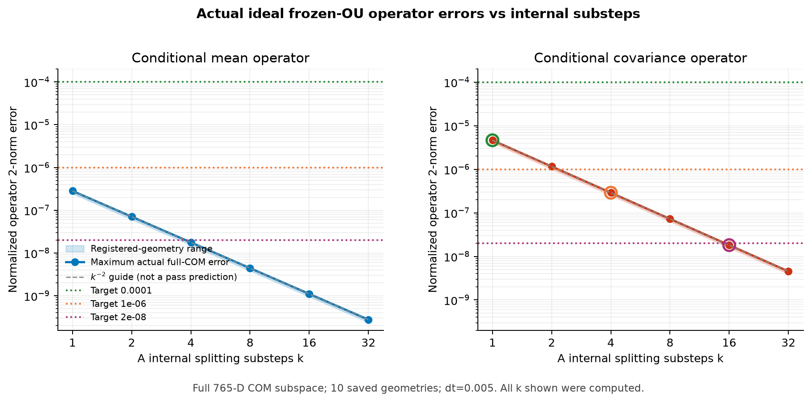
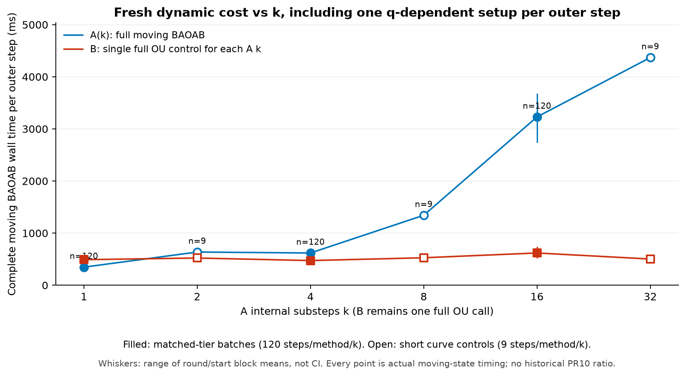
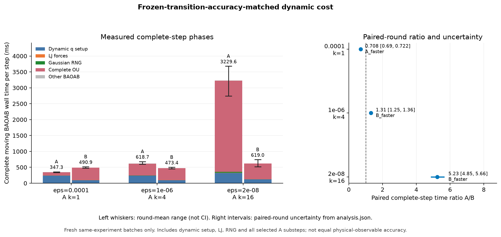
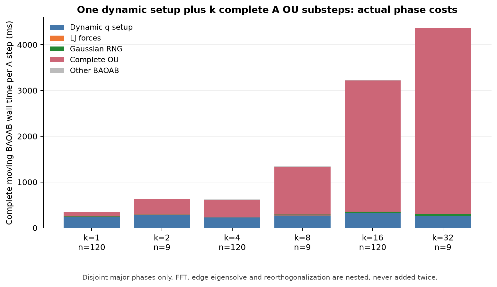

# A/B 冻结 OU 精度匹配后的完整动态 BAOAB 成本

本轮已经在本地 Mac 实际执行冻结转移精度验证和运动粒子计时。三档结论为：**0.0001（k=1）：A_faster；1e-06（k=4）：B_faster；2e-08（k=16）：B_faster**。这些标签仅指 **frozen-transition-accuracy-matched dynamic cost**，不表示已匹配完整物理观测量精度。

| 冻结阈值 | A最小实测通过k | A完整步均值(ms) | B完整步均值(ms) | 配对A/B比 | 近似95%区间 | 本地结论 |
| --- | --- | --- | --- | --- | --- | --- |
| 0.0001 | 1 | 347.254 | 490.869 | 0.7075 | [0.68986, 0.722] | A_faster |
| 1e-06 | 4 | 618.68 | 473.434 | 1.3062 | [1.255, 1.3572] | B_faster |
| 2e-08 | 16 | 3229.59 | 619.022 | 5.233 | [4.8531, 5.6603] | B_faster |

实际完成 **720 个匹配档动态步骤**，以及 **54 个额外成本曲线动态步骤**。匹配档每个精度为6个配对round×A/B各20步，三个旧初态各出现两次；所有步骤都是真实运动粒子，每个外步更新q_mid和全部位置相关数据。PR10旧batch的A=397.96ms/B=515.77ms只作为历史背景，未进入本次速度比、bootstrap或图中的新batch成本。

## 基线、环境和物理模型

基线为PR #10 `84174ae0d11e3f5826cda000c688d147a1b56241`；新分支 `codex/baoab-ab-matched-accuracy`；仅写入 `benchmarks/method_A_clustered/baoab_ab_matched_accuracy/`。基线快照保存1979个tracked文件的SHA，旧PR3–10源码、结果、图和证据未被覆盖。执行环境为 `macOS-27.0.1-arm64-arm-64bit`，Python 3.11.5，NumPy 2.4.6，SciPy 1.17.1；内存为8GiB。全部测试和数值执行在本机，未用SSH、HPC或远程数值计算。

严格复用N=256、rho=.75、L=6.98864371789039，m=sigma=epsilon_LJ=kBT=1；gamma=.5、kappa=.7、r_ref=1.3、c=.5×1.3×exp(.7×1.3)=1.614809646700131。LJ在r_on=2到r_cut=2.5使用quintic switch，保守力包含switch derivative；只有LJ采用minimum image。摩擦保留周期镜像、物理k=0、完整self cancellation和COM约束；image-summed近场边保留完整3×3张量。

Grid PSD参数固定xi=.65、sR=sF=4.7、M=40、p=10，没有重新搜索Gamma-v最优参数。参数/FFT表只在合法的物理参数与盒子固定范围复用；所有q相关邻居/镜像、assignment、degree、A边eigh与coefficients每个外步重建。

## 完整A子步和外层BAOAB

每个真实BAOAB外步执行B-A-O-A-B：两次LJ momentum kick、两次position drift；O使用该步实际q_mid冻结图。A在同一个图上执行k次完整对称子循环，每次为 near_forward(dt/(2k))、long_OU(dt/k)、near_reverse(dt/(2k))。三个Gaussian数组在每个子步重新独立生成，exact OU自己包含dt/k噪声幅度，没有额外sqrt(dt)缩放。A coefficient key区分dt/(2k)、mass、kBT。B保持单次full-Gamma OU(dt)，没有被迫做k个子步。

构图/eigh/coeff只做一次，k个long damping/noise、2k个有序pair sweeps与全部RNG实际累加到完整外步成本。k=1回归检查与旧PR10相同输入/同一随机流的结果一致；k>1用独立小N稠密算子和Gaussian indexing、COM、setup次数测试。冻结比较时A/B在同一给定q使用同一GammaS+GammaL；动态计时每轮从同一q/p起步后各自真实前进，后续轨迹不被强行替换成同q replay。

## 三种阈值的含义

1. **空间预算2e-7**：此前PR10把离散Gamma_h与完整周期物理direct reference比较的要求。本轮固定其参数，不把本轮离散图上的OU比较误称为所有新几何的物理空间全域认证。
2. **此前Lanczos action目标2e-8**：单个矩阵函数action的有限方向误差目标。本轮对子步重选秩，并结合组成路径及该档余量设置更小预算，不能直接沿用旧14/5。
3. **此次epsilon_frozen=1e-4、1e-6、2e-8**：人为注册的冻结**条件转移**均值/协方差匹配目标。严格2e-8是stress test，不是Overleaf完整BAOAB物理观测误差必须达到的条件；未达某档应标accuracy_not_met，而不是宣称A方法失效。

## 理想冻结转移：完整765维COM算子范数

参考B由独立pair-tensor组装的完整离散Gamma做稠密eigendecomposition得到。Q是3N×(3N-3)的Helmert COM基；RB=exp(-dt Gamma)，CB=Pi-RB Pi RB^T。A的有序近场均值乘积为F，小步均值为F^T exp(-(dt/k)GammaL) F，再取k次矩阵乘积，得到RA(k)。理想独立线性OU子步的CA=Pi-RA Pi RA^T；该恒等式另由小N显式Gaussian列传播测试，而不是把finite-Lanczos噪声逐列拼成固定F。

在COM子空间比较：`e_mean=||Q^T(RA-RB)Q||2 / max(||RB Pi||2,small)`；`e_cov=||Q^T(CA-CB)Q||2 / max(||CB||2,small)`。small=1.0e-300，所有实际绝对范数、分母、近零标记、对称残差、完整eigenspectrum/SVD、RA/CA矩阵及SHA保存。分母分别等于最大exp(-dt lambda)与最大[-expm1(-2dt lambda)]，不会把COM单位特征值错误用于mean归一化。数值上不满足对称检查时使用完整SVD，没有用有限探针替代765维谱范数。

注册域包括3个旧独立初始态、6条旧真实轨迹的末步q_mid，并额外扫描1200个已保存q_mid后纳入全局最小距离态，共10个几何。全局最小q_mid距离=0.883208；注册域最大lambda=12.1493，位于 `visited_1_B_200`。lambda极值只对注册稠密域测量，不冒称已对所有1200几何做过完整特征分解。

| k | 注册域最大e_mean | 注册域最大e_cov | 逐几何cov相邻k实测斜率范围 |
| --- | --- | --- | --- |
| 1 | 2.82633e-07 | 4.63693e-06 | N/A |
| 2 | 7.06578e-08 | 1.15923e-06 | [-2, -2] |
| 4 | 1.76644e-08 | 2.89806e-07 | [-2, -2] |
| 8 | 4.41604e-09 | 7.24504e-08 | [-2, -2] |
| 16 | 1.10387e-09 | 1.81102e-08 | [-2.0002, -1.9999] |
| 32 | 2.75789e-10 | 4.52451e-09 | [-2.001, -1.9986] |

| epsilon_frozen | 最小实际通过k | 最大e_mean | 最大e_cov | 选择状态 |
| --- | --- | --- | --- | --- |
| 0.0001 | 1 | 2.82633e-07 | 4.63693e-06 | ideal_operator_accuracy_met |
| 1e-06 | 4 | 1.76644e-08 | 2.89806e-07 | ideal_operator_accuracy_met |
| 2e-08 | 16 | 1.10387e-09 | 1.81102e-08 | ideal_operator_accuracy_met |

所有k=1/2/4/8/16/32均实际计算；k^-2只作观察到的参考斜率，不用于外推通过。选k要求所有注册几何的mean和cov同时通过。另对新计时轨迹实际18个末步q_mid重新做完整COM谱范数检查，记录实际p_half、GH/GL及maps；各档新端点最大误差和通过状态见analysis.json/post_timing_errors.csv。这仍是有限几何域，不是整条轨迹所有状态的统一误差界。

## 有限Lanczos重选秩、组成路径与方向MC

| A k | A r_d | A r_n | B r_d | B r_n | A每action预算 | A整路径预算 | finite验证域 |
| --- | --- | --- | --- | --- | --- | --- | --- |
| 1 | 3 | 8 | 5 | 12 | 2e-08 | 2e-08 | 10个注册态 |
| 2 | 5 | 12 | 5 | 12 | 5e-10 | 2e-09 | 仅代表态（成本曲线） |
| 4 | 3 | 8 | 5 | 12 | 4.43871e-09 | 2e-08 | 10个注册态 |
| 8 | 3 | 12 | 5 | 12 | 1.25e-10 | 2e-09 | 仅代表态（成本曲线） |
| 16 | 3 | 12 | 5 | 12 | 2.95284e-12 | 2.36228e-10 | 10个注册态 |
| 32 | 3 | 12 | 5 | 12 | 3.125e-11 | 2e-09 | 仅代表态（成本曲线） |

slow/fast/random、实际p、实际Gaussian和低波数L/T等方向对照稠密两个矩阵函数，选完跨状态共用秩后再重新验证该实际共用秩；common_probe_checks最大相对误差=1.11305e-08。每个A子步实际中间输入/独立噪声和完整同源随机路径也对照本方法自己的理想参考；最大组成路径相对差=1.05826e-08，最大实际action差=1.1124e-08。非微小负Ritz立即中止，不默默clip。

上述两个全局最大值混合了松/严档，不拿松档的最大值同严档预算比较。各k的实际误差与本身预算如下：

| 方法 | k | 路径验证态数 | 最大实际action误差 | 该action预算 | 最大自身理想耦合路径差 | 该路径预算 | 全部通过 |
| --- | --- | --- | --- | --- | --- | --- | --- |
| A | 1 | 10 | 1.1124e-08 | 2e-08 | 1.05826e-08 | 2e-08 | True |
| A | 2 | 1 | 5.53489e-13 | 5e-10 | 2.86423e-13 | 2e-09 | True |
| A | 4 | 10 | 2.97382e-09 | 4.43871e-09 | 8.6469e-10 | 2e-08 | True |
| A | 8 | 1 | 2.19251e-11 | 1.25e-10 | 1.69207e-10 | 2e-09 | True |
| A | 16 | 10 | 2.73576e-12 | 2.95284e-12 | 4.22967e-11 | 2.36228e-10 | True |
| A | 32 | 1 | 6.19824e-13 | 3.125e-11 | 1.10454e-11 | 2e-09 | True |
| B | 1 | 10 | 9.17401e-11 | 1e-09 | 2.76217e-11 | 2e-09 | True |

真正用于动态计时的MatchedSystem O-loop也在代表态 `initial_0` 对B及A(k=1/4/16)做独立wrapper一致性检查：通过状态=True。记录实际graph_builds、coefficient_tau、matvec计数与每个子步Gaussian SHA；wrapper输出同已验证finite路径、各自理想dense路径的原始数组保存在wrapper_validation_outputs.npz。这项检查防止“验证高k、计时仍跑k=1”或验证与生产wrapper不同步。

这些finite预算是已保存方向和组成路径的实际检查，不构成非线性finite-Lanczos映射的统一算子范数界。A和B噪声结构不同，从未把两方法自然随机raw output距离当作算法偏差；同源路径差只用于finite实现对各自理想实现的比较。理想A的Maxwell保持既不等于full-B conditional transition相同，也不证明运动粒子的完整Gibbs时间误差。

在一个明确代表态 `initial_0` 上，对B和每个选中A(k)各运行16个conditional与16个equilibrium样本，保存真实输出、理想同噪声参考、随机seed/state和Gaussian SHA。统计slow/fast/random/COM方向的mean、variance、fourth moment、SE和逐点近似95%区间。下表只汇总非COM三个方向：

| 方法 | k | phase | 每方向n | 理想variance落入逐点CI | 最大mean SE | 最大variance SE | 最大paired mean差 | 最大paired second差 |
| --- | --- | --- | --- | --- | --- | --- | --- | --- |
| A | 1 | conditional | 16 | 2/3 | 0.0764934 | 0.0273295 | 8.57086e-08 | 1.90836e-09 |
| A | 1 | equilibrium | 16 | 3/3 | 0.216214 | 0.259845 | 1.15155e-08 | 6.40478e-08 |
| A | 4 | conditional | 16 | 3/3 | 0.0920781 | 0.0333674 | 4.39638e-09 | 8.14071e-10 |
| A | 4 | equilibrium | 16 | 2/3 | 0.30089 | 0.531799 | 1.14448e-09 | 4.15181e-09 |
| A | 16 | conditional | 16 | 3/3 | 0.0873038 | 0.0270007 | 3.39819e-10 | 4.71938e-11 |
| A | 16 | equilibrium | 16 | 3/3 | 0.364621 | 0.665012 | 9.13463e-11 | 3.70247e-10 |
| B | 1 | conditional | 16 | 2/3 | 0.0920009 | 0.0294263 | 1.01298e-10 | 6.01053e-11 |
| B | 1 | equilibrium | 16 | 3/3 | 0.36676 | 0.654473 | 6.62251e-11 | 1.98396e-10 |

样本量小，区间宽，且没有多重比较校正；MC不能分辨2e-8级协方差算子差异，也不用于给该严格阈值签发通过。paired second围绕已知理想mean，包含有限mean偏差平方，不被称作纯covariance算子界。冻结理想完整范数、finite方向/路径证据和MC不确定性始终分开。

## 实际动态成本与不确定性

| epsilon | 方法 | 实际OU子步数 | 动态setup(ms) | LJ(ms) | RNG(ms) | 完整OU(ms) | 其它BAOAB(ms) |
| --- | --- | --- | --- | --- | --- | --- | --- |
| 0.0001 | A | 1 | 239.505 | 5.43515 | 1.57893 | 97.2537 | 3.48169 |
| 0.0001 | B | 1 | 97.8065 | 5.38075 | 0.0162521 | 386.843 | 0.82242 |
| 1e-06 | A | 4 | 230.228 | 5.29695 | 5.42503 | 374.051 | 3.67885 |
| 1e-06 | B | 1 | 95.7887 | 5.36478 | 0.0141438 | 371.493 | 0.77364 |
| 2e-08 | A | 16 | 320.958 | 7.33045 | 29.2352 | 2864.03 | 8.03771 |
| 2e-08 | B | 1 | 122.715 | 7.05247 | 0.0250632 | 488.185 | 1.04424 |

以下细项都是上面父阶段内部的诊断，不再次相加：

| epsilon | 方法 | edge eigh | coefficients | pair forward | pair reverse | long/full damp | long/full noise | FFT | reorth |
| --- | --- | --- | --- | --- | --- | --- | --- | --- | --- |
| 0.0001 | A | 45.9067 | 30.8071 | 0.567708 | 0.592904 | 26.5751 | 69.362 | 39.2962 | 0.340753 |
| 0.0001 | B | 0 | 0 | 0 | 0 | 113.39 | 273.279 | 62.8928 | 0.593689 |
| 1e-06 | A | 43.3818 | 30.4965 | 2.07776 | 2.2382 | 101.655 | 267.453 | 140.569 | 1.27813 |
| 1e-06 | B | 0 | 0 | 0 | 0 | 109.079 | 262.256 | 59.7978 | 0.562248 |
| 2e-08 | A | 57.5647 | 39.6307 | 10.1833 | 11.496 | 571.779 | 2267.07 | 1070.96 | 10.8516 |
| 2e-08 | B | 0 | 0 | 0 | 0 | 143.462 | 344.536 | 85.5241 | 0.821027 |

单位均为ms/外层BAOAB步。完整wall包含两次LJ力、fresh q-dependent setup、所有k子步、RNG、drift/kick和计时包装开销。构图q token hash、force同时返回的势能/最小距离在wall内；额外证据哈希、观测汇总与文件序列化在wall外另存。one-time物理表建立在timing_table.json单列，旧初态准备未重新执行。FFT属于setup或OU；eigh属于edge constructor；reorth属于Lanczos。完整父阶段和这些嵌套细项绝不重复求和。

| A k | 实际A步骤 | 完整A均值(ms) | 中位数(ms) | 实际r_d | 实际r_n | 样本说明 |
| --- | --- | --- | --- | --- | --- | --- |
| 1 | 120 | 347.254 | 331.922 | 3.0 | 8.0 | matched target120Asteps |
| 2 | 9 | 637.156 | 632.014 | 5.0 | 12.0 | shortcostcurve9Asteps; one-statefinitevalidation |
| 4 | 120 | 618.68 | 588.393 | 3.0 | 8.0 | matched target120Asteps |
| 8 | 9 | 1342.54 | 1357.47 | 3.0 | 12.0 | shortcostcurve9Asteps; one-statefinitevalidation |
| 16 | 120 | 3229.59 | 3137.51 | 3.0 | 12.0 | matched target120Asteps |
| 32 | 9 | 4369.07 | 4298.89 | 3.0 | 12.0 | shortcostcurve9Asteps; one-statefinitevalidation |

选中k=1/4/16各有120个A步骤及其120个新B控制步骤；非选中k=2/8/32各只有3初态×3步=9个A步骤，加9个B控制步骤，明示更小验证域/更短样本，不把它们升级为匹配精度档。各k的实际秩可以不同，因此成本曲线不是固定秩的简单k倍外推。所有点均为实际移动粒子成本。

每个匹配档有6个完整配对round，每round从同一个旧q/p出发，A和B各真实前进20步，顺序随机化，三个初态各重复两次。时间均值栏是全部实际步骤的算术均值，时间比统计量是6个round均值比的几何均值，因此直接相除两个总均值不必等于配对ratio。20000次bootstrap以整个配对round为单位重采样，保存原始bootstrap样本和seed。近似95%percentile区间仅条件于这3个初态/6个本地时间block，不是物理观测CI，也不把720个相邻步骤当作独立样本。CI完全小于1标A_faster，完全大于1标B_faster，否则INCONCLUSIVE；新增端点精度不满足时标accuracy_not_met，不纳入平等比较。

请求native单线程；macOS Accelerate线程数不能被threadpoolctl完整观测，环境变量不被冒充独立测量。计时期间没有本任务其它数值实验；wall load在每条run记录。最大总动量范数=1.16749e-13，最小pair距离=0.888161，peak RSS=289.938MiB。短轨迹温度、势能、最小距离、动量和运动量均有逐步原始记录；保守力由保存的q重建，并通过有限性与BAOAB两次kick的独立复算检查。这些是sanity证据，不是长期平衡或等动力学观测认证。

同名SVG在figures下；绘图CSV和输入/输出SHA见figure_manifest.json。误差图使用实际完整COM域；cost/total柱图的whisker是round/start均值范围，不是CI；配对A/B比的区间直接来自analysis.json。

## 初态复用、测试、审计和停止线

| 初态 | 旧独立seed | 旧预平衡时间 | 旧输入SHA |
| --- | --- | --- | --- |
| 0 | 202610280101 | 30.0 | ad3916c98feb6d3362d8a1f89c0396a3f5c63be1220c0b86185f5e9c92fa366e |
| 1 | 202610280102 | 30.0 | c25a362c6a1d071898249a59749fec494653c287b6cd60dfb86cb1a3a938fc05 |
| 2 | 202610280103 | 30.0 | bcae2c79dc917b1f5b59b62344386e6f60c5194a953253ddd8716f33935b2dc2 |

本轮canonical preparation实际执行步数为 **0**；旧初态经hash-check复用。旧30时间单位有限预平衡仍只是COM-constrained Langevin准备协议，不作为精确canonical mixing证明。

复用实现回归 **81** 项、新实现测试 **25** 项通过，共 **106**。调试阶段和一次统一运行的测试失败日志保留；统一运行中的import路径修复限于新测试的显式文件加载，不改写旧代码或数值数据。独立审计见results/independent_audit.json及其原始log，核对基线SHA、实际k/rank、每步一次构图、所有子步Gaussian/RNG重放、真实q_mid、完整时钟、输入/输出数组、范数和配对统计。复现命令见README.md。

**完整BAOAB等动力学精度A/B选型仍未完结。** 本轮已回答的只是同一dt/空间离散下、给定有限冻结域/已检查实现误差的动态成本问题。没有执行16-replica×4-dt、长LJ链、正式VACF/MSD/pressure/RDF置信区间、C/D/E、联合Grid PSD生产优化或HPC。下一阶段应先注册物理观测的可接受误差与跨dt统计设计，再独立评估长期/并行资源；本次不会自动启动该阶段。
