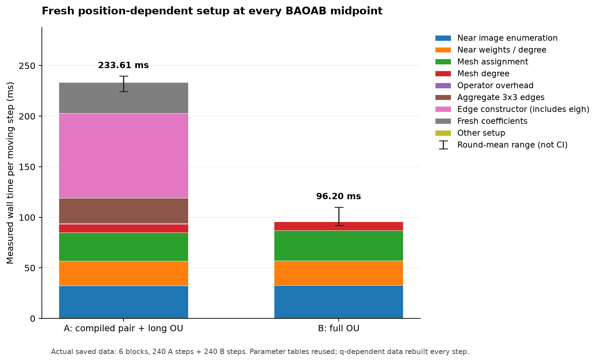
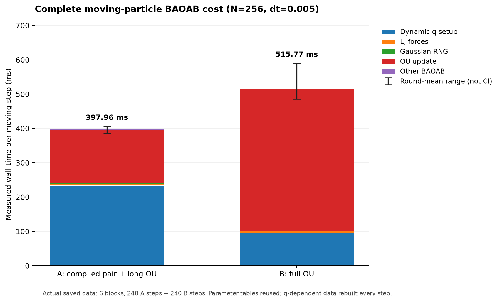
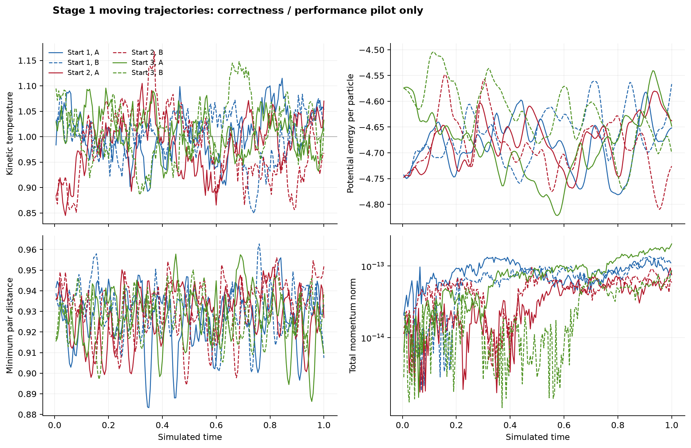

# 运动粒子 BAOAB A/B：本地 Stage 0 + Stage 1 报告

基线为 PR #9 `d6a8d208bcdc30731079715dc4c8e925b4fb2f8b`，工作分支 `codex/baoab-ab-stage01`。本次只在本机 Apple M2 / 8 GiB / macOS 27.0.1 执行。完整环境见 `environment_initial.json`；未执行 Stage 2/3、HPC、SSH、远程计算或正式长期统计。

本次实际完成 **1200 个生产 BAOAB 步**（3 个独立初态 × A/B × 200），另完成 **480 个独立动态计时步**（6 interleaved rounds × A/B ×40）。所有粒子真实移动，每步在新的 q_mid 构建算子。下表来自同一次独立 interleaved batch，单位 ms/完整 BAOAB 步，包含两次 LJ force、全动态 setup、RNG、完整 OU 和漂移/kick：

| 方法 | 完整 wall 均值 | 每步中位数 | 6轮均值范围 | 动态 setup 均值 | 生产轨迹均值 |
| --- | --- | --- | --- | --- | --- |
| A | 397.963 | 381.654 | 385.985–405.514 | 233.614 | 579.539 |
| B | 515.773 | 488.215 | 485.189–589.213 | 96.1997 | 685.626 |

6 个 round 的 A/B 平均成本比均值为 0.774188，范围 [0.686996, 0.800977]。该范围是实际 round 变化，不是置信区间。该比率仅描述本机短 pilot 的动态性能，**不是等动力学精度排名，也不作 A/B 最终 winner 结论**。

## 物理模型与实际积分

N=256，rho=.75，L=6.98864，m=sigma=epsilon_LJ=kBT=1。Candidate 1/S1L 使用 kappa=.7 与 c=.5×1.3×exp(.7×1.3)=1.614809646700131。gamma=.5 是核幅度定义，不是预平衡 scalar Langevin 的 gamma=1。LJ 使用 r_on=2、r_cut=2.5 的 quintic switch，force 同时包含 switch derivative。只有保守 LJ 使用 minimum image；摩擦保留所有 cutoff 内周期镜像，聚合同一 i<j 的完整3×3张量，没有把 self-image 变成自边。

每步执行 p_half=p+dt F(q)/2；q_mid=q+dt p_half/2；在 q_mid 更新 Gamma_h 并冻结整个 O_dt；q_next=q_mid+dt p_after/2；p_next=p_after+dt F(q_next)/2。dt=.005，每条200步轨迹总时长1。wrapped q 与 unwrapped q 分开保存。

复用既有 GridPSDGamma、ProjectedMesh、full/long Lanczos 和 PR9 顺序 C Pair OU。A/B 共享完全相同物理 kernel、盒子与参数表；只有 A 的 splitting 与 B 的 full OU 不同。每步重建近场镜像边、assignment/degree，A 额外重建 eigensystem 和 coefficients。物理 FFT 表跨步共享，位置相关数据不跨步复用。

## Stage 0：空间、算子和 splitting 分开验证

历史候选 xi=.85,sR=sF4.1,M24,p8 在新物理核下空间误差约1.20e-2，未通过。较细的 .85/M40/p10 仍约2.21e-3。实际选定 xi=0.65,sR=sF=4.7,M=40,p=10，未进行 fastest-parameter 搜索。

独立参考直接累加 unsplit c exp(-.7r)/r 的完整周期图，截断 R=45，记录 R33.75/40.5/45 annulus 收敛和解析无限尾界；没有使用 mesh/Ewald split 构造 reference。三个初态和六个实际访问 q_mid 的最大保守相对谱误差为 **3.919e-10**，均满足2e-7。每个几何都保存独立矩阵/镜像计数/尾界、q SHA 和结构诊断；初始可行性几何另存。物理 Fourier k=0 保留；完整 mesh self cancellation 与近场无自边通过测试。实际 projection_active=False 表示本组选定参数无需负块修正，算法仍使用既有 Grid PSD 实现。

实际选择的秩：A/long r_d=5,r_n=14；B/full r_d=5,r_n=14。两方法分别验证后恰好相同，并非强制同秩。slow/fast/random/actual momentum/actual Gaussian/主轴低波数 L/T 方向均对照 dense 矩阵函数；检查实际 FFT actions，最大相对 action 误差 **3.314e-12**，阈值2e-8。六个访问状态复原真实 p_half 和该生产步 Gaussian（A 包含真实 near-forward 输入）。有限方向和采样状态验证不构成全域 rank 误差界。

A 保持1个内部 splitting step。下表是理想线性 splitting 相对 full exact OU 的误差；该误差不同于上面的 finite Krylov 误差：

| 初态 | 内部步数（实际采用1） | mean operator absolute error | covariance relative error |
| --- | --- | --- | --- |
| 0 | 1 | 2.38675e-07 | 4.05318e-06 |
| 0 | 2 | 5.96686e-08 | 1.01329e-06 |
| 0 | 4 | 1.49171e-08 | 2.53323e-07 |
| 1 | 1 | 2.66451e-07 | 4.43509e-06 |
| 1 | 2 | 6.66125e-08 | 1.10877e-06 |
| 1 | 4 | 1.66531e-08 | 2.77192e-07 |
| 2 | 1 | 2.72587e-07 | 4.57075e-06 |
| 2 | 2 | 6.81464e-08 | 1.14268e-06 |
| 2 | 4 | 1.70366e-08 | 2.8567e-07 |

**单个 splitting step 并未达到相对 full exact OU 的合并2e-8误差预算。**例如初态0的 mean operator absolute error约2.39e-7，covariance relative error约4.05e-6。因此严格空间与Krylov检查通过不代表完整A算子已满足等动力学精度；保留substep1仅用于本轮pilot，后续正式精度选择尚未执行。

负 Ritz 使用原有 scale-aware roundoff 规则；非微小负值立即抛出 PSDViolation。固定 frozen O 的理想 Maxwell/FDT 恒等式不作为全 BAOAB Gibbs 证明；本次未完成长期平衡、时间步等价性或动力学收敛认证。

## 独立初态和短轨迹

每个初态从 FCC 和独立 Maxwell 动量开始，用不同 seed 的 COM-constrained scalar Langevin+LJ 预平衡6000步×.005=30时间单位。下面为真实生成记录，准备时间单列，不计入生产单步：

| 初态 | seed | 准备wall(s) | 末态Tkin | 末态U/N | 最小距离 |
| --- | --- | --- | --- | --- | --- |
| 0 | 202610280101 | 18.8384 | 0.985644 | -4.74164 | 0.934741 |
| 1 | 202610280102 | 17.1416 | 0.910296 | -4.7503 | 0.930568 |
| 2 | 202610280103 | 19.1401 | 1.053 | -4.57549 | 0.916694 |

准备总 wall=55.1201s。这是实际预平衡协议，未证明有限时间内精确 canonical mixing。A/B 对每个初态使用完全相同起始 q,p；内部 Gaussian 流彼此独立且可由保存的 PCG64 state 重放。每步记录 Tkin、U/N、总动量、最小距离、位移、真实使用秩、projection 状态和 q/输入/输出/RNG SHA。原始 q_unwrapped/q/p/q_mid 全部保留在 inputs NPZ。

全部生产与计时步最大总动量范数=2.037e-13；最小粒子距离=0.883284；最大进程 peak RSS=312.02 MiB。温度/势能随短轨迹的实际变化见 trajectory_observables，不能据此宣称全程 canonical 或正式动力学一致。

## 动态成本分解

以下为 interleaved batch 的 disjoint 大阶段均值，单位 ms：

| 阶段 | A | B |
| --- | --- | --- |
| LJ 两次 force | 5.24837 | 5.34113 |
| q 相关动态 setup | 233.614 | 96.1997 |
| RNG | 1.4042 | 0.0181008 |
| 完整 O | 154.678 | 413.55 |
| 其它 BAOAB | 3.01819 | 0.664587 |

本次A的q相关setup占完整wall约 58.7%；B的完整OU占约 80.2%。这些是正式研究资源规划时必须计入的实际成本；仅看已缓存Pair OU sweep无法代表整体吞吐。A构造内含每步完整3×3边eigh/不可变数组拷贝，B每次full matvec还包括近场action。保留本次实现和参数，没有启动生产级联合优化。

动态 setup 子阶段均值如下；其余 Python 构造/包装/哈希开销包含在完整 setup，未遗漏进完整 BAOAB wall：

| setup子阶段 | A | B |
| --- | --- | --- |
| 近场邻居/全镜像 | 32.2365 | 32.7842 |
| 近场权重/degree | 24.3519 | 24.4287 |
| mesh assignment | 28.4738 | 29.7867 |
| mesh degree | 8.22587 | 8.65277 |
| A 边张量聚合 | 25.2675 | 0 |
| A edge constructor（含 eigh） | 83.7569 | 0 |
| A coefficients | 30.6679 | 0 |

对应SVG矢量文件保存在同名 figures/*.svg，原始绘图CSV和SHA manifest一并保存。

edge eigh 属于 edge constructor；setup FFT 属于 mesh/setup；OU FFT、reorth、Ritz eigensolve 属于完整 OU。CSV 保存这些嵌套诊断，**不可重复相加**。完整 compute wall 在第二次 momentum kick 后结束；构图q token hash以及force返回势能/最小距离已包含。额外证据哈希、诊断汇总与序列化另记；完整 run loop wall也保存。物理表的一次性构建 wall另列于 production_table.json/timing_done.json，初态准备和空间/rank审计也不计入单步。

独立计时的每个 round 都让 A/B 从同一初态 q,p 开始，分别真实推进40步；方法顺序由固定独立 RNG 随机化。每轮重新开始不复用相同 q 的 frozen/replay O 时钟。环境请求所有 BLAS/native线程为1；macOS Accelerate 的实际 native线程数不能被 threadpoolctl 完整观测，不能把环境变量当作独立硬件测量。计时期间没有其它本任务数值进程。

## 验证、复现、资源规划与停止线

复用实现回归54项、新实现测试27项通过；测试与初次失败修正日志均保留。独立 evidence 审计见 independent_audit.json，核对全部基线 SHA、原始轨迹、真实 q_mid、RNG重放、rank/spatial证据与时间分相。三张 PNG+SVG：dynamic_setup、baoab_total_time、trajectory_observables。生成图所用实际CSV与manifest一并保存。

基于本机上述平均成本，仅估算16初态×A/B×T=10 在单个dt=.005约需 8.12 wall小时（不含准备/验证/IO）。若四个dt假设为 .005,.0025,.00125,.000625，共960000个A/B步骤，同成本/步线性外推约 122 小时；更小dt的rank/系统负载可能改变，不能当作实测。按本次NPZ实际压缩字节/步外推，全量轨迹约 21.2 GiB，另需CSV/RNG/参考矩阵；未压缩四组 q/q_unwrapped/p/q_mid 为24576 bytes/step、约22 GiB。串行单轨迹可参考本次实测peak RSS，16条并发不可按同一峰值当总内存。HPC性能、MPI/FFT scaling未测，不能预测加速数字。**这些只用于规划，未启动任何正式16-replica或远程作业。**

本次停止于 Stage 0 + Stage 1。dt=.005 未被认证为已收敛时间步；尚未执行16-replica四步长、T=10、8/11条长平衡、T=100、VACF/MSD/RDF正式CI或1%等价性研究，未做生产参数联合优化或最终winner选择。
