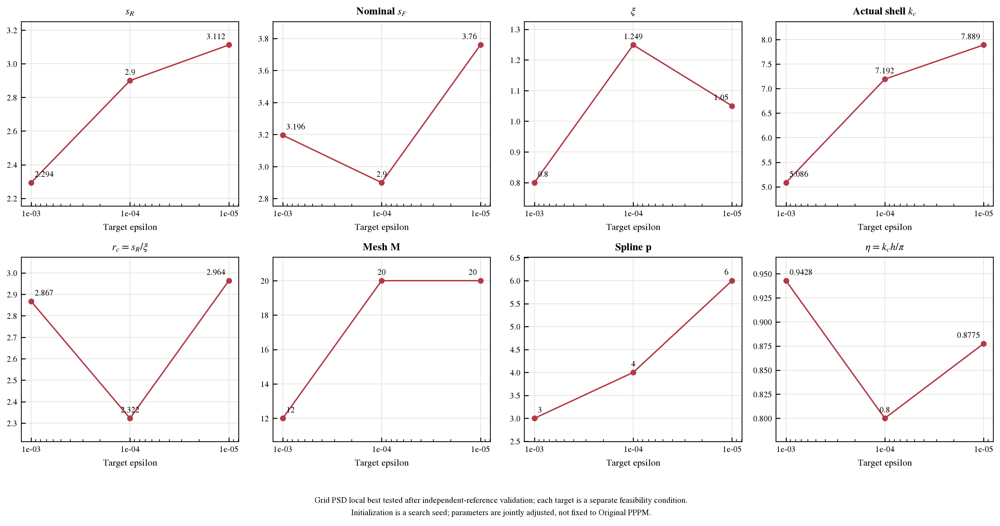
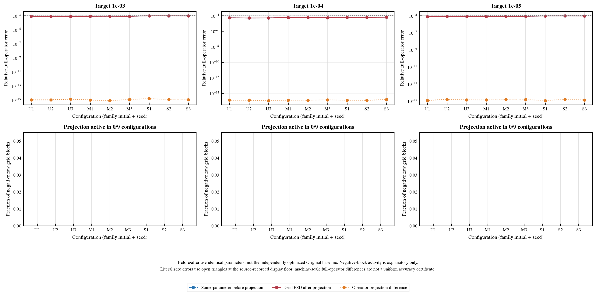
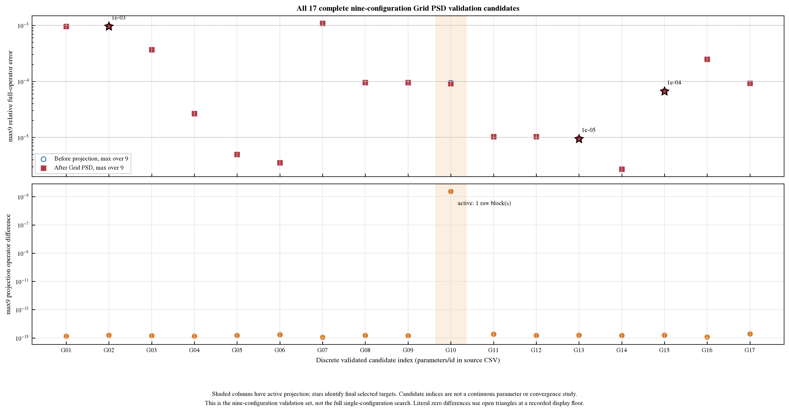
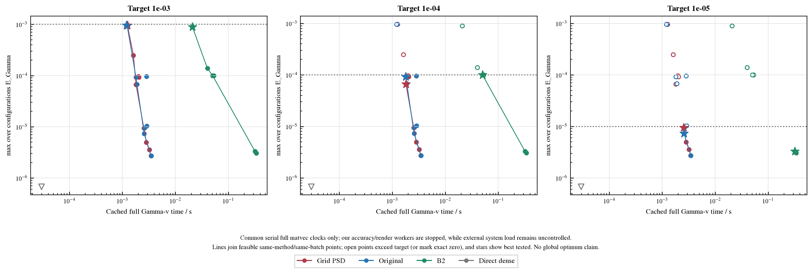
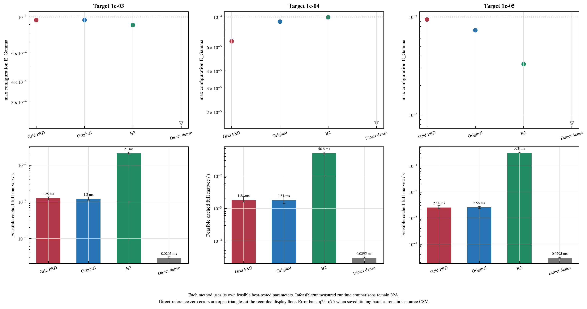
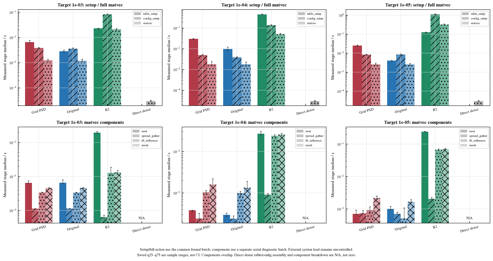
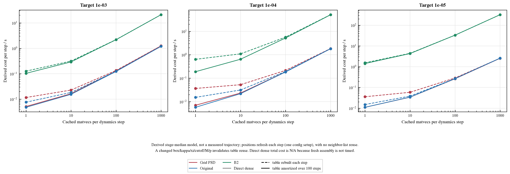
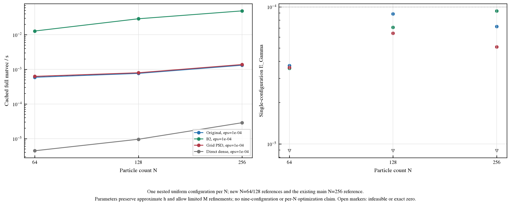

# Experiment 2：最终四步 Grid PSD 联合选参


生成时间：2026-10-27T13:30:39-04:00。本轮独立目录只重跑最终选参验证，保留 PR #3–#6 的既有结果。主基准固定 N=256、rho=0.75、kappa=0.2、amplitude=1；九配置为 uniform/moderate/strong × 三 seed。需求原文见 [requirements_github.md](requirements_github.md)，复现和产物索引见 [README.md](README.md)。下文的最优一律指 **本轮搜索范围内、已测试候选中的最佳**，不声称全局最优。

| 目标 epsilon | Grid PSD状态 | max E_Gamma | cached matvec/秒 | 已保存逐配置误差数 | 候选/限制 |
| --- | --- | --- | --- | --- | --- |
| 1e-03 | 实测可行 | 0.000957859 | 0.00124721 | 9 | PPPM-grid-PSD_xi0.8_sR2.29367_sF3.19571_M12_p3 |
| 1e-04 | 实测可行 | 6.64309e-05 | 0.00181271 | 9 | PPPM-grid-PSD_xi1.24875_sR2.9_sF2.9_M20_p4 |
| 1e-05 | 实测可行 | 9.43297e-06 | 0.00254404 | 9 | PPPM-grid-PSD_xi1.05_sR3.1119_sF3.75967_M20_p6 |
| 1e-06 | N/A | N/A | N/A | 0 | no target-wise measured result |

**主结论：本轮三个精度档的 Grid/Original paired timing 区间均跨 1，Grid PSD 与 Original 的 cached full-action 速度相近，不能宣称 Grid PSD 更快。** 全部三个 winner 的投影 inactive；不能据此推出 active 投影保持高阶精度。它在本轮已测参数与九配置上保留了 Original 的同量级 cached 速度；这个结论限于当前有限搜索、计时设置和外部负载条件，不等于所有参数/构型或全局最优的速度结论。

Grid 相对同精度 B2 的 cached-action 加速（取 paired Grid/B2 ratio 的倒数）：epsilon=0.001，17.0748×；epsilon=0.0001，27.9693×；epsilon=1e-05，126.196×。这是 cached-action 比较，不能替代包含 setup 的每步总成本。

N=256 的已缓存 direct dense G@v 本轮为 2.9542e-05 秒，在该静态 cached-action 比较中更便宜；fresh 周期 dense assembly setup 未测，故其动态步总成本 N/A，不能据此比较完整动力学总成本。

以选择目标统计量直接相除（**ratio of nine-configuration medians**）得到：epsilon=1e-03：同批次 Grid/Original cached-time 中位数比 1.04238；epsilon=1e-04：同批次 Grid/Original cached-time 中位数比 1.00388；epsilon=1e-05：同批次 Grid/Original cached-time 中位数比 0.985235；epsilon=1e-06：速度比较 N/A（one method not measured/feasible）。该比值的分母/分子均需各自通过相同目标误差且来自同一 timing batch；中位数比不自行构成显著性或全局优势证明。

## 1. 四步规则与实际搜索范围


1. 给定 epsilon，以既有 Ewald tail 模型指导 `s_R≈s_F≈sqrt(log(C/epsilon))` 初始化；prefactor C 及模型常数以本轮 protocol/initialization 原始记录为准。初始化只是种子，邻域联合搜索可调整两个 cutoff。
2. 每个 xi/kc 起点先得 nominal `k_c=2*xi*s_F`，沿用已有 `snap_kc` 映射到完整 reciprocal shell；用实际 shell kc、`h=L/M`、`eta=kc_actual*h/pi<=eta_max<1` 与 influence denominator 稳定性选最小合理合法 M，同时考虑 FFT-friendly sizes。
3. 根据 alias/mesh 误差规律从合法 `1<=p<=M` 选最小合理 p，允许 M,p 相互微调；p 增大并不保证误差单调减小。
4. 邻域联合搜索 `(xi,s_R,s_F,M,p)`，每个候选构造自己的 Grid PSD table；以完整算子的 `max_9 E_Gamma<=epsilon` 为经验可行条件，在可重复的 cached full Gamma-v 时间中选择。Original 最佳参数可作为 baseline/种子，但不是 Grid PSD 最优参数的固定约束。

不把 `B_off`、`N*delta`、degree bounds 或 full-matrix PSD eigenvalue 检查加入误差选参硬约束；本轮不重复 B_off 分析，也不开发新 PSD 离散。PSD 来自既有非负 assignment 与逐网格块 PSD 构造的结构；独立结构性代码检查仍保留。经验预算是否松紧不决定本轮 empirical-pass 候选的去留。

**最低合理 p 不等于最低合法 p。** 数学合法域仍为 `1<=p<=M`；本轮初始化模型与有限局部预算从 p>=2 开始、初始化 cap=9，p=1 未测，不能据此说 p=1 数学非法或实测不合格。现有含 zeta(p) 的 majorant 仅在 p>1 有限，p=2 是首个连续 cardinal B-spline；alias_C 经验校准来自 p=3..5 的完整旧误差，亦不是 p=2/p=1 的保证。本轮候选文件记录的实际 p 集合为 `2, 3, 4, 5, 6, 7, 8, 9`；所谓最小合理值只在这组初始化预测与有限已测域内成立，不是对全合法域的最小 p 或全局最优证明。

已保存 protocol：
```json
{
  "epsilons": [
    0.001,
    0.0001,
    1e-05
  ],
  "xi_seeds": [
    0.55,
    0.8,
    1.05,
    1.3,
    1.6,
    1.9
  ],
  "eta_max": 0.95,
  "max_M": 128,
  "max_local": 24,
  "max_boundary": 12,
  "workers": 2,
  "search_source_sha256": "8faaf98be1aae5ef7a02ff3a320c4c7112d1da8d9c14ed1cf31683bfec870725",
  "optional_epsilon_1e6": "not run in this preregistered mandatory-three-tier budget",
  "note": "Local discrete tested optima only; no claim of global optimality. Historical errors seed but do not pass candidates."
}
```

理论源代码与 target physics 的 prefactor 审计见 `theory_source_audit.json`。具体 tail 初始化使用 `C*s*exp(-s²)` 的大 s 分支（Lambert 解），`sqrt(log(C/epsilon))` 只是其近似；`H=exp(-z²)-sqrt(pi)*z*erfc(z), z=kappa/(2*xi)` 是辅助函数而非网格间距。这里使用 kappa=.2、amplitude=1 的 prefactor，不沿用旧 optimizer 的 kappa=.7/nonunit-amplitude 默认值。alias predictor `q(eta)^p` / original mesh 的局部 h^p 规律只指导初始 p，不是 active Grid PSD 的高阶或完整误差证书。

| xi | target kappa | C_S相对预测系数 | C_F相对预测系数 |
| --- | --- | --- | --- |
| 0.35 | 0.2 | 0.105768 | 0.27798 |
| 0.6 | 0.2 | 0.0459025 | 0.607777 |
| 0.85 | 0.2 | 0.0251534 | 0.946907 |
| 1 | 0.2 | 0.0187929 | 1.15199 |
| 1.025 | 0.2 | 0.0179699 | 1.18623 |
| 1.25 | 0.2 | 0.0124876 | 1.49507 |
| 1.5 | 0.2 | 0.0088894 | 1.83908 |
| 1.75 | 0.2 | 0.0066467 | 2.18361 |

| method | epsilon | stage | xi | sR | sF | M | p | eta |
| --- | --- | --- | --- | --- | --- | --- | --- | --- |
| PPPM-grid-PSD | 0.001 | seeds | 0.55 | 2.44169 | 2.90844 | 8 | 2 | 0.866025 |
| PPPM-grid-PSD | 0.001 | seeds | 0.55 | 2.44169 | 2.90844 | 8 | 3 | 0.866025 |
| PPPM-grid-PSD | 0.001 | seeds | 0.55 | 2.44169 | 2.90844 | 8 | 5 | 0.866025 |
| PPPM-grid-PSD | 0.001 | seeds | 0.55 | 2.44169 | 2.90844 | 8 | 7 | 0.866025 |
| PPPM-grid-PSD | 0.001 | seeds | 0.8 | 2.29367 | 2.99571 | 12 | 2 | 0.866025 |
| PPPM-grid-PSD | 0.001 | seeds | 0.8 | 2.29367 | 2.99571 | 12 | 3 | 0.866025 |
| PPPM-grid-PSD | 0.001 | seeds | 0.8 | 2.29367 | 2.99571 | 12 | 5 | 0.866025 |
| PPPM-grid-PSD | 0.001 | seeds | 0.8 | 2.29367 | 2.99571 | 12 | 7 | 0.866025 |
| PPPM-grid-PSD | 0.001 | seeds | 1.05 | 2.1724 | 3.05316 | 15 | 2 | 0.942809 |
| PPPM-grid-PSD | 0.001 | seeds | 1.05 | 2.1724 | 3.05316 | 15 | 3 | 0.942809 |
| PPPM-grid-PSD | 0.001 | seeds | 1.05 | 2.1724 | 3.05316 | 15 | 5 | 0.942809 |
| PPPM-grid-PSD | 0.001 | seeds | 1.05 | 2.1724 | 3.05316 | 15 | 7 | 0.942809 |
| PPPM-grid-PSD | 0.001 | seeds | 1.3 | 2.06816 | 3.09573 | 20 | 2 | 0.894427 |
| PPPM-grid-PSD | 0.001 | seeds | 1.3 | 2.06816 | 3.09573 | 20 | 3 | 0.894427 |
| PPPM-grid-PSD | 0.001 | seeds | 1.3 | 2.06816 | 3.09573 | 20 | 5 | 0.894427 |
| PPPM-grid-PSD | 0.001 | seeds | 1.3 | 2.06816 | 3.09573 | 20 | 7 | 0.894427 |
| PPPM-grid-PSD | 0.001 | seeds | 1.6 | 1.95807 | 3.13538 | 24 | 2 | 0.924211 |
| PPPM-grid-PSD | 0.001 | seeds | 1.6 | 1.95807 | 3.13538 | 24 | 3 | 0.924211 |
| PPPM-grid-PSD | 0.001 | seeds | 1.6 | 1.95807 | 3.13538 | 24 | 5 | 0.924211 |
| PPPM-grid-PSD | 0.001 | seeds | 1.6 | 1.95807 | 3.13538 | 24 | 7 | 0.924211 |
| PPPM-grid-PSD | 0.001 | seeds | 1.9 | 1.85922 | 3.16713 | 30 | 2 | 0.891939 |
| PPPM-grid-PSD | 0.001 | seeds | 1.9 | 1.85922 | 3.16713 | 30 | 3 | 0.891939 |
| PPPM-grid-PSD | 0.001 | seeds | 1.9 | 1.85922 | 3.16713 | 30 | 5 | 0.891939 |
| PPPM-grid-PSD | 0.001 | seeds | 1.9 | 1.85922 | 3.16713 | 30 | 7 | 0.891939 |
| PPPM-grid-PSD | 0.0001 | seeds | 0.55 | 2.90485 | 3.29967 | 10 | 6 | 0.8 |
| PPPM-grid-PSD | 0.0001 | seeds | 0.55 | 2.90485 | 3.29967 | 9 | 3 | 0.888889 |
| PPPM-grid-PSD | 0.0001 | seeds | 0.55 | 2.90485 | 3.29967 | 9 | 5 | 0.888889 |
| PPPM-grid-PSD | 0.0001 | seeds | 0.55 | 2.90485 | 3.29967 | 9 | 7 | 0.888889 |
| PPPM-grid-PSD | 0.0001 | seeds | 0.8 | 2.78527 | 3.37585 | 15 | 6 | 0.8 |
| PPPM-grid-PSD | 0.0001 | seeds | 0.8 | 2.78527 | 3.37585 | 15 | 3 | 0.8 |
| PPPM-grid-PSD | 0.0001 | seeds | 0.8 | 2.78527 | 3.37585 | 15 | 5 | 0.8 |
| PPPM-grid-PSD | 0.0001 | seeds | 0.8 | 2.78527 | 3.37585 | 15 | 7 | 0.8 |
| PPPM-grid-PSD | 0.0001 | seeds | 1.05 | 2.6899 | 3.42632 | 20 | 6 | 0.8 |
| PPPM-grid-PSD | 0.0001 | seeds | 1.05 | 2.6899 | 3.42632 | 18 | 3 | 0.888889 |
| PPPM-grid-PSD | 0.0001 | seeds | 1.05 | 2.6899 | 3.42632 | 18 | 5 | 0.888889 |
| PPPM-grid-PSD | 0.0001 | seeds | 1.05 | 2.6899 | 3.42632 | 18 | 7 | 0.888889 |
| PPPM-grid-PSD | 0.0001 | seeds | 1.3 | 2.6101 | 3.46388 | 24 | 7 | 0.833333 |
| PPPM-grid-PSD | 0.0001 | seeds | 1.3 | 2.6101 | 3.46388 | 24 | 3 | 0.833333 |
| PPPM-grid-PSD | 0.0001 | seeds | 1.3 | 2.6101 | 3.46388 | 24 | 5 | 0.833333 |
| PPPM-grid-PSD | 0.0001 | seeds | 1.3 | 2.6101 | 3.46388 | 24 | 7 | 0.833333 |
| PPPM-grid-PSD | 0.0001 | seeds | 1.6 | 2.52828 | 3.49899 | 30 | 7 | 0.829993 |
| PPPM-grid-PSD | 0.0001 | seeds | 1.6 | 2.52828 | 3.49899 | 27 | 3 | 0.922215 |
| PPPM-grid-PSD | 0.0001 | seeds | 1.6 | 2.52828 | 3.49899 | 27 | 5 | 0.922215 |
| PPPM-grid-PSD | 0.0001 | seeds | 1.6 | 2.52828 | 3.49899 | 27 | 7 | 0.922215 |
| PPPM-grid-PSD | 0.0001 | seeds | 1.9 | 2.45727 | 3.52717 | 36 | 7 | 0.827759 |
| PPPM-grid-PSD | 0.0001 | seeds | 1.9 | 2.45727 | 3.52717 | 32 | 3 | 0.931229 |
| PPPM-grid-PSD | 0.0001 | seeds | 1.9 | 2.45727 | 3.52717 | 32 | 5 | 0.931229 |
| PPPM-grid-PSD | 0.0001 | seeds | 1.9 | 2.45727 | 3.52717 | 32 | 7 | 0.931229 |
| PPPM-grid-PSD | 1e-05 | seeds | 0.55 | 3.29655 | 3.64556 | 12 | 8 | 0.726483 |
| PPPM-grid-PSD | 1e-05 | seeds | 0.55 | 3.29655 | 3.64556 | 10 | 3 | 0.87178 |
| PPPM-grid-PSD | 1e-05 | seeds | 0.55 | 3.29655 | 3.64556 | 10 | 5 | 0.87178 |
| PPPM-grid-PSD | 1e-05 | seeds | 0.55 | 3.29655 | 3.64556 | 10 | 7 | 0.87178 |
| PPPM-grid-PSD | 1e-05 | seeds | 0.8 | 3.19327 | 3.71408 | 18 | 8 | 0.728604 |
| PPPM-grid-PSD | 1e-05 | seeds | 0.8 | 3.19327 | 3.71408 | 15 | 3 | 0.874325 |
| PPPM-grid-PSD | 1e-05 | seeds | 0.8 | 3.19327 | 3.71408 | 15 | 5 | 0.874325 |
| PPPM-grid-PSD | 1e-05 | seeds | 0.8 | 3.19327 | 3.71408 | 15 | 7 | 0.874325 |
| PPPM-grid-PSD | 1e-05 | seeds | 1.05 | 3.1119 | 3.75967 | 24 | 8 | 0.731247 |
| PPPM-grid-PSD | 1e-05 | seeds | 1.05 | 3.1119 | 3.75967 | 20 | 3 | 0.877496 |
| PPPM-grid-PSD | 1e-05 | seeds | 1.05 | 3.1119 | 3.75967 | 20 | 5 | 0.877496 |
| PPPM-grid-PSD | 1e-05 | seeds | 1.05 | 3.1119 | 3.75967 | 20 | 7 | 0.877496 |
| PPPM-grid-PSD | 1e-05 | seeds | 1.3 | 3.04453 | 3.79368 | 30 | 8 | 0.730297 |
| PPPM-grid-PSD | 1e-05 | seeds | 1.3 | 3.04453 | 3.79368 | 24 | 3 | 0.912871 |
| PPPM-grid-PSD | 1e-05 | seeds | 1.3 | 3.04453 | 3.79368 | 24 | 5 | 0.912871 |
| PPPM-grid-PSD | 1e-05 | seeds | 1.3 | 3.04453 | 3.79368 | 24 | 7 | 0.912871 |
| PPPM-grid-PSD | 1e-05 | seeds | 1.6 | 2.97623 | 3.82554 | 36 | 9 | 0.755637 |
| PPPM-grid-PSD | 1e-05 | seeds | 1.6 | 2.97623 | 3.82554 | 30 | 3 | 0.906765 |
| PPPM-grid-PSD | 1e-05 | seeds | 1.6 | 2.97623 | 3.82554 | 30 | 5 | 0.906765 |
| PPPM-grid-PSD | 1e-05 | seeds | 1.6 | 2.97623 | 3.82554 | 30 | 7 | 0.906765 |
| PPPM-grid-PSD | 1e-05 | seeds | 1.9 | 2.91761 | 3.85116 | 45 | 8 | 0.722137 |
| PPPM-grid-PSD | 1e-05 | seeds | 1.9 | 2.91761 | 3.85116 | 36 | 3 | 0.902671 |
| PPPM-grid-PSD | 1e-05 | seeds | 1.9 | 2.91761 | 3.85116 | 36 | 5 | 0.902671 |
| PPPM-grid-PSD | 1e-05 | seeds | 1.9 | 2.91761 | 3.85116 | 36 | 7 | 0.902671 |

本轮 alias 初始化校准（只用于种子，含旧完整误差的 cutoff 成分，不是 alias-only bound）：
```json
{
  "alias_C": 0.0002718877803316353,
  "n_unique_calibration_points": 56,
  "target_kappa": 0.2,
  "target_rho": 0.75,
  "source": "same-physics prior Original complete errors and q(eta)^p; initialization only",
  "model": "C_alias*(eta/(2-eta))^p",
  "fallback_C": 0.001,
  "certified": false,
  "limitation": "contains cutoff errors; neither alias-only estimate nor certified projected error"
}
```

| 候选分组 method/epsilon/stage | 记录 | 独立候选 | 状态计数 |
| --- | --- | --- | --- |
| PPPM-grid-PSD / 0.001 / seeds | 24 | 24 | {"ok": 24} |
| PPPM-original / 0.001 / seeds | 3 | 3 | {"ok": 3} |
| B2-positive / 0.001 / seeds | 5 | 5 | {"ok": 5} |
| PPPM-grid-PSD / 0.0001 / seeds | 23 | 23 | {"ok": 23} |
| PPPM-original / 0.0001 / seeds | 3 | 3 | {"ok": 3} |
| B2-positive / 0.0001 / seeds | 5 | 5 | {"ok": 5} |
| PPPM-grid-PSD / 1e-05 / seeds | 24 | 24 | {"ok": 24} |
| PPPM-original / 1e-05 / seeds | 3 | 3 | {"ok": 3} |
| B2-positive / 1e-05 / seeds | 3 | 3 | {"ok": 3} |
| PPPM-original / 0.001 / local | 8 | 8 | {"invalid_mesh": 4, "ok": 4} |
| B2-positive / 0.001 / local | 8 | 8 | {"ok": 8} |
| PPPM-grid-PSD / 0.001 / local | 24 | 24 | {"ok": 19, "invalid_mesh": 5} |
| PPPM-original / 0.0001 / local | 8 | 8 | {"invalid_mesh": 4, "ok": 4} |
| B2-positive / 0.0001 / local | 8 | 8 | {"ok": 8} |
| PPPM-grid-PSD / 0.0001 / local | 24 | 24 | {"invalid_mesh": 4, "ok": 20} |
| PPPM-original / 1e-05 / local | 8 | 8 | {"ok": 7, "invalid_mesh": 1} |
| B2-positive / 1e-05 / local | 8 | 8 | {"ok": 8} |
| PPPM-grid-PSD / 1e-05 / local | 24 | 24 | {"invalid_mesh": 6, "ok": 18} |
| PPPM-original / 0.001 / boundary | 4 | 4 | {"invalid_mesh": 2, "ok": 2} |
| B2-positive / 0.001 / boundary | 4 | 4 | {"ok": 4} |
| PPPM-grid-PSD / 0.001 / boundary | 12 | 12 | {"invalid_mesh": 5, "ok": 7} |
| PPPM-original / 0.0001 / boundary | 4 | 4 | {"invalid_mesh": 2, "ok": 2} |
| B2-positive / 0.0001 / boundary | 4 | 4 | {"ok": 4} |
| PPPM-grid-PSD / 0.0001 / boundary | 12 | 12 | {"invalid_mesh": 4, "ok": 8} |
| PPPM-original / 1e-05 / boundary | 4 | 4 | {"ok": 3, "invalid_mesh": 1} |
| B2-positive / 1e-05 / boundary | 4 | 4 | {"ok": 4} |
| PPPM-grid-PSD / 1e-05 / boundary | 12 | 12 | {"ok": 10, "invalid_mesh": 2} |

完整搜索轨迹、被测但未通过的点、超预算/未测状态以原始 CSV 为准。筛选时钟只用于搜索启发，不能替代正式隔离 timing 的 full matvec 时钟。局部范围与可承受预算限制了结论；未找到可行候选不能推出该方法在该 epsilon 不存在可行参数。

记录中 `bound_used_as_constraint` 或 `PSD_eigenvalue_used_as_constraint` 为真的候选数：0。候选按 epsilon/stage 的归属来自 memberships，同一参数 id 可服务多个精度目标，不把重复归属当成独立新测。实际独立候选数和预算以 `search_budget.json` 为准。

## 2. 按目标的最佳已测参数与九配置误差


| epsilon | 方法 | 状态 | sR | nominal sF | effective sF | B2 sT | xi | actual kc | rc | M | p | eta | timing batch |
| --- | --- | --- | --- | --- | --- | --- | --- | --- | --- | --- | --- | --- | --- |
| 1e-03 | Grid PSD | 可行 | 2.29367 | 3.19571 | 3.17864 | N/A | 0.8 | 5.08583 | 2.86709 | 12 | 3 | 0.942809 | final_four_step_common_serial |
| 1e-03 | Original | 可行 | 2.29367 | 2.99571 | 2.91977 | N/A | 0.8 | 4.67163 | 2.86709 | 12 | 3 | 0.866025 | final_four_step_common_serial |
| 1e-03 | B2 | 可行 | 2.59071 | N/A | N/A | 36 | 0.32375 | N/A | 8.0022 | 24 | 2 | N/A | final_four_step_common_serial |
| 1e-03 | Direct dense | 可行 | N/A | N/A | N/A | N/A | N/A | N/A | N/A | N/A | N/A | N/A | final_four_step_common_serial |
| 1e-04 | Grid PSD | 可行 | 2.9 | 2.9 | 2.87986 | N/A | 1.24875 | 7.19245 | 2.32232 | 20 | 4 | 0.8 | final_four_step_common_serial |
| 1e-04 | Original | 可行 | 2.9 | 2.9 | 2.88372 | N/A | 1.35 | 7.78606 | 2.14815 | 20 | 4 | 0.866025 | final_four_step_common_serial |
| 1e-04 | B2 | 可行 | 3.1 | N/A | N/A | 36 | 0.35 | N/A | 8.85714 | 72 | 2 | N/A | final_four_step_common_serial |
| 1e-04 | Direct dense | 可行 | N/A | N/A | N/A | N/A | N/A | N/A | N/A | N/A | N/A | N/A | final_four_step_common_serial |
| 1e-05 | Grid PSD | 可行 | 3.1119 | 3.75967 | 3.75676 | N/A | 1.05 | 7.88919 | 2.96371 | 20 | 6 | 0.877496 | final_four_step_common_serial |
| 1e-05 | Original | 可行 | 3.3 | 3.3 | 3.27261 | N/A | 1 | 6.54523 | 3.3 | 16 | 6 | 0.910014 | final_four_step_common_serial |
| 1e-05 | B2 | 可行 | 3.7 | N/A | N/A | 36 | 0.2 | N/A | 18.5 | 100 | 2 | N/A | final_four_step_common_serial |
| 1e-05 | Direct dense | 可行 | N/A | N/A | N/A | N/A | N/A | N/A | N/A | N/A | N/A | N/A | final_four_step_common_serial |
| 1e-06 | Grid PSD | N/A | N/A | N/A | N/A | N/A | N/A | N/A | N/A | N/A | N/A | N/A | 未注明 |
| 1e-06 | Original | N/A | N/A | N/A | N/A | N/A | N/A | N/A | N/A | N/A | N/A | N/A | 未注明 |
| 1e-06 | B2 | N/A | N/A | N/A | N/A | N/A | N/A | N/A | N/A | N/A | N/A | N/A | 未注明 |
| 1e-06 | Direct dense | N/A | N/A | N/A | N/A | N/A | N/A | N/A | N/A | N/A | N/A | N/A | 未注明 |

B2 的 positive-mesh 卷积截断 sT 与 Original/Grid PSD 的 Fourier shell cutoff sF 含义不同；不把占位 sF 推导为 B2 的 kc/eta。direct dense 不使用网格参数。表中的 actual kc 取实际完整 reciprocal shell，effective sF=kc_actual/(2*xi)；输入 nominal sF 可能因既有 shell snapping 与它略有差别，eta始终用实际kc。

| Grid目标 | M | p | actual eta | 本轮eta_max | 实际min W² | denominator阈值 | excluded modes | retained modes |
| --- | --- | --- | --- | --- | --- | --- | --- | --- |
| 1e-03 | 12 | 3 | 0.942809 | 0.95 | 0.102335 | 1e-10 | 0 | 751 |
| 1e-04 | 20 | 4 | 0.8 | 0.95 | 0.10764 | 1e-10 | 0 | 2109 |
| 1e-05 | 20 | 6 | 0.877496 | 0.95 | 0.0185189 | 1e-10 | 0 | 2897 |

本轮 protocol 选 eta_max=.95 作为小于1的操作安全余量；它与既有严格Nyquist/完整shell和influence denominator合法性检查一起使用，不是新的完整误差上界，也不声称.95是所有精度/硬件下的最优margin。



图 1：Grid PSD 随目标 epsilon 的最佳已测参数，实际 eta 与两个物理 cutoff 一并显示。

| epsilon | 配置 | Grid E_Gamma | 同参数投影前误差 | E_proj | 投影活跃诊断 |
| --- | --- | --- | --- | --- | --- |
| 1e-03 | uniform_N256_s2_rho0.75 | 0.000791294 | 0.000791294 | 1.00807e-15 | False |
| 1e-03 | strong_N256_s3_rho0.75 | 0.000927692 | 0.000927692 | 1.11352e-15 | False |
| 1e-03 | uniform_N256_s1_rho0.75 | 0.000820829 | 0.000820829 | 1.00568e-15 | False |
| 1e-03 | uniform_N256_s3_rho0.75 | 0.000811002 | 0.000811002 | 1.34373e-15 | False |
| 1e-03 | moderate_N256_s1_rho0.75 | 0.000844437 | 0.000844437 | 9.81159e-16 | False |
| 1e-03 | moderate_N256_s2_rho0.75 | 0.000856849 | 0.000856849 | 8.16435e-16 | False |
| 1e-03 | moderate_N256_s3_rho0.75 | 0.000836372 | 0.000836372 | 1.13765e-15 | False |
| 1e-03 | strong_N256_s1_rho0.75 | 0.000957859 | 0.000957859 | 1.5887e-15 | False |
| 1e-03 | strong_N256_s2_rho0.75 | 0.000956598 | 0.000956598 | 1.11798e-15 | False |
| 1e-04 | uniform_N256_s2_rho0.75 | 5.10785e-05 | 5.10785e-05 | 1.34597e-15 | False |
| 1e-04 | strong_N256_s3_rho0.75 | 6.64309e-05 | 6.64309e-05 | 1.59135e-15 | False |
| 1e-04 | uniform_N256_s1_rho0.75 | 5.35167e-05 | 5.35167e-05 | 1.34278e-15 | False |
| 1e-04 | uniform_N256_s3_rho0.75 | 5.18939e-05 | 5.18939e-05 | 1.18073e-15 | False |
| 1e-04 | moderate_N256_s1_rho0.75 | 5.89011e-05 | 5.89011e-05 | 1.31062e-15 | False |
| 1e-04 | moderate_N256_s2_rho0.75 | 5.89034e-05 | 5.89034e-05 | 1.30802e-15 | False |
| 1e-04 | moderate_N256_s3_rho0.75 | 5.52424e-05 | 5.52424e-05 | 1.46391e-15 | False |
| 1e-04 | strong_N256_s1_rho0.75 | 6.09423e-05 | 6.09423e-05 | 1.28095e-15 | False |
| 1e-04 | strong_N256_s2_rho0.75 | 5.9999e-05 | 5.9999e-05 | 1.27536e-15 | False |
| 1e-05 | uniform_N256_s2_rho0.75 | 8.30266e-06 | 8.30266e-06 | 1.5126e-15 | False |
| 1e-05 | strong_N256_s3_rho0.75 | 9.20097e-06 | 9.20097e-06 | 1.27354e-15 | False |
| 1e-05 | uniform_N256_s1_rho0.75 | 7.92637e-06 | 7.92637e-06 | 1.17649e-15 | False |
| 1e-05 | uniform_N256_s3_rho0.75 | 8.26986e-06 | 8.26986e-06 | 1.34997e-15 | False |
| 1e-05 | moderate_N256_s1_rho0.75 | 8.31737e-06 | 8.31737e-06 | 1.31682e-15 | False |
| 1e-05 | moderate_N256_s2_rho0.75 | 8.19208e-06 | 8.19208e-06 | 1.48095e-15 | False |
| 1e-05 | moderate_N256_s3_rho0.75 | 8.69282e-06 | 8.69282e-06 | 1.46354e-15 | False |
| 1e-05 | strong_N256_s1_rho0.75 | 9.27766e-06 | 9.27766e-06 | 1.11614e-15 | False |
| 1e-05 | strong_N256_s2_rho0.75 | 9.43297e-06 | 9.43297e-06 | 1.59284e-15 | False |

本轮三档已选 Grid table 的 negative_blocks 均为0，所选点的 PSD 投影 inactive，投影前后完整算子差仅保留实际 CSV 中的浮点数值。它解释了这些局部点与 Original 的精度/速度接近，不能据此推广为 active 投影始终保留高阶精度，亦不能将速度接近归因于投影带来加速。

| Grid目标 | 获选stage | 获选origin | theory seed/parent（有则列） |
| --- | --- | --- | --- |
| 1e-03 | local | joint_measured_neighborhood | eps0.001_xi0.8 |
| 1e-04 | cross-method-control | freshly validated PPPM-original top-two proxy candidate; independent acceptance for destination | N/A |
| 1e-05 | local | joint_measured_neighborhood | eps1e-05_xi1.05 |

同参数的投影前后误差用于解释投影影响，不能把其中的 Original 点等同于独立调参后的 Original baseline。`E_Gamma=||Gamma_h(q)-Gamma_D(q)||_2/||Gamma_D(q)||_2` 使用完整周期算子，保留真实 k=0 与完整 self cancellation；near/mesh-only 指标不能替代它。PSD/负块/修正量只作解释性诊断，不构成额外 hard filter。negative grid blocks 是参数表级诊断：固定箱长/参数的九构型共享同一 table，不能把重复列出的活跃性当成九次独立参数表实验；E_proj 则反映各自位置下的完整算子差。



补图 7：最佳已测 Grid 参数的逐配置投影前后误差与 raw grid block 活跃性，仅作解释性诊断。

为避免只展示 inactive winner，另汇总全部 **17 个完整九配置验证 Grid 候选**，其中 1 个参数表投影 active；这不是全部单配置 screening 候选集合。按各候选逐配置完整误差求 max9 before/after/Eproj，保留离散候选索引与参数/id，不把这些点解释为收敛扫描。

| active验证候选 | xi | sR | sF | M | p | 负网格块数 | max9 E_before | max9 E_after | max9 Eproj |
| --- | --- | --- | --- | --- | --- | --- | --- | --- | --- |
| PPPM-grid-PSD_xi1.05_sR2.6899_sF3.42632_M18_p7 | 1.05 | 2.6899 | 3.42632 | 18 | 7 | 1 | 9.57937e-05 | 9.17369e-05 | 2.40779e-05 |

这些 active 点展示真实投影可能改变误差，但不能仅从本轮少量 active 候选推断任意参数高阶精度。既有 PR #4 的 active-projection 精度扫描仍完整保留，本轮不替代或覆盖它。



补图 7b：全部九配置验证 Grid 候选的 max9 投影前后误差与 Eproj，标出 active 参数表和三个最终winner。

## 3. 同精度成本比较与局部 Pareto


| 正式 timing context 字段 | 保存值 |
| --- | --- |
| batch | final_four_step_common_serial |
| rounds | 5 |
| reps | 7 |
| n_configs | 9 |
| threads | 1 |
| seed | 20261029 |
| warmup | 3 per candidate/config/round and one immediately before every sample |
| setup | 3 fresh tables per candidate, 3 fresh config builds per configuration; common kernel primitives warm |
| direct_dense | cached independent numerical Gamma_D; full assembly cost not measured, setup/amortization unavailable |

完整线程、随机顺序、warmup/repeat 与计时环境记录见 `results/timing_context.json`（或本轮等价 context 文件）；分析 JSON 保留全文。

线程设置的证据限于导入前 OMP/OPENBLAS/MKL/VECLIB/NUMEXPR/BLIS 六类环境变量请求1，协议与 raw/context 的 threads=1。Mac Accelerate 下 `threadpool_info()` 返回空列表，native pool 未能由 threadpoolctl 枚举，实际 native 线程数没有被独立验证。各方法在同一进程、相同设置下运行；本文的单线程应理解为按单线程配置/请求运行，而非工具已经实测确认所有 native pool 均为1。

| 运行环境来源 | 保存值 |
| --- | --- |
| platform | macOS-27.0.1-arm64-arm-64bit |
| Python/NumPy | 3.11.5 / 2.4.6 |
| 线程环境请求 | {"OMP_NUM_THREADS": "1", "OPENBLAS_NUM_THREADS": "1", "MKL_NUM_THREADS": "1", "VECLIB_MAXIMUM_THREADS": "1", "NUMEXPR_NUM_THREADS": "1", "BLIS_NUM_THREADS": "1"} |
| 可枚举native pools | [] |
| native线程数独立验证 | False |

`runtime_environment.json` 是计时后的同一导入环境 provenance，保留 NumPy 的 Accelerate BLAS/LAPACK 构建信息；未新增性能样本，也不回填未验证native线程数。

**计时环境限制：仅隔离本实验自身的 search/reference/render worker，不能称机器空闲或硬件完全隔离。** 本机存在 chrome_crashpad 等外部进程持续 CPU 负载；未操作或终止其它应用。正式候选采用同批随机交错、单线程与 paired timing/区间，这些措施降低顺序偏差，却不能消除外部系统负载、温度或调频的不确定性。`system_load.json` 保存每配置与起始时的 load average 和 top15 进程证据。

| 计时阶段 | 1/5/15分钟load average | 保存的top CPU进程（原始top15另见JSON） |
| --- | --- | --- |
| before_common_formal_batch | 7.04932, 7.13379, 6.6626 |  6223     1 248.5  0.0 /var/folders/2z/l_0spjx1341528jy3yg4h_dm0000gn/T/AppTranslocation/CACBD069-140A-4742-9AA4-D6ADAF216770/d/Visual Studio Code-2.app/Contents/Frameworks/Electron Framework.framework/Helpers/chrome_crashpad_handler |
| uniform_N256_s2_rho0.75 | 7.40039, 7.36475, 6.82422 |  6223     1 270.0  0.0 /var/folders/2z/l_0spjx1341528jy3yg4h_dm0000gn/T/AppTranslocation/CACBD069-140A-4742-9AA4-D6ADAF216770/d/Visual Studio Code-2.app/Contents/Frameworks/Electron Framework.framework/Helpers/chrome_crashpad_handler |
| strong_N256_s3_rho0.75 | 6.21631, 6.99512, 6.74609 |  6223     1 276.2  0.0 /var/folders/2z/l_0spjx1341528jy3yg4h_dm0000gn/T/AppTranslocation/CACBD069-140A-4742-9AA4-D6ADAF216770/d/Visual Studio Code-2.app/Contents/Frameworks/Electron Framework.framework/Helpers/chrome_crashpad_handler |
| uniform_N256_s1_rho0.75 | 6.57178, 6.7915, 6.68652 |  6223     1 272.6  0.0 /var/folders/2z/l_0spjx1341528jy3yg4h_dm0000gn/T/AppTranslocation/CACBD069-140A-4742-9AA4-D6ADAF216770/d/Visual Studio Code-2.app/Contents/Frameworks/Electron Framework.framework/Helpers/chrome_crashpad_handler |
| uniform_N256_s3_rho0.75 | 6.04102, 6.58398, 6.6167 |  6223     1 275.2  0.0 /var/folders/2z/l_0spjx1341528jy3yg4h_dm0000gn/T/AppTranslocation/CACBD069-140A-4742-9AA4-D6ADAF216770/d/Visual Studio Code-2.app/Contents/Frameworks/Electron Framework.framework/Helpers/chrome_crashpad_handler |
| moderate_N256_s1_rho0.75 | 5.26074, 6.18018, 6.45361 |  6223     1 269.4  0.0 /var/folders/2z/l_0spjx1341528jy3yg4h_dm0000gn/T/AppTranslocation/CACBD069-140A-4742-9AA4-D6ADAF216770/d/Visual Studio Code-2.app/Contents/Frameworks/Electron Framework.framework/Helpers/chrome_crashpad_handler |
| moderate_N256_s2_rho0.75 | 5.48291, 5.99707, 6.34961 |  6223     1 274.2  0.0 /var/folders/2z/l_0spjx1341528jy3yg4h_dm0000gn/T/AppTranslocation/CACBD069-140A-4742-9AA4-D6ADAF216770/d/Visual Studio Code-2.app/Contents/Frameworks/Electron Framework.framework/Helpers/chrome_crashpad_handler |
| moderate_N256_s3_rho0.75 | 5.16797, 5.73779, 6.20947 |  6223     1 265.9  0.0 /var/folders/2z/l_0spjx1341528jy3yg4h_dm0000gn/T/AppTranslocation/CACBD069-140A-4742-9AA4-D6ADAF216770/d/Visual Studio Code-2.app/Contents/Frameworks/Electron Framework.framework/Helpers/chrome_crashpad_handler |
| strong_N256_s1_rho0.75 | 5.24756, 5.57471, 6.08789 |  6223     1 275.7  0.0 /var/folders/2z/l_0spjx1341528jy3yg4h_dm0000gn/T/AppTranslocation/CACBD069-140A-4742-9AA4-D6ADAF216770/d/Visual Studio Code-2.app/Contents/Frameworks/Electron Framework.framework/Helpers/chrome_crashpad_handler |
| strong_N256_s2_rho0.75 | 6.16309, 5.81445, 6.12354 |  6223     1 278.3  0.0 /var/folders/2z/l_0spjx1341528jy3yg4h_dm0000gn/T/AppTranslocation/CACBD069-140A-4742-9AA4-D6ADAF216770/d/Visual Studio Code-2.app/Contents/Frameworks/Electron Framework.framework/Helpers/chrome_crashpad_handler |

| epsilon | 方法 | 状态 | max E_Gamma | 验证配置数 | cached matvec/秒 | q25–q75/秒 | 已验证可行数 | 正式已计时可行数 | batch/限制 |
| --- | --- | --- | --- | --- | --- | --- | --- | --- | --- |
| 1e-03 | Grid PSD | 可行 | 0.000957859 | 9 | 0.00124721 | [0.00112604,0.00136371] | 16 | 10 | final_four_step_common_serial |
| 1e-03 | Original | 可行 | 0.000957888 | 9 | 0.0011965 | [0.00111769,0.00136565] | 14 | 9 | final_four_step_common_serial |
| 1e-03 | B2 | 可行 | 0.000891785 | 9 | 0.0209821 | [0.0200381,0.0227655] | 10 | 6 | final_four_step_common_serial |
| 1e-03 | Direct dense | 可行 | 0 | 9 | 2.9542e-05 | [2.92085e-05,3.20205e-05] | 0 | 1 | final_four_step_common_serial |
| 1e-04 | Grid PSD | 可行 | 6.64309e-05 | 9 | 0.00181271 | [0.00157344,0.0023631] | 12 | 7 | final_four_step_common_serial |
| 1e-04 | Original | 可行 | 9.2384e-05 | 9 | 0.00180571 | [0.00144583,0.00227717] | 11 | 7 | final_four_step_common_serial |
| 1e-04 | B2 | 可行 | 9.96558e-05 | 9 | 0.0506188 | [0.0483008,0.0552003] | 8 | 4 | final_four_step_common_serial |
| 1e-04 | Direct dense | 可行 | 0 | 9 | 2.9542e-05 | [2.92085e-05,3.20205e-05] | 0 | 1 | final_four_step_common_serial |
| 1e-05 | Grid PSD | 可行 | 9.43297e-06 | 9 | 0.00254404 | [0.00241779,0.00299721] | 4 | 4 | final_four_step_common_serial |
| 1e-05 | Original | 可行 | 7.34048e-06 | 9 | 0.00258217 | [0.00232165,0.00285983] | 6 | 3 | final_four_step_common_serial |
| 1e-05 | B2 | 可行 | 3.30302e-06 | 9 | 0.320524 | [0.313695,0.340942] | 5 | 2 | final_four_step_common_serial |
| 1e-05 | Direct dense | 可行 | 0 | 9 | 2.9542e-05 | [2.92085e-05,3.20205e-05] | 0 | 1 | final_four_step_common_serial |
| 1e-06 | Grid PSD | N/A | N/A | N/A | N/A | N/A | N/A | N/A | no target-wise measured result |
| 1e-06 | Original | N/A | N/A | N/A | N/A | N/A | N/A | N/A | no target-wise measured result |
| 1e-06 | B2 | N/A | N/A | N/A | N/A | N/A | N/A | N/A | no target-wise measured result |
| 1e-06 | Direct dense | N/A | N/A | N/A | N/A | N/A | N/A | N/A | no target-wise measured result |

| epsilon | 同批次中位数成本比 | ratio（<1表示Grid更快） | batch/不可比较原因 |
| --- | --- | --- | --- |
| 1e-03 | Grid/PPPM-original | 1.04238 | final_four_step_common_serial |
| 1e-03 | Grid/B2-positive | 0.0594416 | final_four_step_common_serial |
| 1e-03 | Grid/direct-dense | 42.2181 | final_four_step_common_serial |
| 1e-04 | Grid/PPPM-original | 1.00388 | final_four_step_common_serial |
| 1e-04 | Grid/B2-positive | 0.0358109 | final_four_step_common_serial |
| 1e-04 | Grid/direct-dense | 61.3604 | final_four_step_common_serial |
| 1e-05 | Grid/PPPM-original | 0.985235 | final_four_step_common_serial |
| 1e-05 | Grid/B2-positive | 0.00793713 | final_four_step_common_serial |
| 1e-05 | Grid/direct-dense | 86.1161 | final_four_step_common_serial |
| 1e-06 | Grid/PPPM-original | N/A | one method not measured/feasible |
| 1e-06 | Grid/B2-positive | N/A | one method not measured/feasible |
| 1e-06 | Grid/direct-dense | N/A | one method not measured/feasible |

| epsilon | 方法/参照 | paired ratio | CI95 low | CI95 high | batch/配对单位 |
| --- | --- | --- | --- | --- | --- |
| 0.001 | PPPM-grid-PSD / PPPM-original | 0.988094 | 0.912759 | 1.02574 | final_four_step_common_serial |
| 0.001 | PPPM-grid-PSD / B2-positive | 0.0585659 | 0.055696 | 0.0623931 | final_four_step_common_serial |
| 0.001 | PPPM-grid-PSD / direct-dense | 40.0525 | 39.3093 | 42.4968 | final_four_step_common_serial |
| 0.0001 | PPPM-grid-PSD / PPPM-original | 1.05761 | 0.991865 | 1.15031 | final_four_step_common_serial |
| 0.0001 | PPPM-grid-PSD / B2-positive | 0.0357535 | 0.0319539 | 0.0400492 | final_four_step_common_serial |
| 0.0001 | PPPM-grid-PSD / direct-dense | 59.5952 | 56.2275 | 65.4116 | final_four_step_common_serial |
| 1e-05 | PPPM-grid-PSD / PPPM-original | 0.991445 | 0.941546 | 1.04817 | final_four_step_common_serial |
| 1e-05 | PPPM-grid-PSD / B2-positive | 0.00792419 | 0.00761322 | 0.00815073 | final_four_step_common_serial |
| 1e-05 | PPPM-grid-PSD / direct-dense | 87.0605 | 82.4555 | 90.3378 | final_four_step_common_serial |

原始 paired/bootstrap 比值与置信区间完整保留于本轮 speed-ratio CSV 和 analysis_summary.json；配对单位、批次和区间解释以文件字段及 timing protocol 为准，不能用独立中位数比冒充 paired interval。该 bootstrap 区间条件于已选候选及当前计时样本，不包含有限搜索/候选选择的不确定性，也不证明全局速度优势。

两种比值是不同估计量：正式排名先对各配置的35次样本取中位数，再对九个配置中位数取中位数；上表的 ratio-of-medians 是两个这样的目标统计量相除。paired ratio 则在每个配置×round 的7样本块内分别取中位数后相除，最后取45个块比值的中位数。中位数与除法不可交换，因此如约1.04与约.988可以同时正确；不能混用它们的点估计与区间。



图 2：正式已计时候选的精度–成本关系，仅连接同方法同批次且符合当前目标的 Pareto 点。



图 3：Grid PSD、Original、B2、direct dense 的同目标误差与 cached full matvec 比较，未达标/未测显示 N/A。

各方法使用自己的可行/已优化参数，不能以不同误差水平的旧时钟拼接速度比。不同 epsilon 若来自不同 timing batch，只在各自批次内比较；筛选期间竞争负载下的时间不作正式速度证据。即使同机同线程，接近的时钟也应结合重复样本分布与已保存区间判断，不强行宣称稳定提速。正式时钟池从新 serial prescreen 的每方法/epsilon top2 及可行 cross-controls 组成；未纳入正式池的已验证候选不能被称为已作同等重复计时，因此最佳结论限于该正式池。

cross-method control 另保存 99 条逐配置验证（方法记录数：{'PPPM-original': 54, 'PPPM-grid-PSD': 45}），将 Grid/Original 各自每 epsilon 的 top2 proxy 候选参数交叉构造并独立检验，再将全部可行 controls 纳入正式计时；计划保存在 `cross_plan.json`。这样减少仅因搜索路径不同造成的表观优势；交叉点仍只代表已测控制，不能证明全局最优。

## 4. Setup、matvec 分解与动力学步总成本


| epsilon | 方法 | 阶段 | median/秒 | q25–q75/秒 | 原始样本数 | phase batch |
| --- | --- | --- | --- | --- | --- | --- |
| 1e-03 | Grid PSD | table_setup | 0.00654092 | [0.00637258,0.00760579] | 3 | final_four_step_common_serial |
| 1e-03 | Grid PSD | config_setup | 0.00383867 | [0.0036921,0.00394758] | 27 | final_four_step_common_serial |
| 1e-03 | Grid PSD | matvec | 0.00124721 | [0.00112604,0.00136371] | 315 | final_four_step_common_serial |
| 1e-03 | Grid PSD | near | 0.000649209 | [0.00061625,0.0007465] | 81 | isolated_component_diagnostics |
| 1e-03 | Grid PSD | spread_gather | 0.000113917 | [0.0001135,0.000114583] | 81 | isolated_component_diagnostics |
| 1e-03 | Grid PSD | fft_influence | 0.000339 | [0.000336166,0.000345583] | 81 | isolated_component_diagnostics |
| 1e-03 | Grid PSD | mesh | 0.000464334 | [0.00046125,0.000469416] | 81 | isolated_component_diagnostics |
| 1e-03 | Original | table_setup | 0.0028575 | [0.00255144,0.00314813] | 3 | final_four_step_common_serial |
| 1e-03 | Original | config_setup | 0.00356592 | [0.00346442,0.0038439] | 27 | final_four_step_common_serial |
| 1e-03 | Original | matvec | 0.0011965 | [0.00111769,0.00136565] | 315 | final_four_step_common_serial |
| 1e-03 | Original | near | 0.00065825 | [0.000632333,0.000804417] | 81 | isolated_component_diagnostics |
| 1e-03 | Original | spread_gather | 0.000114167 | [0.000113375,0.000115667] | 81 | isolated_component_diagnostics |
| 1e-03 | Original | fft_influence | 0.0003355 | [0.000330958,0.000344083] | 81 | isolated_component_diagnostics |
| 1e-03 | Original | mesh | 0.000460083 | [0.000453334,0.000477125] | 81 | isolated_component_diagnostics |
| 1e-03 | B2 | table_setup | 0.022977 | [0.0216286,0.0233414] | 3 | final_four_step_common_serial |
| 1e-03 | B2 | config_setup | 0.0825845 | [0.0789431,0.0861317] | 27 | final_four_step_common_serial |
| 1e-03 | B2 | matvec | 0.0209821 | [0.0200381,0.0227655] | 315 | final_four_step_common_serial |
| 1e-03 | B2 | near | 0.0195621 | [0.0189045,0.0212708] | 81 | isolated_component_diagnostics |
| 1e-03 | B2 | spread_gather | 6.4042e-05 | [5.72921e-05,7.3125e-05] | 81 | isolated_component_diagnostics |
| 1e-03 | B2 | fft_influence | 0.00128021 | [0.00110075,0.0018605] | 81 | isolated_component_diagnostics |
| 1e-03 | B2 | mesh | 0.00131892 | [0.00115517,0.00152154] | 81 | isolated_component_diagnostics |
| 1e-03 | Direct dense | matvec | 2.9542e-05 | [2.92085e-05,3.20205e-05] | 315 | final_four_step_common_serial |
| 1e-04 | Grid PSD | table_setup | 0.0299855 | [0.0291709,0.030866] | 3 | final_four_step_common_serial |
| 1e-04 | Grid PSD | config_setup | 0.00494963 | [0.0045475,0.00548319] | 27 | final_four_step_common_serial |
| 1e-04 | Grid PSD | matvec | 0.00181271 | [0.00157344,0.0023631] | 315 | final_four_step_common_serial |
| 1e-04 | Grid PSD | near | 0.00038025 | [0.000354834,0.000383875] | 81 | isolated_component_diagnostics |
| 1e-04 | Grid PSD | spread_gather | 0.000238792 | [0.000237542,0.000318167] | 81 | isolated_component_diagnostics |
| 1e-04 | Grid PSD | fft_influence | 0.00105054 | [0.000927708,0.00115025] | 81 | isolated_component_diagnostics |
| 1e-04 | Grid PSD | mesh | 0.00159325 | [0.00127242,0.00219483] | 81 | isolated_component_diagnostics |
| 1e-04 | Original | table_setup | 0.00963342 | [0.00842377,0.012197] | 3 | final_four_step_common_serial |
| 1e-04 | Original | config_setup | 0.00386513 | [0.00327802,0.00415406] | 27 | final_four_step_common_serial |
| 1e-04 | Original | matvec | 0.00180571 | [0.00144583,0.00227717] | 315 | final_four_step_common_serial |
| 1e-04 | Original | near | 0.000294666 | [0.000270375,0.000323542] | 81 | isolated_component_diagnostics |
| 1e-04 | Original | spread_gather | 0.000238208 | [0.000237458,0.000277417] | 81 | isolated_component_diagnostics |
| 1e-04 | Original | fft_influence | 0.00100742 | [0.000816416,0.001084] | 81 | isolated_component_diagnostics |
| 1e-04 | Original | mesh | 0.00133996 | [0.00126108,0.00188317] | 81 | isolated_component_diagnostics |
| 1e-04 | B2 | table_setup | 0.4544 | [0.444085,0.476788] | 3 | final_four_step_common_serial |
| 1e-04 | B2 | config_setup | 0.134832 | [0.131801,0.142415] | 27 | final_four_step_common_serial |
| 1e-04 | B2 | matvec | 0.0506188 | [0.0483008,0.0552003] | 315 | final_four_step_common_serial |
| 1e-04 | B2 | near | 0.0268875 | [0.0251883,0.0306615] | 81 | isolated_component_diagnostics |
| 1e-04 | B2 | spread_gather | 0.000910375 | [0.000830042,0.000960959] | 81 | isolated_component_diagnostics |
| 1e-04 | B2 | fft_influence | 0.024013 | [0.0228828,0.0253663] | 81 | isolated_component_diagnostics |
| 1e-04 | B2 | mesh | 0.0256244 | [0.024667,0.0274501] | 81 | isolated_component_diagnostics |
| 1e-04 | Direct dense | matvec | 2.9542e-05 | [2.92085e-05,3.20205e-05] | 315 | final_four_step_common_serial |
| 1e-05 | Grid PSD | table_setup | 0.0249089 | [0.0235304,0.0266126] | 3 | final_four_step_common_serial |
| 1e-05 | Grid PSD | config_setup | 0.00828021 | [0.00785273,0.00867863] | 27 | final_four_step_common_serial |
| 1e-05 | Grid PSD | matvec | 0.00254404 | [0.00241779,0.00299721] | 315 | final_four_step_common_serial |
| 1e-05 | Grid PSD | near | 0.000706 | [0.000670083,0.000920375] | 81 | isolated_component_diagnostics |
| 1e-05 | Grid PSD | spread_gather | 0.000738667 | [0.000732125,0.000902584] | 81 | isolated_component_diagnostics |
| 1e-05 | Grid PSD | fft_influence | 0.000920959 | [0.000793708,0.00116383] | 81 | isolated_component_diagnostics |
| 1e-05 | Grid PSD | mesh | 0.00218908 | [0.00197058,0.00250021] | 81 | isolated_component_diagnostics |
| 1e-05 | Original | table_setup | 0.00401083 | [0.00399656,0.00414125] | 3 | final_four_step_common_serial |
| 1e-05 | Original | config_setup | 0.00848329 | [0.00741569,0.00902325] | 27 | final_four_step_common_serial |
| 1e-05 | Original | matvec | 0.00258217 | [0.00232165,0.00285983] | 315 | final_four_step_common_serial |
| 1e-05 | Original | near | 0.0010035 | [0.000934334,0.00119396] | 81 | isolated_component_diagnostics |
| 1e-05 | Original | spread_gather | 0.000704125 | [0.000699709,0.000797083] | 81 | isolated_component_diagnostics |
| 1e-05 | Original | fft_influence | 0.000511417 | [0.00049875,0.00107304] | 81 | isolated_component_diagnostics |
| 1e-05 | Original | mesh | 0.00166787 | [0.00160863,0.00194567] | 81 | isolated_component_diagnostics |
| 1e-05 | B2 | table_setup | 0.124192 | [0.117044,0.127625] | 3 | final_four_step_common_serial |
| 1e-05 | B2 | config_setup | 1.10101 | [1.04768,1.15775] | 27 | final_four_step_common_serial |
| 1e-05 | B2 | matvec | 0.320524 | [0.313695,0.340942] | 315 | final_four_step_common_serial |
| 1e-05 | B2 | near | 0.241736 | [0.238789,0.247587] | 81 | isolated_component_diagnostics |
| 1e-05 | B2 | spread_gather | 0.00203962 | [0.00192954,0.00224225] | 81 | isolated_component_diagnostics |
| 1e-05 | B2 | fft_influence | 0.0676095 | [0.0652352,0.0712927] | 81 | isolated_component_diagnostics |
| 1e-05 | B2 | mesh | 0.0700485 | [0.0679167,0.0739078] | 81 | isolated_component_diagnostics |
| 1e-05 | Direct dense | matvec | 2.9542e-05 | [2.92085e-05,3.20205e-05] | 315 | final_four_step_common_serial |



图 4：table/config setup、cached full matvec 与 near/spread/FFT 分解，所有阶段以秒显示。

Grid PSD 投影在 table 构造阶段执行；缓存后的 Gamma-v 不重新投影、不重新计算 bound。table 与 config setup 分开测量：位置改变使 config setup 失效；box、kappa、xi、cutoff、M 或 p 改变使 table 失效。matvec 的 mesh/FFT/spread 等阶段可能包含彼此，不能把重叠阶段独立中位数直接相加。参数表跨配置共享的样本需按实际重复单位去重。

正式 full-action 的目标统计量是九个配置各自计时中位数的中位数；保存的 q25–q75 来自原始重复样本，是样本分布范围而非置信区间。near/mesh/spread/FFT 分解另在独立 component-diagnostics batch 测量，其 pooled median 只用于解释成本，不回填或改变正式 full-action 排名。direct dense 使用已缓存独立 reference 的 G@v；完整周期 dense assembly setup 未隔离计时，因此 direct table/config setup 与动态步总成本均 N/A，不能用矩阵绑定/copy 的耗时代替 assembly。

每动力学步的摊销只作透明的线性成本模型：
```text
derived_cost_per_step = measured_table_setup / table_reuse_steps
                      + measured_config_setup
                      + matvecs_per_step * measured_cached_full_matvec
```
这里每步更新位置并做一次 config setup，不假设额外邻居表跨步复用。正式 `results/amortization.csv` 与报告另存的 `results/report_amortization.csv` 保留 table 复用 1/10/100/1000 步与每步 1/10/100/1000 次 matvec 的组合；这是实测阶段中位数的线性摊销，不能冒充新测得的完整动力学轨迹或随机/Lanczos 总时间。



图 5：多个 matvec 次数下的每步推算总成本，对比 table 每步重建与复用 100 步。

## 5. 随 N 扩展、检查与结论边界


N 扩展是固定密度下的单个 nested uniform_s2 构型（N=64/128 新生成 unsplit direct references，N=256 沿用主基准 reference）。从主 epsilon=1e-4 的已测最佳参数按箱长重标定 M 以近似保持 h，必要时最多四次增大 M；没有在每个 N 完整重复五维联合搜索。故它既不是九配置扩展验证，也不代表每 N 的优化最优。reference 生成的并发 wall time 不拼入正式 setup 比较。

| 新reference N | rho | kappa | position hash | unsplit cutoff RD | reference tail/norm |
| --- | --- | --- | --- | --- | --- |
| 128 | 0.75 | 0.2 | a1152a8925fe | 190 | 9.86976e-14 |
| 64 | 0.75 | 0.2 | 240eddde5a11 | 190 | 9.79739e-14 |

| N | 方法 | epsilon | max E_Gamma | cached matvec/秒 | M | p | batch |
| --- | --- | --- | --- | --- | --- | --- | --- |
| 64 | Original | 0.0001 | 3.73154e-05 | 0.000591375 | 15 | 4 | isolated_N_scaling_single_config |
| 64 | B2 | 0.0001 | 3.56331e-05 | 0.012833 | 48 | 2 | isolated_N_scaling_single_config |
| 64 | Grid PSD | 0.0001 | 3.61654e-05 | 0.0006285 | 15 | 4 | isolated_N_scaling_single_config |
| 64 | Direct dense | 0.0001 | 0 | 4.459e-06 | N/A | N/A | isolated_N_scaling_single_config |
| 128 | Original | 0.0001 | 8.87726e-05 | 0.000765083 | 16 | 4 | isolated_N_scaling_single_config |
| 128 | B2 | 0.0001 | 7.07604e-05 | 0.0289797 | 60 | 2 | isolated_N_scaling_single_config |
| 128 | Grid PSD | 0.0001 | 6.425e-05 | 0.000798583 | 16 | 4 | isolated_N_scaling_single_config |
| 128 | Direct dense | 0.0001 | 0 | 9.583e-06 | N/A | N/A | isolated_N_scaling_single_config |
| 256 | Original | 0.0001 | 7.18737e-05 | 0.0013185 | 20 | 4 | isolated_N_scaling_single_config |
| 256 | B2 | 0.0001 | 9.34262e-05 | 0.0489637 | 72 | 2 | isolated_N_scaling_single_config |
| 256 | Grid PSD | 0.0001 | 5.10785e-05 | 0.00138138 | 20 | 4 | isolated_N_scaling_single_config |
| 256 | Direct dense | 0.0001 | 0 | 2.8792e-05 | N/A | N/A | isolated_N_scaling_single_config |



图 6：单个 nested uniform 构型的实测 N 扩展，64/128 为新 reference，256 沿用主 reference。

| 测试证据 | 测试数 | 状态 |
| --- | --- | --- |
| test_selection.log | 12 | 通过 |
| tests_summary.json | 12 | 通过 |

独立 `structural_audit.json` 状态 `pass`，issues=0。它在全部正式计时结束后单独运行，不参与搜索接受/淘汰：odd/even 两组各自新建 projection table，以 literal pair contraction 对照 FFT、完整degree与full action，检查真实 k=0/其投影改变量、完整 singleton self cancellation、平移零模、对称性、PSD能量。独立小N eigensolve/随机能量只是float64结构回归诊断，不是选参hard filter，也不是任意配置统一精度认证。

| M/parity | N | 新建自身投影 | checks通过/总数 | 失败项 |
| --- | --- | --- | --- | --- |
| 15/odd | 6 | True | 16/16 | 无 |
| 16/even | 6 | True | 16/16 | 无 |

| 独立结构量 | M=15 odd | M=16 even |
| --- | --- | --- |
| stencil_min_weight | 4.10487e-16 | 5.37875e-20 |
| stencil_partition_defect | 4.44089e-16 | 4.44089e-16 |
| physical_ifft_table_max_defect | 2.22045e-16 | 2.77556e-16 |
| fft_pair_vs_literal_max_defect | 8.21565e-15 | 5.27356e-15 |
| sparse_laplacian_vs_literal_max_defect | 1.86517e-14 | 9.99201e-15 |
| full_degree_vs_including_self_literal_max_defect | 1.90958e-14 | 1.37668e-14 |
| full_action_vs_literal_max_defect | 1.77636e-14 | 9.76996e-15 |
| zero_mode_max_defect | 1.42109e-14 | 1.42109e-14 |
| zero_mode_projection_shift_max_defect | 4.16247e-15 | 3.53884e-15 |
| retained_zero_mode_norm | 176.776 | 178.421 |
| singleton_self_response_norm | 0.383058 | 0.386309 |
| singleton_full_self_cancellation_residual | 9.61481e-17 | 7.88107e-17 |
| translation_residual_max | 1.06771e-17 | 1.06652e-17 |
| symmetry_residual | 5.50668e-15 | 5.10005e-15 |
| min_projected_table_eigenvalue | -1.78488e-17 | -6.19998e-17 |
| min_full_graph_eigenvalue | -1.71343e-15 | -8.49701e-16 |
| min_centered_energy_rayleigh | 1.65521 | 1.61932 |

未完成项：主流程所列产物已保存，终审通过。epsilon=1e-6 和 N 扩展按实际预算报告；N/A 不表示数学不可行。最终审计状态 `pass`，issues=0；旧结果保全以 hash 审计为准。

本轮区分三种结论：九配置实测 `max E_Gamma<=epsilon` 是 empirical-pass；任意合法参数/位置的 PSD 来自既有结构；任意配置的统一完整精度认证目前 unavailable，尤其缺少独立 `epsilon_old^cert`，不能从 empirical envelope 升级得到。最终判断限于已测候选、构型、机器与批次；不把局部搜索称全局最优，不以保守 bound 未过淘汰实测合格候选。
