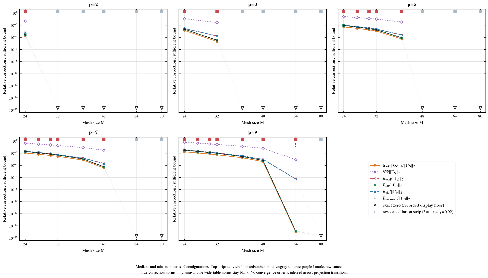
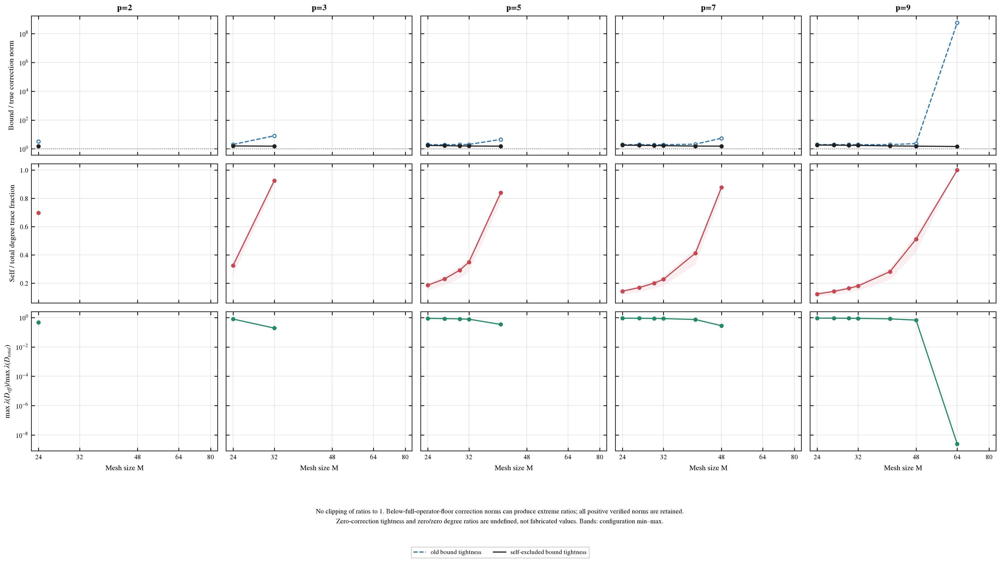
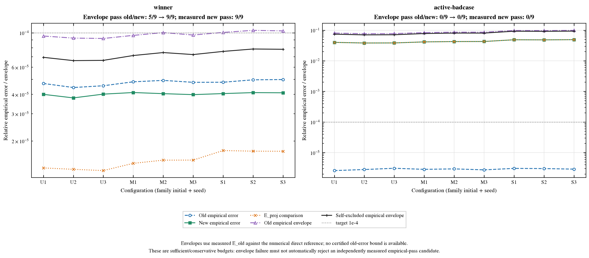
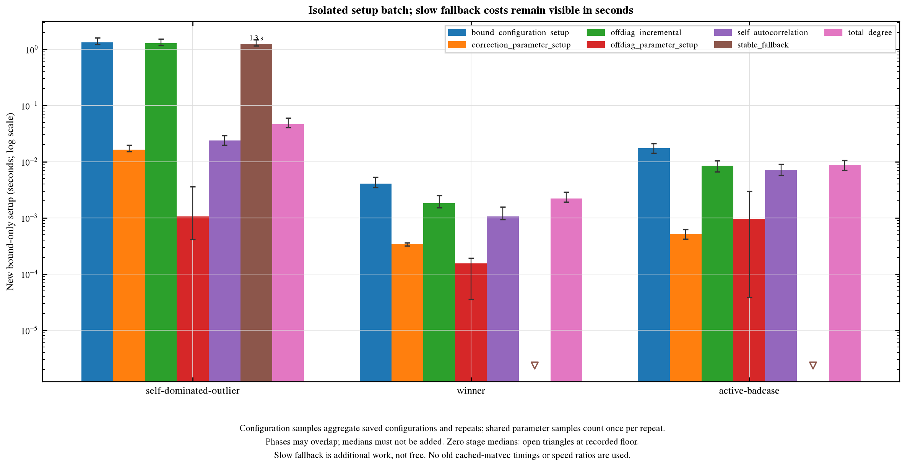

# Self-excluded degree bound：验证、预算与数值相消


生成时间：2026-10-27T12:26:54-04:00。本轮仅在 `offdiag_degree/` 增量验证既有 correction 的 self-excluded degree bound；不改变 Grid PSD、Ewald split、物理核、旧 PPPM、cached matvec、Lanczos/OU 或已发布文件。完整任务见 [requirements_github.md](requirements_github.md)。

## 1. 数学结论与浮点实现


证明与适用条件见 [proof.md](proof.md)。沿用 correction-only 物理规范 `C_hat=FFT(C)`，不额外乘/除 h³，保留 zero mode。因非负 stencil 和 `C_d` PSD，所有 `C_ij` PSD，`D_total=Σ_j C_ij`，`D_off=Σ_(j≠i) C_ij=D_total−C_ii`。精确算术下，

```text
B_simple   = N*delta
B_total    = 2*max_i lambda_max(D_total_i)
B_off      = 2*max_i lambda_max(D_off_i)
B_old      = min(B_simple,B_total)
B_improved = min(B_simple,B_total,B_off) = min(B_simple,B_off)
||Delta Gamma||_2 <= B_improved <= B_old.
```


self response 在 degree-minus-weight graph 中代数抵消；去除 self 只收紧误差界，不改变 graph 或 PSD 结构。`C_ii` 用逐轴 stencil autocorrelation 与真实模 M support 求和，不默认 p^6 双重三维循环或稠密粒子图。解析式 `D_off=D_total−C_ii` 在 self 主导时会相消；原始相减、数值标记、稳定 fallback 和独立先置 Wii=0 再求和的审计必须分开。任何额外 fallback 成本均计入本轮 setup，不以静默 clipping/floor 伪造 PSD 数值证书。精确算术定理不等同于 float64 FFT/eigensolve 的有向舍入或区间证书。

## 2. 覆盖、真值与相消检查


保存 1692 条来源记录、1602 个逻辑完整算子 case、1269 个 table/config correction、141 个参数表。不同 sR 可共享 correction，不把复用范数当作独立计算。

| 口径 | 记录 | active/inactive | true正范数 | literal zero | 活跃wide norm unavailable |
| --- | --- | --- | --- | --- | --- |
| 逻辑完整算子 | 1602 | 603/999 | 540 | 999 | 63 |
| 实际table/config | 1269 | 540/729 | 477 | 729 | 63 |

| 数值检查（table/config） | 观测 |
| --- | --- |
| fresh small-N 核查 | 1269 |
| small-N 明确 unavailable（非主N256结果） | 3 |
| full-N focus 核查（含 literal zero） | 342 |
| 两粒子 literal 双stencil 核查 | 60 |
| raw subtraction 相消标记 | 9 |
| stable fallback 使用 | 9 |
| stable fallback unavailable | 0 |
| 改进界 unavailable | 0 |
| B_improved>B_old 浮点诊断条数 | 0 |
| true correction norm>B_improved 诊断条数 | 0 |
| 最大 true norm 超界（已核查部分，绝对） | 0 |

这里只用 true correction-only dense norm 或 literal-zero 真值；旧 full-operator `E_proj` 不替代 true norm。wide norm 空值、失败和不可靠结果保留；B_off/B_improved unavailable 时留空，不用 raw subtraction 补空。数值诊断细项、fresh direct Doff 审计、对称性/min eigenvalue 与 residual 见 `results/verification_summary.json`、独立数值审计及下列实际字段；不能仅凭图片宣布相消安全。

| 关键实际数值诊断字段 | n | min | median | max |
| --- | --- | --- | --- | --- |
| audit_full_raw_error_relative_true_correction_norm | 207 | 6.41826e-16 | 1.0143e-15 | 3.48681e-07 |
| audit_full_error_relative_true_correction_norm | 207 | 3.77273e-16 | 9.85774e-16 | 1.30048e-14 |
| audit_small_raw_error_relative_true_correction_norm | 509 | 2.42557e-16 | 4.08806e-15 | 3.71194e+25 |
| audit_small_error_relative_true_correction_norm | 509 | 0 | 2.10268e-15 | 1.71902e+07 |
| raw_offdiag_min_eigenvalue | 1269 | -6.50521e-19 | 0 | 0.138618 |
| offdiag_min_eigenvalue | 1269 | -6.50521e-19 | 0 | 0.138618 |
| cancellation_index_raw | 540 | 1.11494 | 1.48813 | 9.17868e+08 |
| raw_relative_roundoff_indicator | 540 | 1.00638e-14 | 1.60154e-14 | 1.08018e-05 |
| B_total_source_residual_abs | 1269 | 0 | 0 | 0 |
| B_old_source_residual_abs | 1269 | 0 | 0 | 0 |
| audit_literal_pair_max_component_residual | 60 | 1.27055e-20 | 1.53388e-16 | 3.30465e-15 |

完整数值诊断字段范围保存在 analysis_summary.json，未因图表简化而删除失败/不可用记录。full-N 核查总数包含可直接证明为零的 correction；active dense 与 literal-zero 的口径分开保留。

**small-N 与主 N=256 的可用性分开判断。** small-N 检查 1269 组，可用 1266、明确 unavailable 3、未注明 0。wide correction support 触发稳定查询预算上限时，auto 路径只保留 raw 诊断并明确不提供数值 bound；这些行不是稳定路径成功，也不冒充主 N=256 的 bound 失败。available small-N 的 error/true correction norm 最大 2.16033e-08，对应集合的绝对谱误差最大 3.25263e-17；unavailable small-N 的 raw 相对误差最大 1.71902e+07，保留该大值及 unavailable 标志，不用它描述可用稳定路径的误差。完整字段表中的 small-N 全体最大值因此可能非常大。这些都是浮点精度诊断，不是区间证书。

| small-N unavailable 参数表 | 配置 | M | p | kappa | rho | active offsets |
| --- | --- | --- | --- | --- | --- | --- |
| table_e6506faf8c42a402 | uniform_N256_s2_rho0.3 | 80 | 9 | 0.7 | 0.3 | 31513 |
| table_8536068d0cc0a4bc | uniform_N256_s2_rho0.75 | 80 | 9 | 1 | 0.75 | 23735 |
| table_8536068d0cc0a4bc | moderate_N256_s1_rho0.75 | 80 | 9 | 1 | 0.75 | 23735 |

另保存 **6 个 targeted small-N 离线稳定核查**：选择 auto error/true norm≥1e-8 或 auto bound unavailable 的 case，显式强制 positive-occupancy 路径，允许超出默认查询预算。它不修改默认阈值、主 CSV 或主实验的 unavailable 状态，不是新的默认生产路径；计时也不与主 setup 批次合并。其中原 auto unavailable 3 个，强制路径超默认预算 3 个。强制后最大 error/true norm 为 3.80507e-16，最大绝对谱误差 9.05445e-26；额外单次强制 setup 为 [0.111372,32.2846] **秒**。

| 参数表/配置（N=4子集） | auto bound可用 | auto error/true norm | 强制 error/true norm | 额外强制setup/秒 | 超默认预算 |
| --- | --- | --- | --- | --- | --- |
| table_0dfb399e75c3848e / uniform_N256_s2_rho0.75 | True | 1.42993e-08 | 7.50171e-17 | 0.111372 | False |
| table_afadced5512770e4 / uniform_N256_s1_rho0.75 | True | 2.16033e-08 | 3.14014e-16 | 0.214838 | False |
| table_ec3c296a0b8a6221 / uniform_N256_s2_rho0.75 | True | 1.05585e-08 | 3.80507e-16 | 1.23371 | False |
| table_e6506faf8c42a402 / uniform_N256_s2_rho0.3 | False | 0.954256 | 3.30467e-16 | 32.2846 | True |
| table_8536068d0cc0a4bc / uniform_N256_s2_rho0.75 | False | 1.71902e+07 | 2.32717e-16 | 15.1847 | True |
| table_8536068d0cc0a4bc / moderate_N256_s1_rho0.75 | False | 1.16746e-06 | 2.50236e-16 | 12.6554 | True |

强制路径保存的最大严格 `true norm−B_improved` 正部为 2.58494e-26（浮点诊断，未用 floor/inflation 消去）。即使误差落在机器精度尺度，也不等同于有向舍入数值证书。特别是 wide case 的数十秒成本只属于该额外离线核查，不能称免费修复，也不能据此将默认 auto 的三项 unavailable 改成 passed。详见 `results/smallN_stability_cases.csv`、`smallN_stability_summary.json` 与 `audit_small_stability.py`。

实际采用的 degree-off 路径计数：`{"total_minus_autocorrelation_self": 1260, "positive_local_occupancy": 9}`。普通 autocorrelation 路径与稳定 fallback 的复杂度/触发条件以实现和 proof 为准；没有将 fallback 成本隐藏到旧 matvec 中。

## 3. 界的收紧与 self 主导区


| 实际table/config正范数组 | n | tightness min | median | max |
| --- | --- | --- | --- | --- |
| old | 477 | 1.90389 | 2.03174 | 6.36634e+08 |
| improved | 477 | 1.34419 | 1.63274 | 1.90508 |

按相对 correction norm>1.13687e-13 的诊断显示尺度另有 468 组：old/improved tightness 中位数 2.02982/1.63595。这只分层解释 below-roundoff 的 ratio，不删除任何 C、不改 bound、不在 ratio 图强制取 max(1,ratio)。真实零修正的 tightness 和 zero/zero degree ratio 未定义；图中真零使用明确 floor/空心倒三角，CSV 保留真实数值。



图 1：p2/3/5/7/9 随 M 的 true correction norm 与五个界，统一 ||Gamma_D||₂ 归一化。



图 2：old/improved tightness、self trace fraction 与 off/total 最大degree比。

曲线是 uniform/moderate/strong × 三 seed 的中位数与 min–max，逐图 CSV 保留 case_id/parameter_id。不在投影开关或 mixed-transition 上解释 12/26 等 formal slopes 为收敛阶。self-dominated outlier 的改善既需看真实 correction 图，也需看相消标记与 fresh direct offdiagonal 核查；不能把机器尺度上很大的 ratio 改善推广成所有实际精度场景。

## 4. Winner 与 active bad case：经验预算是否改善


| case组 | n | max E_new | max old envelope | max new envelope | old pass | new pass | new envelope可用 | 实际 E_new pass |
| --- | --- | --- | --- | --- | --- | --- | --- | --- |
| self-dominated-outlier | 9 | 1.71675e-13 | 6.22467e-07 | 1.73487e-13 | 9/9 | 9/9 | 9 | 9/9 |
| winner | 9 | 4.11271e-05 | 0.000103778 | 7.86233e-05 | 5/9 | 9/9 | 9 | 9/9 |
| active-badcase | 9 | 0.0490923 | 0.0989779 | 0.0935272 | 0/9 | 0/9 | 9 | 0/9 |

`self-dominated-outlier` 参数：rho=0.75, kappa=0.7, xi=0.85, sR=8, sF=6, M=64, p=9。经验 envelope 通过数由 9/9 变为 9/9；独立 reference 的实际新误差通过数为 9/9。

`winner` 参数：rho=0.75, kappa=0.2, xi=1.025, sR=2.85, sF=3, M=15, p=5。经验 envelope 通过数由 5/9 变为 9/9；独立 reference 的实际新误差通过数为 9/9。

`active-badcase` 参数：rho=0.75, kappa=0.7, xi=0.85, sR=4, sF=4, M=16, p=7。经验 envelope 通过数由 0/9 变为 0/9；独立 reference 的实际新误差通过数为 0/9。



图 3：逐配置 empirical errors、两个 triangle envelope 与 1e-4；直接显示原 5/9 是否改善。

**界是 sufficient/conservative。** `E_old_measured+B_improved_rel` 仍只是相对于独立数值参考的经验 envelope，不是 certified total error。`epsilon_old^cert` 当前 unavailable，theory-certified candidates 无法据此认证；独立 reference 已实测达标的 empirical-pass candidates 不能因保守 bound 未通过自动淘汰。PSD 对任意合法参数/粒子位置的结构保证不依赖这个配置相关误差预算，bound 不在每次 cached/Lanczos matvec 中计算；选参目标仍应在等精度验证基础上挑成本最低者。

## 5. 新增 setup、测试与复现


| case组 | 新批次阶段 | 独立样本数 | median/秒 | q25–q75/秒 | 范围 |
| --- | --- | --- | --- | --- | --- |
| self-dominated-outlier | bound_configuration_setup | 81 | 1.33412 | [1.22464,1.607] | 配置与repeat聚合 |
| self-dominated-outlier | correction_parameter_setup | 9 | 0.0162788 | [0.0151836,0.0197197] | 跨配置共享，按repeat去重 |
| self-dominated-outlier | offdiag_incremental | 81 | 1.28316 | [1.18264,1.53133] | 配置与repeat聚合 |
| self-dominated-outlier | offdiag_parameter_setup | 9 | 0.00105717 | [0.0004175,0.00357933] | 跨配置共享，按repeat去重 |
| self-dominated-outlier | self_autocorrelation | 81 | 0.0236991 | [0.019723,0.0293652] | 配置与repeat聚合 |
| self-dominated-outlier | stable_fallback | 81 | 1.25647 | [1.15432,1.49638] | 配置与repeat聚合 |
| self-dominated-outlier | total_degree | 81 | 0.0465747 | [0.0407357,0.0605757] | 配置与repeat聚合 |
| winner | bound_configuration_setup | 81 | 0.00409713 | [0.00349046,0.00531829] | 配置与repeat聚合 |
| winner | correction_parameter_setup | 9 | 0.000338042 | [0.000317083,0.000363042] | 跨配置共享，按repeat去重 |
| winner | offdiag_incremental | 81 | 0.00182921 | [0.00151683,0.00249537] | 配置与repeat聚合 |
| winner | offdiag_parameter_setup | 9 | 0.000154333 | [3.5417e-05,0.000191791] | 跨配置共享，按repeat去重 |
| winner | self_autocorrelation | 81 | 0.0010645 | [0.000937583,0.00156321] | 配置与repeat聚合 |
| winner | stable_fallback | 81 | 0 | [0,0] | 配置与repeat聚合 |
| winner | total_degree | 81 | 0.0021965 | [0.00191629,0.00287583] | 配置与repeat聚合 |
| active-badcase | bound_configuration_setup | 81 | 0.017504 | [0.0142493,0.021227] | 配置与repeat聚合 |
| active-badcase | correction_parameter_setup | 9 | 0.000520416 | [0.000419209,0.000620084] | 跨配置共享，按repeat去重 |
| active-badcase | offdiag_incremental | 81 | 0.00845604 | [0.00657087,0.0104163] | 配置与repeat聚合 |
| active-badcase | offdiag_parameter_setup | 9 | 0.000967708 | [3.8208e-05,0.00297442] | 跨配置共享，按repeat去重 |
| active-badcase | self_autocorrelation | 81 | 0.007103 | [0.00579242,0.00909212] | 配置与repeat聚合 |
| active-badcase | stable_fallback | 81 | 0 | [0,0] | 配置与repeat聚合 |
| active-badcase | total_degree | 81 | 0.00882042 | [0.00702867,0.0105958] | 配置与repeat聚合 |

`self-dominated-outlier` 的 stable fallback 在独立计时批中的中位数为 1.25647 **秒**，q25–q75 为 [1.15432,1.49638] 秒，保存样本范围 [1.04078,2.2643] 秒。稳定慢路径是明确的额外代价，不能以 bound 更紧就宣称计算免费。

`winner` 的 stable fallback 在独立计时批中的中位数为 0 **秒**，q25–q75 为 [0,0] 秒，保存样本范围 [0,0] 秒。稳定慢路径是明确的额外代价，不能以 bound 更紧就宣称计算免费。

`active-badcase` 的 stable fallback 在独立计时批中的中位数为 0 **秒**，q25–q75 为 [0,0] 秒，保存样本范围 [0,0] 秒。稳定慢路径是明确的额外代价，不能以 bound 更紧就宣称计算免费。



图 4：新的 bound-only setup 独立批次，以秒和 log 轴显示慢 fallback，中位数与 q25–q75。

参数表样本跨配置共享时只计一次；配置样本包含位置和 repeat 变化。full-bound configuration、self autocorrelation、fallback 与 offdiag incremental 可有包含关系，独立中位数不相加。仅比较本轮新增 bound setup；不拼接 PR #4/5 的旧 cached matvec 时间宣称提速，不改变旧 action。

恢复检查另存 `results/resume.log`：141 个参数表复用 cached checkpoint；`results/timing_resume_check.json` 记录 raw timing/context 的 SHA 在恢复前后保持不变：`True`。恢复只重建 derived summary，不重测或静默覆写旧批次。

| 测试证据 | 测试数 | 结果 |
| --- | --- | --- |
| test_offdiag_bounds.log | 12 | 通过 |

测试与独立审计覆盖 autocorrelation support 的周期 wrap、重复 indices、p=1、M<2p−1、奇偶网格、zero mode/self cancellation，以及不用大 degree 相减的 direct offdiagonal 对照。实际 pass/failure 与覆盖以保存日志/审计为准。

未完成/覆盖限制：主流程产物已保存。活跃 wide norm 未核查 63 组仍留空；certified total bound 永远标 unavailable，除非另有独立 epsilon_old^cert。

最终审计状态 `pass`，issues=0；旧已发布文件、source catalog 与 reference 的保全以最终 hash 审计为准。

恢复命令与文件索引见 [README.md](README.md)。`results/analysis_summary.json` 包括双口径覆盖、数值相消/true-bound诊断、selected-case 预算与 setup IQR；各图 source CSV 和 `plot_status.json` 可独立复核。
