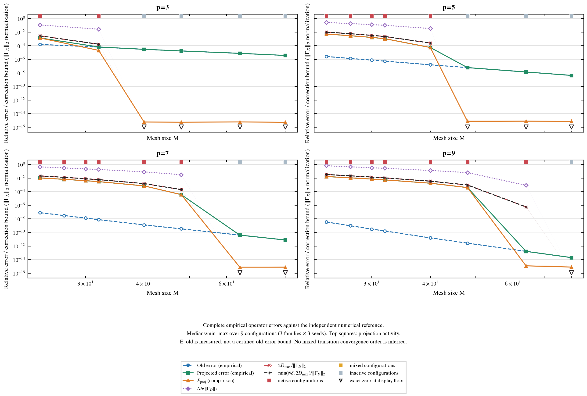
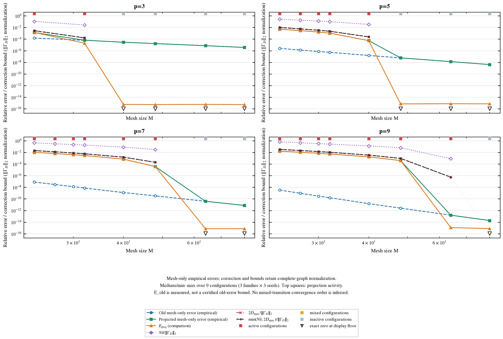
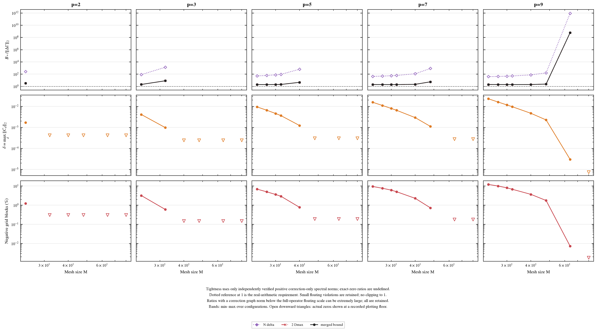
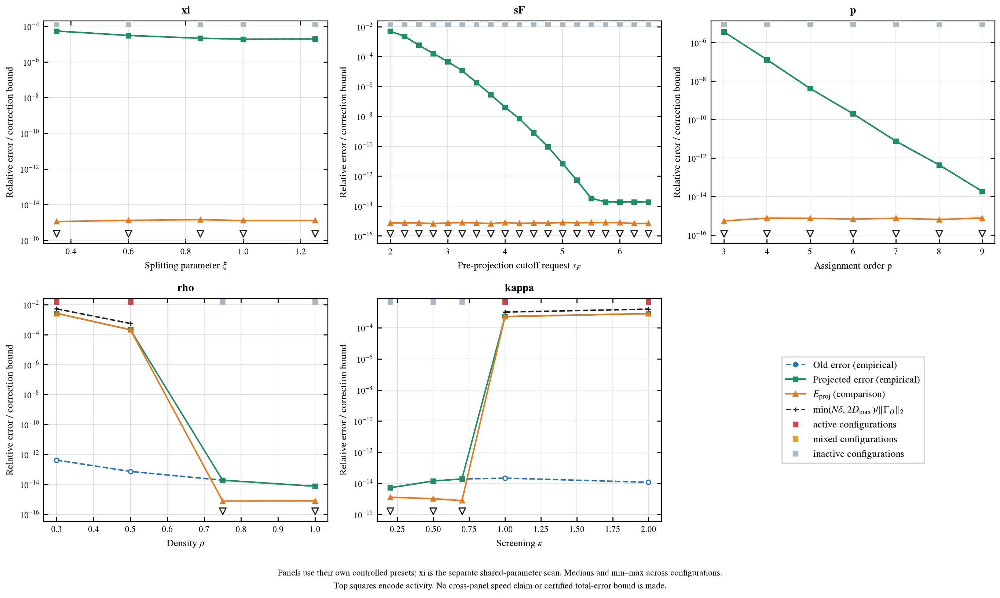
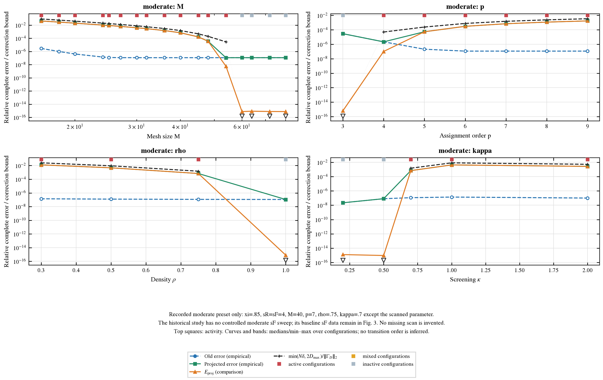
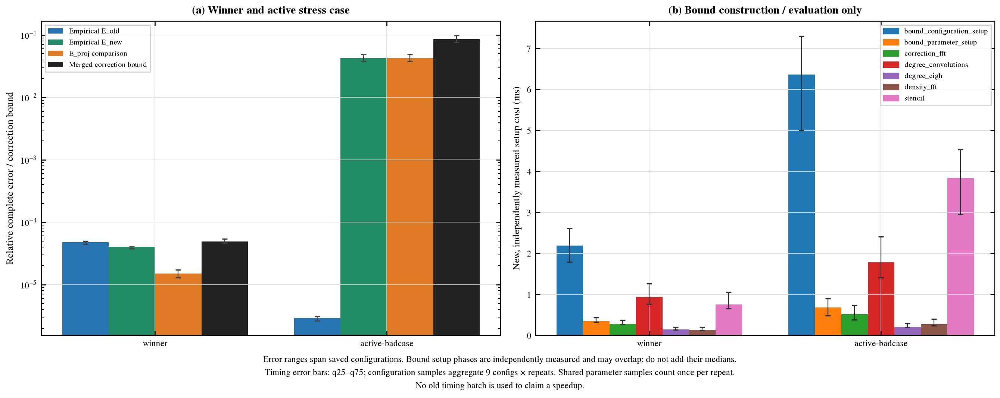
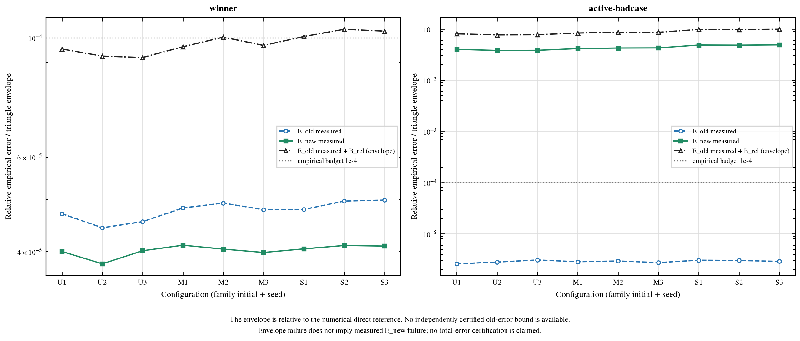

# Grid PSD 投影修正上界：验证与误差预算


生成时间：2026-10-27T02:27:04-04:00。本轮只验证既有投影修正的两个上界、绘图与分析；不更改旧 Grid PSD 方法、参数搜索、cached matvec 或旧结果，不开发新离散方案或 SDP。任务全文见 [requirements_github.md](requirements_github.md)。

## 1. 数学界与数值比较的不同含义


完整证明、适用条件、self cancellation 和浮点诊断界限见 [proof.md](proof.md)。使用既有物理实空间规范 `T_raw=IFFT(G_old)/h³`，再令 `S_d=(T_raw[d]+T_raw[-d])/2` 得到反演对称化表；`C_d=(-S_d)_+`，`delta=max_d||C_d||₂`。非负且总和为 1 的同权 stencil 给出 PSD 边修正 `C_ij=Σ w_ig C_(g-l) w_jl`。实数精确算术中，

```text
B_simple = N*delta                         (N>=2)
D_i^C = sum_g w_ig sum_l C_(g-l) n_l       (包含 self)
B_degree = 2*max_i lambda_max(D_i^C)
||Delta Gamma||_2 <= B = min(B_simple,B_degree).
```


`N*delta` 对任意粒子配置成立；`2Dmax` 依赖当前配置，但只需 correction-only FFT 与 N 个 3×3 degree，不用形成 3N×3N 稠密矩阵。degree 直接来自 C，不从两个大完整 degree 相减。self 可保留在 degree 以使上界成立，graph action 中完整 self response 代数抵消。这是精确算术数学证书；本轮 float64 FFT、特征分解、对称化 defect 与 norm residual 是独立数值诊断，未经有向舍入/区间算术认证，不能把保存的浮点数字当作逐位严格的机器证书。

**所有 E_old/E_new 都是对独立数值 direct reference 的 empirical error。**`E_proj` 是历史完整新旧算子的数值差，可能含旧权重/对称化/FFT 的舍入差。真正 correction-only graph 范数优先独立 dense all-offset 核查；宽活跃表未核查则留空。`E_old_measured+B/||Gamma_D||₂` 仅叫相对于该数值参考的 triangle envelope，不是 certified total bound。另行认证的 epsilon_old 不可用，本轮 `certified_total_bound` 始终 unavailable。

## 2. 覆盖范围与浮点检查


保存 1692 条来源记录、1602 个唯一构型算子、141 个唯一参数表；同一 case_id 出现在多个数据集时，逻辑完整算子统计按 case_id 去重。真正重算的 table/config correction 有 1269 组；不同 sR 的完整算子可共享同一 C/degree/GC，不能把它们当作独立 correction 计算。原始来源行与参数标识在 bounds.csv 保留。

| 数据集 | 来源行 | 唯一 case | active/inactive | true dense 正范数 | 活跃宽表未核查 |
| --- | --- | --- | --- | --- | --- |
| best_projection_diagnostics | 9 | 9 | 9/0 | 9 | 0 |
| convergence | 324 | 324 | 189/135 | 189 | 0 |
| sweeps | 927 | 855 | 351/504 | 288 | 63 |
| validation | 387 | 387 | 63/324 | 63 | 0 |
| xi_sweep | 45 | 45 | 0/45 | 0 | 0 |

| correction 覆盖口径 | 活跃 | true dense 正范数 | literal zero | 宽活跃表未核查 |
| --- | --- | --- | --- | --- |
| 逻辑完整算子 case（含不同 sR） | 603 | 540 | 999 | 63 |
| 实际 table/config correction 组 | 540 | 477 | 729 | 63 |

| 检查量（唯一 case） | 观测 |
| --- | --- |
| literal-zero 修正 | 999 |
| true dense 正范数覆盖 | 540 |
| 宽活跃表只复用历史完整差、无 true norm | 63 |
| E_proj>B_rel 浮点诊断 / roundoff / material | 945/945/0 |
| 最大 E_proj 比较超界（相对） | 1.8475e-15 |
| true correction-only 最大超界（绝对） | 0 |
| 最大对称化 defect（绝对表分量） | 4.4409e-16 |
| 最大 correction norm 比较残差（绝对） | 1.566e-13 |

roundoff/material 分类使用运行摘要中保存的判定尺度，不通过膨胀 B、截掉 E_proj 或强制 tightness≥1 来修饰结果。本次保存尺度为 1.1369e-13。C 完全为零时，B 与真实 correction graph 均为真零；历史 E_proj 仍可在机器舍入量级非零。图中真零使用空心倒三角和单独显示 floor，源 CSV 同时保留零 mask 与显示坐标；零修正的 tightness=0/0 未定义，未用无穷大或假定的 1 代替。

按原始来源行统计，E_proj 比较超界 999 条，其中 roundoff 999、material 0；上表按唯一逻辑 case 去重，两个计数口径不代表不同的失败结论。

## 3. 上界保守性与参数规律


对具有 true dense correction-only 正范数核查结果的逻辑完整算子 case，合并上界 tightness `B/||Delta Gamma||₂` 范围 1.9039–6.3663e+08，中位数 2.0231（540 逻辑 case，包含共享 correction 的不同 sR）。宽表历史 E_proj 只作完整算子比较，不进入这项严格定义的 tightness 统计。

按实际独立 table/config correction 分组后，正范数核查 477 组，tightness 中位数 2.0317、范围 1.9039–6.3663e+08。补充使用相对 correction norm > 1.1369e-13 的明确显示尺度，保留 468 组，tightness 中位数 2.0298、范围 1.9039–5616.1；另有 9 组图修正范数位于该尺度以下。这是额外的诊断分层，不删除 C、不改 B、也不是新的数学容差。

最大 ratio 的代表是 `uniform_N256_s2_rho0.75`、M=64、p=9：delta=2.9938e-05、负块 19，B=5.1595e-06，真实图修正范数=8.1044e-15，相对图修正=9.7775e-16。这里 C 的表尺度本身并非机器微小量；图修正很小而 degree 含 self，可使上界极保守；不能把这种 below-roundoff 的巨大 ratio 当作有效选参预算精度。

独立离线审计 `results/tightness_outlier_diagnostic.json` 复算同一 correction graph norm 8.1044e-15，与保存值一致；self degree 的 trace 占比为 99.9999999497%，self 与 total degree 最大特征值分别为 2.57976710169e-06 / 2.57976710198e-06。先将 W_ii 置零再直接求和的非 self degree 最大特征值只有 6.0132e-15，非 self / total 最大 degree 比 2.3309e-09。因此这个极端保守性确由含 self 的 degree 上界主导，且图修正分母落在完整算子比较的浮点尺度；不是 tiny active C，也不是用两个大 degree 相减造成的灾难性相消。该离线解释未修改任何 bound 或生产方法。



图 1a：同 p 随 M 的完整经验误差、投影比较量及三个 correction bound。



图 1b：独立 mesh-only 经验误差；correction 与界仍以同一 ||Gamma_D||₂ 归一化。



图 2：真实 correction-only tightness、delta 与负块比例，包含 p2/3/5/7/9。



图 3：受控 xi/sF/p/rho/kappa 扫描的经验误差、界与投影活跃性。



图 3b：补充 moderate 的 M/p/rho/kappa 受控扫描，保留明显活跃情形。

曲线以九配置（uniform/moderate/strong × 三 seed）的中位数与 min–max 表示，逐图 CSV 保留参与 case_id/parameter_id；顶部色块表示 active/mixed/inactive。xi panel 使用其独立共享参数 preset，其余优先 baseline controlled sweep；跨 panel 不是同一物理设置的速度比较。本轮不拟合收敛阶：投影开关过渡处原先 12/26 等 formal slopes 不作为高阶证书。

原历史数据没有 controlled moderate sF 扫描，因此不虚构该 panel；其 sF 扫描只在 baseline 图中展示，moderate 补图用真实存在的 M/p/rho/kappa 四组。独立 xi preset 的全不活跃结果如实保留，不通过跨 M 混合验证候选来制造 xi 活跃曲线。

## 4. Winner、active bad case 与经验误差预算


| case组 | 配置数 | max E_old | max E_new | max E_proj | max B_rel | max 经验 envelope | envelope≤1e-4 | E_new≤1e-4 | tightness中位/范围 |
| --- | --- | --- | --- | --- | --- | --- | --- | --- | --- |
| winner | 9 | 4.99e-05 | 4.1127e-05 | 1.7344e-05 | 5.4088e-05 | 0.00010378 | 5/9 | 9/9 | 3.3508 / [3.0371,3.6732] |
| active-badcase | 9 | 3.0933e-06 | 0.049092 | 0.049092 | 0.098975 | 0.098978 | 0/9 | 0/9 | 2.0134 / [2.0114,2.0269] |

`winner` 参数：N=256, rho=0.75, kappa=0.2, xi=1.025, sR=2.85, sF=3, M=15, p=5。

该组 5/9 个配置满足 measured E_old+B_rel≤1e-4，而实际 E_new 有 9/9 个达标。这直接量化上界提供预算的范围与保守性：经验 envelope 未通过不能反推算法实际误差未达标；通过也只对该数值 reference 的经验预算成立，不能升级为 certified total error。

`active-badcase` 参数：N=256, rho=0.75, kappa=0.7, xi=0.85, sR=4, sF=4, M=16, p=7。

该组 0/9 个配置满足 measured E_old+B_rel≤1e-4，而实际 E_new 有 0/9 个达标。这直接量化上界提供预算的范围与保守性：经验 envelope 未通过不能反推算法实际误差未达标；通过也只对该数值 reference 的经验预算成立，不能升级为 certified total error。



图 4：winner/active bad case 的经验误差、correction bound 与本轮增量 setup。



图 5：逐配置经验 triangle envelope 与 1e-4 预算，显示保守性而非总误差证书。

## 5. 新增成本、测试和结论边界


| case组 | 新增阶段 | 独立样本数 | 中位 / ms | IQR / ms | 统计范围 |
| --- | --- | --- | --- | --- | --- |
| winner | bound_configuration_setup | 81 | 2.1926 | [1.7869,2.604] | 包含构型与重复变化 |
| winner | bound_parameter_setup | 9 | 0.33971 | [0.32896,0.43367] | 同一 repeat 跨配置共享，只计一次 |
| winner | correction_fft | 9 | 0.28288 | [0.27038,0.36979] | 同一 repeat 跨配置共享，只计一次 |
| winner | degree_convolutions | 81 | 0.93408 | [0.76379,1.2622] | 包含构型与重复变化 |
| winner | degree_eigh | 81 | 0.13933 | [0.13312,0.19817] | 包含构型与重复变化 |
| winner | density_fft | 81 | 0.131 | [0.12462,0.19462] | 包含构型与重复变化 |
| winner | stencil | 81 | 0.74958 | [0.65288,1.0569] | 包含构型与重复变化 |
| active-badcase | bound_configuration_setup | 81 | 6.3649 | [4.9996,7.3021] | 包含构型与重复变化 |
| active-badcase | bound_parameter_setup | 9 | 0.67742 | [0.48063,0.89446] | 同一 repeat 跨配置共享，只计一次 |
| active-badcase | correction_fft | 9 | 0.52017 | [0.37812,0.73088] | 同一 repeat 跨配置共享，只计一次 |
| active-badcase | degree_convolutions | 81 | 1.7835 | [1.4059,2.4075] | 包含构型与重复变化 |
| active-badcase | degree_eigh | 81 | 0.20633 | [0.19592,0.29042] | 包含构型与重复变化 |
| active-badcase | density_fft | 81 | 0.26975 | [0.23058,0.39621] | 包含构型与重复变化 |
| active-badcase | stencil | 81 | 3.8336 | [2.952,4.533] | 包含构型与重复变化 |

这些时间来自本轮 isolated_incremental_bound_setup，保留旧 cached matvec 完全不变。parameter setup/correction FFT 的同一次参数表样本可供九个构型共享，不能算作九个独立 FFT 样本。configuration setup、stencil、density FFT、degree convolutions 与小 degree eigensolve 单独列出；阶段包含关系与独立中位数不相加。不与 PR #4 的旧 matvec/setup 计时拼接速度比，也不据此声称新方法或加速。负载与线程上下文见 `results/timing_context.json`。

运行过程中曾在合并输出阶段遇到 JSON 序列化问题；修复后仅重新执行 merge/postprocess，完整参数表 checkpoint 保留，最终成功摘要见 merge.log 与 verification_summary.json，计时见 timing.log。保留初次 run.log 作为过程证据，不把早期输出异常解释为数学上界或单元测试失败。

| 测试日志 | 测试数 | 结果 |
| --- | --- | --- |
| test_bounds.log | 10 | 通过 |

本次独立测试覆盖了 N*delta、2Dmax、合并 bound、self cancellation、奇偶 M、零模、对称/PSD correction 与独立 correction-only action；实际 pass/failure 以上表日志为准。数学结构与任意合法参数 PSD 保证延续既有证明，不由有限样本 eigenvalues 代替。

来源 catalog 记录 1693 行，最终 bounds 只处理有真实构型的条目；aggregate timing 行不作为单构型误差数据。最终覆盖与分组见 verification_summary.json 和 analysis_summary.json。

尚未完成/覆盖限制：已保存主流程产物，仍保留如下覆盖限制。

活跃宽表中 63 个 case 未构造 true correction-only dense norm，对应 tightness 留空；不得用 historical full-difference norm 冒充。所有 total certified bounds unavailable。degree bound 的预算价值限于本次模型和已测设置；本轮不推出保 PSD 高阶新方案、不修改投影，也不作速度替代结论。

结束审计文件已保存，状态 `pass`、issues=0；旧源码、CSV、图和 reference 未改动的具体逐文件 hash/pass 结果见该审计文件。

checkpoint 恢复已实跑，`results/resume.log` 中记录 cached 141 次；这是复用既有参数表结果的恢复检查，不是重新执行同一批计算。

## 复现

在仓库根目录运行，compute 按参数表 checkpoint 恢复；仅补本轮目录的产物：

```bash
python3 -B benchmarks/method_A_clustered/validation_exp1/deconv_psd_comparison/projection_bounds/audit_sources.py
python3 -B benchmarks/method_A_clustered/validation_exp1/deconv_psd_comparison/projection_bounds/test_bounds.py
python3 -B benchmarks/method_A_clustered/validation_exp1/deconv_psd_comparison/projection_bounds/run_bounds.py compute --workers 2
python3 -B benchmarks/method_A_clustered/validation_exp1/deconv_psd_comparison/projection_bounds/run_bounds.py merge
python3 -B benchmarks/method_A_clustered/validation_exp1/deconv_psd_comparison/projection_bounds/run_bounds.py timing --repeats 9
python3 -B benchmarks/method_A_clustered/validation_exp1/deconv_psd_comparison/projection_bounds/plot_results.py
python3 -B benchmarks/method_A_clustered/validation_exp1/deconv_psd_comparison/projection_bounds/report_generator.py
```


入口、最终审计命令与输出索引见 [README.md](README.md)。本报告的逐数据集/参数表/selected case/参数扫描分析保存为 `results/analysis_summary.json`；所有图附 PNG、SVG 与 `figures/plot_data/` 中的源 CSV。
