# 去卷积 PPPM 的实空间网格张量 PSD 投影：三方法实验报告


生成时间：2026-10-26T22:46:06-04:00（America/Detroit）。本报告由 `report_generator.py` 读取现有 CSV 自动生成，未完成的计算保留为未完成，所有数值均来自已保存观测。

完整要求见 [GitHub 评论](https://github.com/raphaefwang-source/ass1/pull/3#issuecomment-6431287227)及本目录 `requirements_github.md`。


## 当前交付状态


| 方法 | 六扫记录 | 预期六扫记录 | 独立网格收敛记录 | 新搜索候选 | 主档同批计时 |
| --- | --- | --- | --- | --- | --- |
| PPPM-original | 927 | 927 | 324 | 105 | 完成 |
| B2-positive | 927 | 927 | 324 | 87 | 完成 |
| PPPM-grid-PSD | 927 | 927 | 324 | 118 | 完成 |


网格收敛记录总计 972/972；补充受控 xi 记录 135/135；图表已保存 11 组。只有三方法六扫、独立收敛、九配置验证与同批计时均完成后，主实验才完整。


## 1. 模型、基线和历史数据保护


三个方案采用相同 Candidate-1 / law-A 分裂、原 amplitude 与周期核、短程图 action、位置与 seed。`PPPM-original` 保留旧高阶去卷积；`B2-positive` 使用无去卷积正实空间表与非负分配；`PPPM-grid-PSD` 对原去卷积实空间表逐 3×3 张量做 PSD 投影。没有更改物理 kappa，没有 Fourier clipping、全局 delta*P 修正或 OU 实验。

初始分支 `codex/b2-positive-mesh`；初始 HEAD `128aaf1cd8bf39c69d2bf2db9619e478fefc0c73`。独立新分支为 `codex/deconv-grid-psd-comparison`。新代码、CSV、图与报告均位于独立 `deconv_psd_comparison/`；历史源码、结果与 reference 只读复用。

| 初始核对项 | 文件数 | 不匹配数 |
| --- | --- | --- |
| 原始历史产物 | 301 | 0 |
| B2 源文件 | 11 | 0 |
| 原始 reference | 18 | 0 |
| 独立 direct reference | 72 | 0 |


结束时审计文件已存在，详见 `audit_final.json`；具体逐文件 hash 记录为判断历史内容是否变化的依据。

| 结束时 hash 检查项 | 不匹配数 |
| --- | --- |
| checks.search_validation.summary_mismatches | 0 |
| checks.frontier.source_mismatches | 0 |


Direct reference 为独立 unsplit periodic annulus sum；初始审计中最大相对证书界为 9.963e-14。reference 位置 hash、物理参数及来源在 `audit_initial.json` 中逐一核对。

环境：macOS-27.0.1-arm64-arm-64bit；Python 3.11.5；NumPy 2.4.6；SciPy 1.17.1；逻辑 CPU 8；物理内存 8192 MiB。


## 2. 实现及 PSD 证明


旧 influence `G_old=Khat_L/|What_h|²` 仍沿用原 kc、Nyquist 与安全分母规则。adapter `grid_psd.py` 使用物理张量 `T_raw=irfftn(G_old)/h³`；六个分量构成对称 3×3 块，先对 d 与 −d 求平均，再把**全部负特征值**截到零。修正按 negative part 直接构造，避免两个近似相等的重建张量相减造成污染；diagnostics 的 roundoff threshold 只用于统计，未用于丢弃修正。

`G_plus=G_old+h³*rfftn(T_plus−S)` 与 `h³*rfftn(T_plus)` 在精确算术中等价。当修正为零时保留原 influence，避免无意义 FFT round-trip 舍入；保留投影新产生的所有 modes、Nyquist 面与零频，不重施 kc mask、不再次去卷积、不把实空间原点置零。degree 使用新 influence 与同一套非负 B-spline spread/gather 重新构造；完整 interpolated self response 在 degree-minus-response 中代数抵消。

令 `A_ij⁺=Σ_(g,l) w_ig T_plus[g−l] w_jl`。因每个 `T_plus[d]` 是 PSD 且 `w_ig,w_jl≥0`，所以每个 `A_ij⁺` 是 PSD；因 `T_plus[d]=T_plus[−d]=T_plus[d]ᵀ`，边权满足 `A_ij⁺=A_ji⁺`。于是对任意粒子向量 v，


```text
vᵀ Γ_Lh⁺ v = (1/2) Σ_(i,j) (v_i−v_j)ᵀ A_ij⁺ (v_i−v_j) ≥ 0.
```


因此新长程 graph 在精确算术中严格 PSD，并保留三维 translation nullspace。Candidate-1 短程边核也为 PSD，完整短加长 graph 同样具有该结构。这是结构证明；float64 的表重建、degree 与 FFT 的舍入误差单列报告，不把有限配置上的最小特征值采样当成证明。

完整归一化、结构证明与近 rank-one 核二阶偏差机制分析见 [proof.md](proof.md)。该机制分析忽略 alias 与有限截断，仅解释可能的误差来源，不充当本实验的任意参数高阶或二阶定理。

原与新使用数学上同一 B-spline 分配；新方案采用 B2 稳定正 recurrence 和 partition normalization。因此即使表投影完全不活跃，新旧粒子算子在浮点中仍可能相差舍入量；`E_proj≈机器精度` 不应解读为数学投影活跃。参数表随 L、核、xi、sF、M、p 变化而重建；同一参数表可跨位置配置复用；位置改变需重建 stencil、degree 与短程邻居缓存。


## 3. 独立验证


`test_grid_psd.py` 覆盖已知 indefinite/PSD 块、微小负特征值不丢弃、无投影 round-trip 与旧 action、奇偶网格/Nyquist、非负与归一化 stencil、周期边界与 p=1 半格点、零 amplitude 与非法输入、全 mode 的 DFT/独立 direct-stencil contraction、新 degree、完整 action 的对称/translation-null、单粒子 self cancellation。投影后 dense 真值使用旧有限 mode sum **加完整实空间稀疏修正**，不把旧 mode list 当成修复后算子的全部真值；小网格测试另用 literal stencil 与完整 DFT 独立交叉核对。

| 测试日志 | 测试数 | 结果 |
| --- | --- | --- |
| tests_b2_regression.log | 8 | 通过 |
| tests_grid_psd.log | 9 | 通过 |
| unit_tests.log | 9 | 通过 |


独立 table audit 完成 77/77 个不同参数表，非法表 0；其中 12 个参数表用小 N literal 3D stencil 对照。最大 direct/FFT-basis 相对差 3.852e-13，最大 direct graph action 相对差 3.583e-13。逐表、零频、新 mode、负谱与浮点重建残差见 `results/table_diagnostics.csv`；这些校验耗时不作为公平 matvec 时间。

全部 audit 表的最小 post-clipping eigenvalue 为 -9.608e-17；谱剪裁后的微小负值按算子尺度评估为浮点重建误差，数学 PSD 结论来自证明。

| p | 配置数 | 一维权重最大差 | 三维乘积权重最大差 | 无投影 apply 最大相对差 |
| --- | --- | --- | --- | --- |
| 1 | 9 | 0 | 0 | 0 |
| 2 | 9 | 0 | 0 | 0 |
| 3 | 9 | 1.11e-16 | 1.665e-16 | 2.909e-16 |
| 5 | 9 | 2.22e-16 | 1.388e-16 | 4.919e-16 |
| 7 | 9 | 2.22e-16 | 1.11e-16 | 4.557e-16 |
| 9 | 9 | 2.22e-16 | 8.327e-17 | 4.893e-16 |
| 11 | 9 | 2.776e-16 | 6.939e-17 | 5.286e-16 |


上表是稳定非负 recurrence 与旧 Mesh assignment 的实际量化对照；p1 精确半格点的历史 tie 歧义单独用测试覆盖，不从随机配置的一致性推定。

| 方法 | 完整验证记录 | 最小 restricted λ(full) | 最小 restricted λ(long) | 最大 symmetry residual | 最大 translation residual | 最大 FFT/dense discrepancy |
| --- | --- | --- | --- | --- | --- | --- |
| PPPM-original | 288 | 67.73 | 61.46 | 6.487e-18 | 8.745e-16 | 1.159e-15 |
| B2-positive | 171 | 67.73 | 47.16 | 0 | 8.288e-16 | 1.585e-15 |
| PPPM-grid-PSD | 387 | 67.73 | 61.46 | 5.214e-18 | 8.847e-16 | 1.171e-15 |


restricted λ 在去除 translation 的子空间上计算；此表的未达标候选也保留，不只筛选成功点。计时只使用完成九配置验证的可行候选。


## 4. Experiment 1：六组参数与高阶精度


沿用 uniform/moderate/strong × seed 1/2/3。主误差为完整矩阵 `E_G=||Γ_h−Γ_D||₂/||Γ_D||₂`，以对称矩阵极端特征值计算 spectral norm；`E_GX` 使用原 10 个 Gaussian probes，作为 action 补充而非主约束的替代。rho/kappa 扫描改变物理设置用于研究规律；选参实验始终固定物理设置。

| 方法 | sR | sF（原/投影前） | sT（B2） | M | p | rho | kappa |
| --- | --- | --- | --- | --- | --- | --- | --- |
| PPPM-original | 171 | 171 | 0 | 297 | 126 | 72 | 90 |
| B2-positive | 171 | 0 | 171 | 297 | 126 | 72 | 90 |
| PPPM-grid-PSD | 171 | 171 | 0 | 297 | 126 | 72 | 90 |


sR=xi*r_c；原/新 sF=k_c/(2xi)，Fourier cutoff 实际按 reciprocal shell 向下吸附；新方案中的 sF 只限定投影前 influence。B2 的 sT=kappa*R_T 是实空间 image cube half-window，与 sF 具有不同定义，不因数值相等就视为相同截断。图中将两者分面。baseline/moderate 与历史扫描保持相同定义；历史结果的 source/path/hash 见导入记录及初始审计。


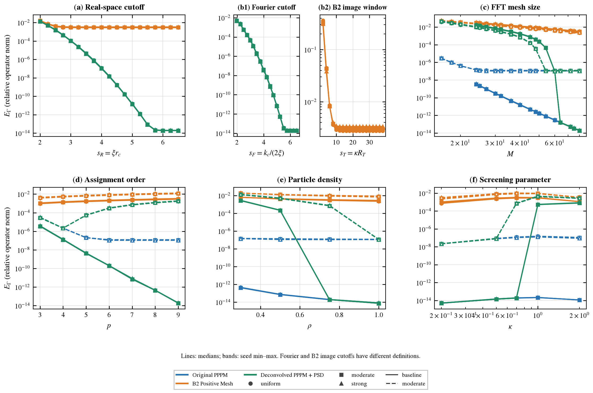

图 1：三方法六组 E_G 参数扫描，颜色统一，带状区域为 seed min–max。


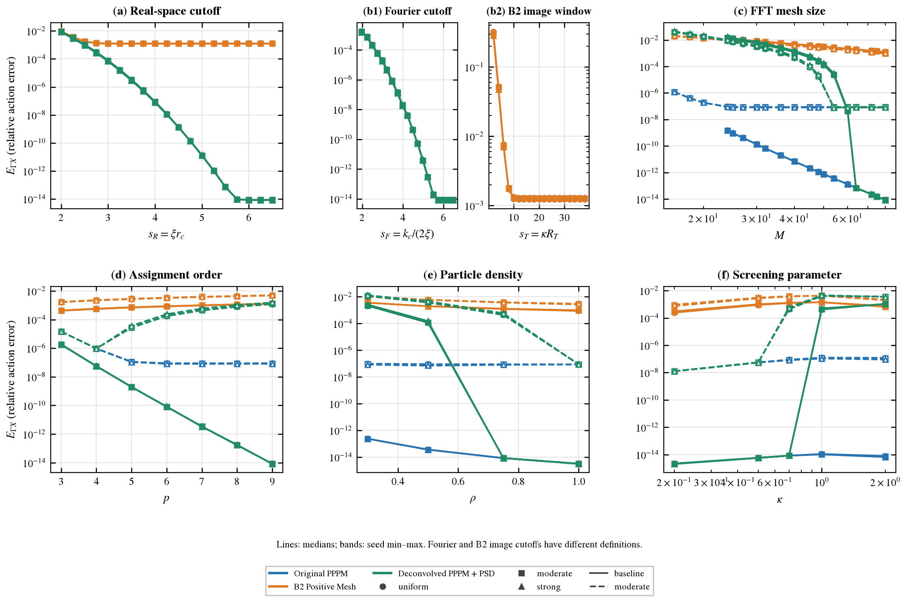

图 2：对应 Gaussian action 误差 E_GX。


### 受控 xi 扫描：与独立选参分开


补充扫描固定 N=256、rho=.75、kappa=.2、c=1、M=20、p=5、sR=3；原/新 sF=3，B2 sT=36。三方法均取 xi∈{.35,.6,.85,1,1.25}，每个 xi 覆盖三个配置族 × 三个 seed，共预期 135 条记录。这组曲线用于隔离共同数值设置下 xi 的影响，与 Experiment 2 中各方法独立优化 xi/M/p/截断参数的最快配置分开解读。固定的是无量纲 sR/sF，因此 xi 改变时派生物理截断 rc=sR/xi、kc≈2*xi*sF 也随之改变；B2 的 image-table 窗口仍为 sT/kappa。

| 方法 | 已保存/预期记录 | xi 范围 | E_G 范围 | E_GX 范围 | max E_proj |
| --- | --- | --- | --- | --- | --- |
| PPPM-original | 45/45 | 0.35–1.25 | 1.78e-05–5.43e-05 | 7.54e-06–4.554e-05 | N/A |
| B2-positive | 45/45 | 0.35–1.25 | 0.002307–0.01055 | 0.0003075–0.004204 | N/A |
| PPPM-grid-PSD | 45/45 | 0.35–1.25 | 1.78e-05–5.43e-05 | 7.54e-06–4.554e-05 | 1.591e-15 |


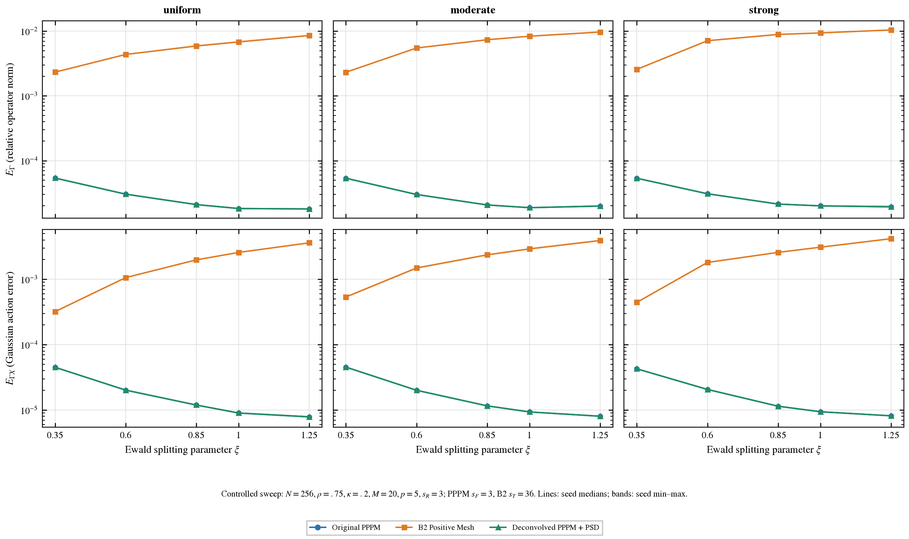

图 9：受控 xi 扫描，E_G/E_GX × 配置族分面；曲线为 seed 中位数与 min–max。

原始逐配置观测保存在 `results/xi_sweep.csv`，逐图聚合源在 `figures/plot_data/fig9_xi_controlled_sweep.csv`。共同参数下的单个最小误差 xi 不自动等于各方法相同误差约束下最快的 xi。

| 投影数据范围 | 记录数 | 活跃记录 | 显著负块记录* | max E_proj | max 相对表修正 Fro | max 单块修正谱范数 | min λ(raw) | min λ(after) |
| --- | --- | --- | --- | --- | --- | --- | --- | --- |
| 六扫 | 927 | 378 | 378 | 0.04909 | 0.1259 | 0.0598 | -0.0598 | -9.608e-17 |
| 独立网格收敛 | 324 | 189 | 189 | 0.01848 | 0.05491 | 0.02302 | -0.02302 | -6.897e-17 |
| 九配置候选验证 | 387 | 63 | 63 | 0.0005055 | 0.01248 | 0.2194 | -0.2194 | 0.05626 |


*显著性统计仅在保存了 `significant_negative_blocks` 的记录上有意义，阈值为 64*eps_float64*max|λ|；所有 λ<0 的修正仍全部施加。旧检查点缺该字段时，上表的显著记录数不能当作无显著负块的证据。

已保存范围有 630/1638 条活跃记录；活跃区 M 为 14–80，p 为 2–9，xi 为 0.85–1.45。这些范围是混合多个设置的包络，不代表其中每一点都活跃。

排除原始误差≤1e-11的 floor 附近点后，修复后/原始总误差比在已保存记录中为 0.8209–1.167e+08（中位数 1）。PSD projection 保证结构，不保证误差一定下降；两个误差仍按相同 Γ_D 实测。


### 独立网格收敛与阶数


独立 refinement 固定 rho=.75、kappa=.7、xi=.85、sR=8、sF=6、B2 sT=36；p∈{2,3,5,7,9}，M 依合法 Nyquist 域取值。定义 mesh-only error 为 `||Γ_Lh−(Γ_D−Γ_S(sR=8))||₂/||Γ_D||₂`，GSfar 独立从短程核计算。已采用大截断隔离短程与 Fourier tail；若这些残差在某范围仍占主导，该范围不得解释为网格渐近阶。拟合对每个 method/family 先对 seed 取中位数，剔除 E_mesh≤1e-11，取剩余最后四个 M，至少三个点且要求严格下降；无合法拟合时留空。1e-11 是拟合排除阈值，不能据此声称 direct reference 的实际误差恰等于该值。

| 方法 | 配置族 | p | M 拟合区间 | 点数 | 观测 q | fit内 max E_proj | 投影区域 |
| --- | --- | --- | --- | --- | --- | --- | --- |
| B2-positive | moderate | 2 | 40–80 | 4 | 2.055 | 0 | 不适用 |
| B2-positive | moderate | 3 | 40–80 | 4 | 1.987 | 0 | 不适用 |
| B2-positive | moderate | 5 | 40–80 | 4 | 1.977 | 0 | 不适用 |
| B2-positive | moderate | 7 | 40–80 | 4 | 1.968 | 0 | 不适用 |
| B2-positive | moderate | 9 | 40–80 | 4 | 1.959 | 0 | 不适用 |
| B2-positive | strong | 2 | 40–80 | 4 | 1.971 | 0 | 不适用 |
| B2-positive | strong | 3 | 40–80 | 4 | 1.988 | 0 | 不适用 |
| B2-positive | strong | 5 | 40–80 | 4 | 1.979 | 0 | 不适用 |
| B2-positive | strong | 7 | 40–80 | 4 | 1.971 | 0 | 不适用 |
| B2-positive | strong | 9 | 40–80 | 4 | 1.962 | 0 | 不适用 |
| B2-positive | uniform | 2 | 40–80 | 4 | 1.974 | 0 | 不适用 |
| B2-positive | uniform | 3 | 40–80 | 4 | 1.984 | 0 | 不适用 |
| B2-positive | uniform | 5 | 40–80 | 4 | 1.972 | 0 | 不适用 |
| B2-positive | uniform | 7 | 40–80 | 4 | 1.961 | 0 | 不适用 |
| B2-positive | uniform | 9 | 40–80 | 4 | 1.95 | 0 | 不适用 |
| PPPM-grid-PSD | moderate | 2 | 40–80 | 4 | 1.938 | 0 | inactive (0/12 active) |
| PPPM-grid-PSD | moderate | 3 | 40–80 | 4 | 3.021 | 6.655e-16 | inactive (0/12 active) |
| PPPM-grid-PSD | moderate | 5 | 40–80 | 4 | 12.16 | 5.482e-05 | mixed (3/12 active) |
| PPPM-grid-PSD | moderate | 7 | 32–64 | 4 | 26.22 | 0.002921 | mixed (9/12 active) |
| PPPM-grid-PSD | moderate | 9 | 30–48 | 4 | 6.038 | 0.006944 | active (12/12 active) |
| PPPM-grid-PSD | strong | 2 | 40–80 | 4 | 2.04 | 0 | inactive (0/12 active) |
| PPPM-grid-PSD | strong | 3 | 40–80 | 4 | 3.023 | 7.273e-16 | inactive (0/12 active) |
| PPPM-grid-PSD | strong | 5 | 40–80 | 4 | 12.11 | 5.711e-05 | mixed (3/12 active) |
| PPPM-grid-PSD | strong | 7 | 32–64 | 4 | 26.27 | 0.00323 | mixed (9/12 active) |
| PPPM-grid-PSD | strong | 9 | 30–48 | 4 | 6.077 | 0.007738 | active (12/12 active) |
| PPPM-grid-PSD | uniform | 2 | 40–80 | 4 | 2.087 | 0 | inactive (0/12 active) |
| PPPM-grid-PSD | uniform | 3 | 40–80 | 4 | 2.961 | 7.395e-16 | inactive (0/12 active) |
| PPPM-grid-PSD | uniform | 5 | 40–80 | 4 | 12.14 | 5.382e-05 | mixed (3/12 active) |
| PPPM-grid-PSD | uniform | 7 | 32–64 | 4 | 26.25 | 0.00285 | mixed (9/12 active) |
| PPPM-grid-PSD | uniform | 9 | 30–48 | 4 | 5.915 | 0.006711 | active (12/12 active) |
| PPPM-original | moderate | 2 | 40–80 | 4 | 1.938 | 0 | 不适用 |
| PPPM-original | moderate | 3 | 40–80 | 4 | 3.021 | 0 | 不适用 |
| PPPM-original | moderate | 5 | 40–80 | 4 | 5.11 | 0 | 不适用 |
| PPPM-original | moderate | 7 | 32–64 | 4 | 7.527 | 0 | 不适用 |
| PPPM-original | moderate | 9 | 27–40 | 4 | 10.46 | 0 | 不适用 |
| PPPM-original | strong | 2 | 40–80 | 4 | 2.04 | 0 | 不适用 |
| PPPM-original | strong | 3 | 40–80 | 4 | 3.023 | 0 | 不适用 |
| PPPM-original | strong | 5 | 40–80 | 4 | 5.135 | 0 | 不适用 |
| PPPM-original | strong | 7 | 32–64 | 4 | 7.582 | 0 | 不适用 |
| PPPM-original | strong | 9 | 27–40 | 4 | 10.38 | 0 | 不适用 |
| PPPM-original | uniform | 2 | 40–80 | 4 | 2.087 | 0 | 不适用 |
| PPPM-original | uniform | 3 | 40–80 | 4 | 2.961 | 0 | 不适用 |
| PPPM-original | uniform | 5 | 40–80 | 4 | 5.202 | 0 | 不适用 |
| PPPM-original | uniform | 7 | 32–64 | 4 | 7.623 | 0 | 不适用 |
| PPPM-original | uniform | 9 | 27–40 | 4 | 10.5 | 0 | 不适用 |


按 p 汇总配置族的 formal slope 范围如下；这是上述有限 M 区间的形式斜率，mixed-transition 不代表收敛阶。

| 方法 | p | formal q 的配置族范围 | 中位 q | 参与配置族数 |
| --- | --- | --- | --- | --- |
| B2-positive | 2 | 1.971–2.055 | 1.974 | 3 |
| B2-positive | 3 | 1.984–1.988 | 1.987 | 3 |
| B2-positive | 5 | 1.972–1.979 | 1.977 | 3 |
| B2-positive | 7 | 1.961–1.971 | 1.968 | 3 |
| B2-positive | 9 | 1.95–1.962 | 1.959 | 3 |
| PPPM-grid-PSD | 2 | 1.938–2.087 | 2.04 | 3 |
| PPPM-grid-PSD | 3 | 2.961–3.023 | 3.021 | 3 |
| PPPM-grid-PSD | 5 | 12.11–12.16 | 12.14 | 3 |
| PPPM-grid-PSD | 7 | 26.22–26.27 | 26.25 | 3 |
| PPPM-grid-PSD | 9 | 5.915–6.077 | 6.038 | 3 |
| PPPM-original | 2 | 1.938–2.087 | 2.04 | 3 |
| PPPM-original | 3 | 2.961–3.023 | 3.021 | 3 |
| PPPM-original | 5 | 5.11–5.202 | 5.135 | 3 |
| PPPM-original | 7 | 7.527–7.623 | 7.582 | 3 |
| PPPM-original | 9 | 10.38–10.5 | 10.46 | 3 |


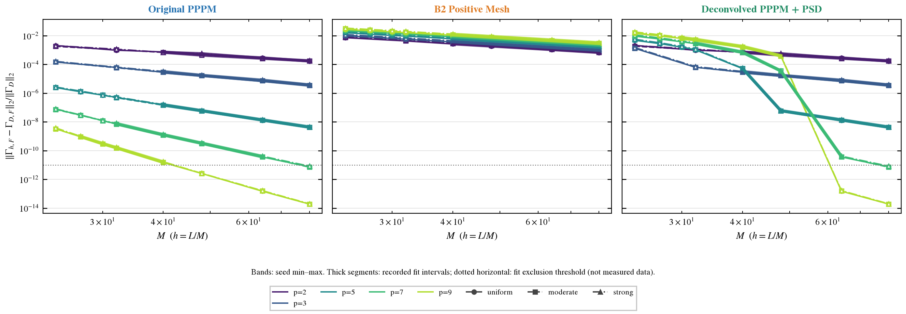

图 3：三方法多 p mesh-only 收敛；粗线为已记录拟合区间。

**mixed-transition 拟合不是收敛阶证书。** 若某个区间横跨投影从活跃到不活跃、负块修正迅速消失或误差抵消，formal log–log slope 可能非常大；这不表示获得超高阶。`mesh_rate_fits.csv` 保留该区间斜率以便审计，图中 mixed active/inactive 点为空心。局部相邻斜率与 above-floor 标志另见 `results/mesh_local_slopes.csv`；只有投影全不活跃、至少三个 above-floor 网格点的恢复区拟合另见 `results/mesh_inactive_rate_fits.csv`。若 p7/p9 在不活跃区迅速达到 reference/roundoff floor、只剩不足三个可用点，恢复阶必须记为 N/A，不能用过渡区大斜率补齐。

| 配置族 | p | 无投影拟合区间 M | 有效点数 | 恢复区实测 q | 状态 |
| --- | --- | --- | --- | --- | --- |
| uniform | 2 | 40–80 | 4 | 2.087 | measured projection-inactive interval |
| uniform | 3 | 40–80 | 4 | 2.961 | measured projection-inactive interval |
| uniform | 5 | 48–80 | 3 | 5.186 | measured projection-inactive interval |
| uniform | 7 | 64–64 | 1 | N/A | N/A: fewer than three decreasing inactive points above floor |
| uniform | 9 | N/A–N/A | 0 | N/A | N/A: fewer than three decreasing inactive points above floor |
| moderate | 2 | 40–80 | 4 | 1.938 | measured projection-inactive interval |
| moderate | 3 | 40–80 | 4 | 3.021 | measured projection-inactive interval |
| moderate | 5 | 48–80 | 3 | 5.154 | measured projection-inactive interval |
| moderate | 7 | 64–64 | 1 | N/A | N/A: fewer than three decreasing inactive points above floor |
| moderate | 9 | N/A–N/A | 0 | N/A | N/A: fewer than three decreasing inactive points above floor |
| strong | 2 | 40–80 | 4 | 2.04 | measured projection-inactive interval |
| strong | 3 | 40–80 | 4 | 3.023 | measured projection-inactive interval |
| strong | 5 | 48–80 | 3 | 5.118 | measured projection-inactive interval |
| strong | 7 | 64–64 | 1 | N/A | N/A: fewer than three decreasing inactive points above floor |
| strong | 9 | N/A–N/A | 0 | N/A | N/A: fewer than three decreasing inactive points above floor |


| method | family | p | Mlo | Mhi | order | n | floor | status |
| --- | --- | --- | --- | --- | --- | --- | --- | --- |
| PPPM-grid-PSD | uniform | 2 | 40 | 80 | 2.087 | 4 | 1e-11 | measured projection-inactive interval |
| PPPM-grid-PSD | uniform | 3 | 40 | 80 | 2.961 | 4 | 1e-11 | measured projection-inactive interval |
| PPPM-grid-PSD | uniform | 5 | 48 | 80 | 5.186 | 3 | 1e-11 | measured projection-inactive interval |
| PPPM-grid-PSD | uniform | 7 | 64 | 64 |  | 1 | 1e-11 | N/A: fewer than three decreasing inactive points above floor |
| PPPM-grid-PSD | uniform | 9 |  |  |  | 0 | 1e-11 | N/A: fewer than three decreasing inactive points above floor |
| PPPM-grid-PSD | moderate | 2 | 40 | 80 | 1.938 | 4 | 1e-11 | measured projection-inactive interval |
| PPPM-grid-PSD | moderate | 3 | 40 | 80 | 3.021 | 4 | 1e-11 | measured projection-inactive interval |
| PPPM-grid-PSD | moderate | 5 | 48 | 80 | 5.154 | 3 | 1e-11 | measured projection-inactive interval |
| PPPM-grid-PSD | moderate | 7 | 64 | 64 |  | 1 | 1e-11 | N/A: fewer than three decreasing inactive points above floor |
| PPPM-grid-PSD | moderate | 9 |  |  |  | 0 | 1e-11 | N/A: fewer than three decreasing inactive points above floor |
| PPPM-grid-PSD | strong | 2 | 40 | 80 | 2.04 | 4 | 1e-11 | measured projection-inactive interval |
| PPPM-grid-PSD | strong | 3 | 40 | 80 | 3.023 | 4 | 1e-11 | measured projection-inactive interval |
| PPPM-grid-PSD | strong | 5 | 48 | 80 | 5.118 | 3 | 1e-11 | measured projection-inactive interval |
| PPPM-grid-PSD | strong | 7 | 64 | 64 |  | 1 | 1e-11 | N/A: fewer than three decreasing inactive points above floor |
| PPPM-grid-PSD | strong | 9 |  |  |  | 0 | 1e-11 | N/A: fewer than three decreasing inactive points above floor |


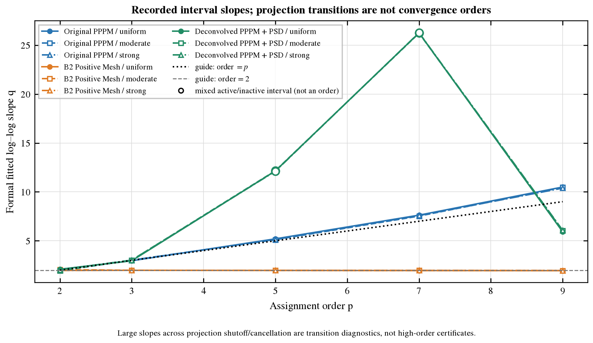

图 3b：各 p 的记录区间 formal slope；mixed-transition 不是收敛阶。


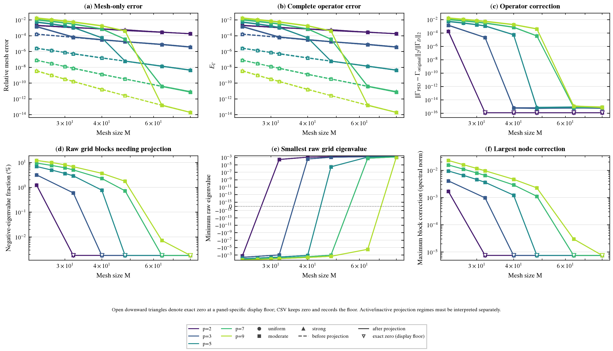

图 4：投影前后误差、实际粒子算子修正、负块比例与块修正；空心倒三角表示真零。

对数图中的 exact zero 使用单独的显示 floor，逐图 `plot_data/*.csv` 同时保留真实零与显示 floor。投影不活跃区的高阶、投影活跃区的有限区间斜率与任意参数高阶证书须分别陈述。


## 5. Experiment 2：固定误差约束下的实测选参


固定 N=256、rho=.75、kappa=.2、c=1，九个配置，主目标 epsilon=1e-4。三方法分别优化合法数值参数：原/新为 xi,sR,sF,M,p，B2 为 xi,sR,sT,M,p。采用历史 best 起点及 coarse→local→feasibility-boundary 搜索；short/Fourier Gaussian tail 以 sqrt(log(1/epsilon)) 提供量级，B2 参考实测正分配偏差，new 依据 `E_total≤E_original+E_proj` 逐点检查 correction；未先验强加新方案 h^p 或 h²。搜索的 t_screen 在 accuracy 任务并发负载下获得，只用于候选排序，不能与最终 serial 时间混用。

| 方法 | 独立新候选 | 失败候选 | coarse | local | boundary | cross/其它 | 完成九配置验证候选 |
| --- | --- | --- | --- | --- | --- | --- | --- |
| PPPM-original | 105 | 15 | 47 | 28 | 28 | 2 | 32 |
| B2-positive | 87 | 0 | 45 | 24 | 16 | 2 | 19 |
| PPPM-grid-PSD | 118 | 14 | 47 | 28 | 41 | 2 | 43 |


| 方法 | xi 搜索包络 | sR 搜索包络 | 专用 cutoff 包络 | M 搜索包络 | p 搜索包络 |
| --- | --- | --- | --- | --- | --- |
| PPPM-original | 0.325–1.75 | 2.6–4.8 | 2.6–4.8 | 15–64 | 2–9 |
| B2-positive | 0.2–1.45 | 2.85–4 | 16–42 | 15–128 | 2–5 |
| PPPM-grid-PSD | 0.325–1.75 | 2.6–4.8 | 2.6–4.8 | 12–64 | 2–9 |


包络不是穷举笛卡尔积；完整独立候选、失败原因和顺序见 `results/search.csv`。历史搜索预算与新预算不同，旧最佳仅作为初始知识；具体阶段计数如上。有限候选、局部与边界检查产生的是**最快已测值**，不构成全局最优证明。

| 方法 | 候选 id | 失败原因 |
| --- | --- | --- |
| PPPM-original | PPPM-original_xi1.25_sR3.3_sF3.3_M16_p3 | invalid original mesh: {'M': 16, 'h': 0.4367902323681494, 'mc': 9, 'eta': 1.14564392373896, 'valid': False, 'reason': 'Nyquist: largest retained \|m_a\| = 9 >= M/2 = 8', 't_mesh_build_s': 2.0583043806254864e-05} |
| PPPM-original | PPPM-original_xi1.25_sR3.3_sF3.3_M16_p5 | invalid original mesh: {'M': 16, 'h': 0.4367902323681494, 'mc': 9, 'eta': 1.14564392373896, 'valid': False, 'reason': 'Nyquist: largest retained \|m_a\| = 9 >= M/2 = 8', 't_mesh_build_s': 4.832982085645199e-06} |
| PPPM-original | PPPM-original_xi1.25_sR3.3_sF3.3_M16_p7 | invalid original mesh: {'M': 16, 'h': 0.4367902323681494, 'mc': 9, 'eta': 1.14564392373896, 'valid': False, 'reason': 'Nyquist: largest retained \|m_a\| = 9 >= M/2 = 8', 't_mesh_build_s': 7.541966624557972e-06} |
| PPPM-original | PPPM-original_xi1.5_sR3.3_sF3.3_M20_p3 | invalid original mesh: {'M': 20, 'h': 0.3494321858945195, 'mc': 11, 'eta': 1.1, 'valid': False, 'reason': 'Nyquist: largest retained \|m_a\| = 11 >= M/2 = 10', 't_mesh_build_s': 7.208087481558323e-06} |
| PPPM-original | PPPM-original_xi1.5_sR3.3_sF3.3_M20_p5 | invalid original mesh: {'M': 20, 'h': 0.3494321858945195, 'mc': 11, 'eta': 1.1, 'valid': False, 'reason': 'Nyquist: largest retained \|m_a\| = 11 >= M/2 = 10', 't_mesh_build_s': 5.749985575675964e-06} |
| PPPM-original | PPPM-original_xi1.5_sR3.3_sF3.3_M20_p7 | invalid original mesh: {'M': 20, 'h': 0.3494321858945195, 'mc': 11, 'eta': 1.1, 'valid': False, 'reason': 'Nyquist: largest retained \|m_a\| = 11 >= M/2 = 10', 't_mesh_build_s': 8.25000461190939e-06} |
| PPPM-original | PPPM-original_xi1.75_sR3.3_sF3.3_M24_p3 | invalid original mesh: {'M': 24, 'h': 0.29119348824543295, 'mc': 12, 'eta': 1.070436048222094, 'valid': False, 'reason': 'Nyquist: largest retained \|m_a\| = 12 >= M/2 = 12', 't_mesh_build_s': 1.154094934463501e-05} |
| PPPM-original | PPPM-original_xi1.75_sR3.3_sF3.3_M24_p5 | invalid original mesh: {'M': 24, 'h': 0.29119348824543295, 'mc': 12, 'eta': 1.070436048222094, 'valid': False, 'reason': 'Nyquist: largest retained \|m_a\| = 12 >= M/2 = 12', 't_mesh_build_s': 1.2459000572562218e-05} |
| PPPM-original | PPPM-original_xi1.75_sR3.3_sF3.3_M24_p7 | invalid original mesh: {'M': 24, 'h': 0.29119348824543295, 'mc': 12, 'eta': 1.070436048222094, 'valid': False, 'reason': 'Nyquist: largest retained \|m_a\| = 12 >= M/2 = 12', 't_mesh_build_s': 7.874914444983006e-06} |
| PPPM-grid-PSD | PPPM-grid-PSD_xi1.25_sR3.3_sF3.3_M16_p3 | invalid original mesh: {'M': 16, 'h': 0.4367902323681494, 'mc': 9, 'eta': 1.14564392373896, 'valid': False, 'reason': 'Nyquist: largest retained \|m_a\| = 9 >= M/2 = 8', 't_mesh_build_s': 8.750008419156075e-06} |
| PPPM-grid-PSD | PPPM-grid-PSD_xi1.25_sR3.3_sF3.3_M16_p5 | invalid original mesh: {'M': 16, 'h': 0.4367902323681494, 'mc': 9, 'eta': 1.14564392373896, 'valid': False, 'reason': 'Nyquist: largest retained \|m_a\| = 9 >= M/2 = 8', 't_mesh_build_s': 6.9999368861317635e-06} |
| PPPM-grid-PSD | PPPM-grid-PSD_xi1.25_sR3.3_sF3.3_M16_p7 | invalid original mesh: {'M': 16, 'h': 0.4367902323681494, 'mc': 9, 'eta': 1.14564392373896, 'valid': False, 'reason': 'Nyquist: largest retained \|m_a\| = 9 >= M/2 = 8', 't_mesh_build_s': 2.0167091861367226e-05} |
| PPPM-grid-PSD | PPPM-grid-PSD_xi1.5_sR3.3_sF3.3_M20_p3 | invalid original mesh: {'M': 20, 'h': 0.3494321858945195, 'mc': 11, 'eta': 1.1, 'valid': False, 'reason': 'Nyquist: largest retained \|m_a\| = 11 >= M/2 = 10', 't_mesh_build_s': 1.491699367761612e-05} |
| PPPM-grid-PSD | PPPM-grid-PSD_xi1.5_sR3.3_sF3.3_M20_p5 | invalid original mesh: {'M': 20, 'h': 0.3494321858945195, 'mc': 11, 'eta': 1.1, 'valid': False, 'reason': 'Nyquist: largest retained \|m_a\| = 11 >= M/2 = 10', 't_mesh_build_s': 1.2874952517449856e-05} |
| PPPM-grid-PSD | PPPM-grid-PSD_xi1.5_sR3.3_sF3.3_M20_p7 | invalid original mesh: {'M': 20, 'h': 0.3494321858945195, 'mc': 11, 'eta': 1.1, 'valid': False, 'reason': 'Nyquist: largest retained \|m_a\| = 11 >= M/2 = 10', 't_mesh_build_s': 9.541981853544712e-06} |
| PPPM-grid-PSD | PPPM-grid-PSD_xi1.75_sR3.3_sF3.3_M24_p3 | invalid original mesh: {'M': 24, 'h': 0.29119348824543295, 'mc': 12, 'eta': 1.070436048222094, 'valid': False, 'reason': 'Nyquist: largest retained \|m_a\| = 12 >= M/2 = 12', 't_mesh_build_s': 1.354096457362175e-05} |
| PPPM-grid-PSD | PPPM-grid-PSD_xi1.75_sR3.3_sF3.3_M24_p5 | invalid original mesh: {'M': 24, 'h': 0.29119348824543295, 'mc': 12, 'eta': 1.070436048222094, 'valid': False, 'reason': 'Nyquist: largest retained \|m_a\| = 12 >= M/2 = 12', 't_mesh_build_s': 1.8834020011126995e-05} |
| PPPM-grid-PSD | PPPM-grid-PSD_xi1.75_sR3.3_sF3.3_M24_p7 | invalid original mesh: {'M': 24, 'h': 0.29119348824543295, 'mc': 12, 'eta': 1.070436048222094, 'valid': False, 'reason': 'Nyquist: largest retained \|m_a\| = 12 >= M/2 = 12', 't_mesh_build_s': 2.6333029381930828e-05} |
| PPPM-original | PPPM-original_xi1.5_sR2.8_sF2.8_M18_p5 | invalid original mesh: {'M': 18, 'h': 0.3882579843272439, 'mc': 9, 'eta': 1.030402055055078, 'valid': False, 'reason': 'Nyquist: largest retained \|m_a\| = 9 >= M/2 = 9', 't_mesh_build_s': 1.425005029886961e-05} |
| PPPM-original | PPPM-original_xi1.5_sR2.8_sF2.8_M16_p5 | invalid original mesh: {'M': 16, 'h': 0.4367902323681494, 'mc': 9, 'eta': 1.1592023119369628, 'valid': False, 'reason': 'Nyquist: largest retained \|m_a\| = 9 >= M/2 = 8', 't_mesh_build_s': 9.334064088761806e-06} |
| PPPM-original | PPPM-original_xi1.5_sR2.8_sF3_M20_p5 | invalid original mesh: {'M': 20, 'h': 0.3494321858945195, 'mc': 10, 'eta': 0.9999999999999999, 'valid': False, 'reason': 'Nyquist: largest retained \|m_a\| = 10 >= M/2 = 10', 't_mesh_build_s': 1.2457952834665775e-05} |
| PPPM-grid-PSD | PPPM-grid-PSD_xi1_sR2.8_sF2.8_M12_p5 | invalid original mesh: {'M': 12, 'h': 0.5823869764908659, 'mc': 6, 'eta': 1.0274023338281628, 'valid': False, 'reason': 'Nyquist: largest retained \|m_a\| = 6 >= M/2 = 6', 't_mesh_build_s': 3.37500823661685e-05} |
| PPPM-grid-PSD | PPPM-grid-PSD_xi1_sR3.3_sF3.3_M14_p5 | invalid original mesh: {'M': 14, 'h': 0.49918883699217076, 'mc': 7, 'eta': 1.0400156984686455, 'valid': False, 'reason': 'Nyquist: largest retained \|m_a\| = 7 >= M/2 = 7', 't_mesh_build_s': 5.47909876331687e-05} |
| PPPM-grid-PSD | PPPM-grid-PSD_xi1_sR3.3_sF3.3_M12_p5 | invalid original mesh: {'M': 12, 'h': 0.5823869764908659, 'mc': 7, 'eta': 1.2133516482134197, 'valid': False, 'reason': 'Nyquist: largest retained \|m_a\| = 7 >= M/2 = 6', 't_mesh_build_s': 2.3082946427166462e-05} |
| PPPM-original | PPPM-original_xi1.5_sR3_sF2.8_M18_p5 | invalid original mesh: {'M': 18, 'h': 0.3882579843272439, 'mc': 9, 'eta': 1.030402055055078, 'valid': False, 'reason': 'Nyquist: largest retained \|m_a\| = 9 >= M/2 = 9', 't_mesh_build_s': 3.6499928683042526e-05} |
| PPPM-original | PPPM-original_xi1.5_sR3_sF2.8_M16_p5 | invalid original mesh: {'M': 16, 'h': 0.4367902323681494, 'mc': 9, 'eta': 1.1592023119369628, 'valid': False, 'reason': 'Nyquist: largest retained \|m_a\| = 9 >= M/2 = 8', 't_mesh_build_s': 7.999944500625134e-06} |
| PPPM-original | PPPM-original_xi1.5_sR3_sF3_M20_p5 | invalid original mesh: {'M': 20, 'h': 0.3494321858945195, 'mc': 10, 'eta': 0.9999999999999999, 'valid': False, 'reason': 'Nyquist: largest retained \|m_a\| = 10 >= M/2 = 10', 't_mesh_build_s': 1.3499986380338669e-05} |
| PPPM-grid-PSD | PPPM-grid-PSD_xi1.05_sR2.8_sF2.8_M12_p5 | invalid original mesh: {'M': 12, 'h': 0.5823869764908659, 'mc': 6, 'eta': 1.0801234497346435, 'valid': False, 'reason': 'Nyquist: largest retained \|m_a\| = 6 >= M/2 = 6', 't_mesh_build_s': 8.082948625087738e-06} |
| PPPM-grid-PSD | PPPM-grid-PSD_xi1_sR2.8_sF3_M12_p5 | invalid original mesh: {'M': 12, 'h': 0.5823869764908659, 'mc': 6, 'eta': 1.1055415967851332, 'valid': False, 'reason': 'Nyquist: largest retained \|m_a\| = 6 >= M/2 = 6', 't_mesh_build_s': 1.7999904230237007e-05} |


候选先在 uniform seed2 用完整 E_G 筛选；之后检查所有九配置，约束为 `max_configuration E_G≤epsilon`，不会以 probe 误差或平均误差放宽约束。数据文件区分 screen-pass、nine-config feasible 与 final common timed。


### 主 1e-4 档最快已测参数与同批时间


**两轮计时与候选交叉复核。** 第一轮 primary timing 的全部原始样本、参数表/配置 setup、组件、内存及协议完整保存在 `results/primary_timing/`。发现新方案 winner 的数值参数此前未被 Original 同样尝试后，增加 `Original @ grid-PSD winner` 的九配置准确性验证，并将三方法 primary best、原/B2 历史 anchor 与交叉候选纳入第二轮主 1e-4 confirmation。`results/` 根目录的 final_timing/best_configuration/components/paired ratios 是最终主档确认批次；本报告所有主档速度比、Pareto、setup/组件与摊销只读取这一轮。交叉复核让 Original 也获得相同的候选参数，避免把搜索路径差异当作投影算法本身的速度优势。

| 批次 | 用途 | 已计时候选数 | rounds×samples×configs | 原始正式样本行 | 协议预期行 |
| --- | --- | --- | --- | --- | --- |
| primary | secondary epsilon 与第一轮候选记录 | 15 | 5×7×9 | 4725 | 4725 |
| confirmation | 最终主 1e-4 比较 | 6 | 5×7×9 | 1890 | 1890 |


完整协议为 primary 15 候选 ×5×7×9=4725 条，随后主档 confirmation 6 候选 ×5×7×9=1890 条；上表读取实际保存数，在检查点时可能尚未齐全。primary 发现的新方案较快，不能直接归因于投影，因为 Original 在第一轮尚未覆盖该 winner 参数；最终主判定使用交叉后的第二轮。

| 同参数交叉方法 | 来自 primary grid winner 的参数 | 验证配置数 | max E_G | 最终批 matvec / ms | 状态 |
| --- | --- | --- | --- | --- | --- |
| PPPM-original | xi=1.025, sR=2.85, sF=3, M=15, p=5 | 9 | 4.99e-05 | 2.059 | 最终主档确认批 |
| PPPM-grid-PSD | xi=1.025, sR=2.85, sF=3, M=15, p=5 | 9 | 4.113e-05 | 1.823 | 最终主档确认批 |


| 参数来源 winner | 接受交叉参数的方法 | 九配置数 | max E_G | max E_proj | 主 1e-4 可行性 |
| --- | --- | --- | --- | --- | --- |
| PPPM-grid-PSD | PPPM-original | 9 | 4.99e-05 | 0 | 达标 |
| B2-positive | PPPM-original | 9 | 4.133e-05 | 0 | 达标 |
| PPPM-original | B2-positive | 9 | 0.01164 | 0 | 未达标 |
| PPPM-grid-PSD | B2-positive | 9 | 0.0163 | 0 | 未达标 |
| PPPM-original | PPPM-grid-PSD | 9 | 0.0005215 | 0.0005055 | 未达标 |
| B2-positive | PPPM-grid-PSD | 9 | 4.133e-05 | 0 | 达标 |


完整六个交叉候选及失败筛选点也完成九配置验证，见 `results/cross_winner_summary.csv`；该表的 source_winner 旧耗时与 t_screen 仅保留追溯信息，本报告没有将它们用作最终速度比。

| 方法 | xi | sR | 专用 cutoff | M | p | max E_G | max E_proj | 完整 matvec / ms | 最大相对 IQR |
| --- | --- | --- | --- | --- | --- | --- | --- | --- | --- |
| PPPM-original | 1.025 | 2.85 | sF=3 | 15 | 5 | 4.99e-05 | 0 | 2.059 | 0.6147 |
| B2-positive | 0.35 | 3.1 | sT=36 | 72 | 2 | 9.966e-05 | 0 | 61.41 | 0.3198 |
| PPPM-grid-PSD | 1.025 | 2.85 | sF=3 | 15 | 5 | 4.113e-05 | 1.734e-05 | 1.823 | 0.5101 |


上述时间来自同一 serial timing pass：5 rounds × 7 samples × 9 configs，单计算线程；目标统计量为 `median over nine configuration medians`。方法/候选 block 随机化，warmup 与逐样本原始时间见 `timing_protocol.json`、`final_timing_raw.csv`。

| 方法 | 参照 | 方法耗时 / 参照耗时 | 参照耗时 / 方法耗时（加速倍数） |
| --- | --- | --- | --- |
| PPPM-original | B2-positive | 0.03353 | 29.82 |
| B2-positive | PPPM-original | 29.82 | 0.03353 |
| PPPM-grid-PSD | PPPM-original | 0.8851 | 1.13 |
| PPPM-grid-PSD | B2-positive | 0.02968 | 33.69 |


这些比值仅由同批、相同最大误差约束下各自最佳已测配置计算；没有拼接旧硬件或旧负载的时间。

新方案主档最快已测候选 `PPPM-grid-PSD_xi1.025_sR2.85_sF3_M15_p5`：九配置验证记录 9 条，其中表投影活跃 9 条，max E_proj=1.734e-05，raw 最小特征值=-0.01379，post 最小特征值=-1.785e-17。这把最快区的投影状态与高精度 baseline 的状态分开检验。

最快表的 raw/post 实际谱诊断另由 `best_table_audit.py` 离线计算，见 `results/best_table_diagnostics.csv` 与 `best_projection_diagnostics.csv`；其中 offline_audit_t_* 不计入生产 setup，既有 E_G、E_proj 与 graph eigenvalue 不变。

| 方法 | 参照方法 | paired 耗时比 | 95% bootstrap 区间 | 配置-round blocks |
| --- | --- | --- | --- | --- |
| B2-positive | PPPM-original | 32.75 | [31.55, 34.55] | 45 |
| PPPM-grid-PSD | PPPM-original | 1.021 | [0.959, 1.064] | 45 |
| PPPM-grid-PSD | B2-positive | 0.03043 | [0.02886, 0.03277] | 45 |


paired ratio 是方法耗时/参照耗时；bootstrap 以同配置-round 的中位数比为 block，区间条件于已经完成的候选选择，不包含全搜索选择偏差。

**与 Original 的速度判断：** 配对耗时比为 1.021，95% 区间 [0.959, 1.064] 覆盖 1。两者在本模型与匹配参数下的缓存作用成本相近；不能用九配置中位数的中位数之比宣称投影更快。两个统计量聚合顺序不同，加上实测 IQR 与外部负载，可能给出不同点估计；所有原始样本均保留。


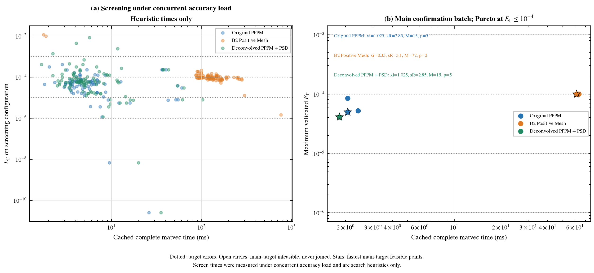

图 5：筛选误差-时间与九配置验证最大误差-时间；只连接主 1e-4 可行的实测非支配点。


### 额外精度档 frontier


| 目标 epsilon | 方法 | 最快完整 matvec / ms | max E_G | 参数摘要 | 状态 | timing_batch |
| --- | --- | --- | --- | --- | --- | --- |
| 1e-03 | PPPM-original | 1.409 | 0.0003797 | xi=1.5,sR=2.8,M=20,p=3 | 已测达标 | primary |
| 1e-03 | B2-positive | 46.21 | 0.0001389 | xi=0.375,sR=3.2,M=64,p=2 | 已测达标 | primary |
| 1e-03 | PPPM-grid-PSD | 1.669 | 4.113e-05 | xi=1.025,sR=2.85,M=15,p=5 | 已测达标 | primary |
| 1e-04 | PPPM-original | 2.059 | 4.99e-05 | xi=1.025,sR=2.85,M=15,p=5 | 已测达标 | main_confirmation |
| 1e-04 | B2-positive | 61.41 | 9.966e-05 | xi=0.35,sR=3.1,M=72,p=2 | 已测达标 | main_confirmation |
| 1e-04 | PPPM-grid-PSD | 1.823 | 4.113e-05 | xi=1.025,sR=2.85,M=15,p=5 | 已测达标 | main_confirmation |
| 1e-05 | PPPM-original | 3.397 | 3.841e-06 | xi=1,sR=3.3,M=16,p=7 | 已测达标 | primary |
| 1e-05 | B2-positive | 510.5 | 1.49e-06 | xi=0.2,sR=4,M=128,p=2 | 已测达标 | primary |
| 1e-05 | PPPM-grid-PSD | 4.162 | 1.517e-06 | xi=1,sR=3.8,M=24,p=5 | 已测达标 | primary |
| 1e-06 | PPPM-original | 6.646 | 6.69e-09 | xi=1,sR=4.2,M=32,p=7 | 已测达标 | primary |
| 1e-06 | B2-positive | N/A | N/A | N/A | no fully nine-configuration validated feasible candidate | primary |
| 1e-06 | PPPM-grid-PSD | 7.043 | 6.69e-09 | xi=1,sR=4.2,M=32,p=7 | 已测达标 | primary |


N/A 不插值、不外推时间、不放宽目标误差；有验证但未计时也不能算已经完成该档。

合并 frontier 的主 1e-4 行来自最终 confirmation，1e-3/1e-5/1e-6 行沿用完整归档的 primary timing；每一 epsilon 下三方法取同一批次。不同 epsilon 可能来自不同轮，图 6/7 标明 timing_batch；只在同 epsilon、同 batch 内计算速度比。主 Pareto 不从 secondary frontier 追加点，也不把 primary 与 confirmation 的 raw samples 混池。secondary 高成本 M128 等候选未在 confirmation 重跑。


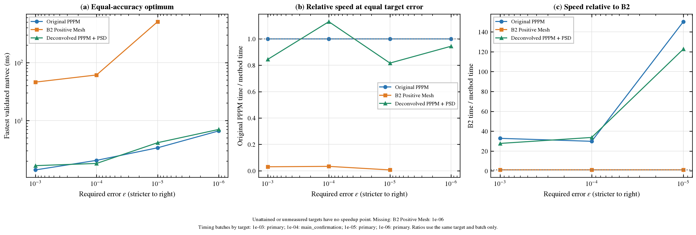

图 6：各精度档的最快已测时间与同批速度比。


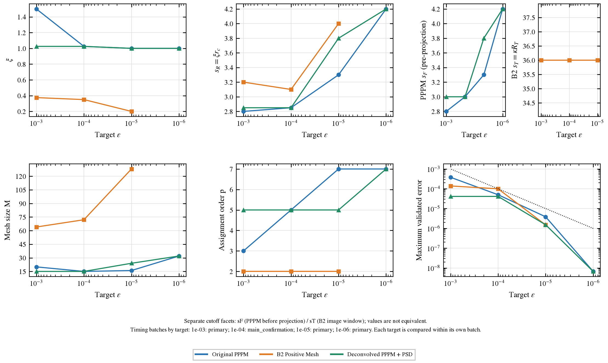

图 7：各档最快已测参数；专用 cutoff 不混同定义。


## 6. Setup、组件、内存与摊销


| 方法 | table setup / ms | config setup / ms | matvec / ms | 表数组 / MiB | 最大配置数组 / MiB | 最大临时数组估算 / MiB | 最大数组峰值估算 / MiB |
| --- | --- | --- | --- | --- | --- | --- | --- |
| PPPM-original | 3.628 | 5.221 | 2.059 | 0.2688 | 1.414 | 0.8661 | 2.549 |
| B2-positive | 357.5 | 179.9 | 61.41 | 26 | 25.59 | 45.82 | 97.41 |
| PPPM-grid-PSD | 18.2 | 6.285 | 1.823 | 0.8148 | 1.414 | 0.8661 | 3.095 |


参数表 setup 包含 new 的旧 influence、IFFT、d/−d symmetrization、投影必须的 batched eigh、negative-part projection 与修正 FFT；kernel primitive 预热条件对三者一致，另有 `common_kernel_setup_raw.csv`。reference、dense validation 与 eigen diagnostics 不进入 cached matvec。正式生产路径使用 `ProjectedMesh(audit_eigenvalues=False)`，关闭额外 raw/post eigvalsh 与分位数审计；投影必须的 eigh 与全部负谱修正仍执行。该路径与审计路径的 table、delta、Gr、degree/action 逐位一致性另有测试。77-table 的独立审计默认打开额外检查，其耗时不属于正式 setup。下表以本次 `table_setup_raw.csv` 的实际阶段字段核实诊断是否执行；不因历史审计耗时推断正式 setup。

| 新方案参数表阶段 | 中位数 / ms |
| --- | --- |
| 旧 influence | 3.9 |
| 原表 IFFT | 0.8227 |
| d/−d 对称化 | 0.2262 |
| 投影所需 batched eigh | 7.324 |
| negative-part/反演平均 | 0.6317 |
| 修正 FFT | 1.289 |
| 额外 raw/post eigen diagnostics | 0 |


本轮所有已记录参数表样本 `t_eigenvalue_diagnostics_s=0`：正式 setup 已排除可选 raw/post eigen 审计，上表总 setup 就是已实现生产路径的实测成本，包含投影所需 eigh；无须再扣除 77-table 独立审计或旧检查点的审计耗时。matvec 从不重复投影。

| 方法 | 组件 | 样本数 | 独立计时中位数 / ms | min–max / ms |
| --- | --- | --- | --- | --- |
| PPPM-original | fft_influence | 135 | 0.46 | 0.415–1.189 |
| PPPM-original | mesh | 135 | 1.127 | 0.8192–2.49 |
| PPPM-original | near | 135 | 0.6792 | 0.5337–2.423 |
| PPPM-original | spread_gather | 135 | 0.6068 | 0.3933–1.362 |
| PPPM-original | total | 135 | 1.906 | 1.355–4.403 |
| B2-positive | fft_influence | 135 | 29.01 | 22.05–45.67 |
| B2-positive | mesh | 135 | 30.03 | 23.5–150 |
| B2-positive | near | 135 | 28.55 | 25.82–39.15 |
| B2-positive | spread_gather | 135 | 0.8771 | 0.554–2.301 |
| B2-positive | total | 135 | 58.22 | 50.55–101.3 |
| PPPM-grid-PSD | fft_influence | 135 | 0.4534 | 0.4158–1.157 |
| PPPM-grid-PSD | mesh | 135 | 1.051 | 0.8063–2.203 |
| PPPM-grid-PSD | near | 135 | 0.6784 | 0.5467–1.595 |
| PPPM-grid-PSD | spread_gather | 135 | 0.5963 | 0.3942–1.672 |
| PPPM-grid-PSD | total | 135 | 1.89 | 1.418–3.898 |


near、spread/gather、FFT/influence、mesh、total 是分别计时的诊断，其中 mesh 与子阶段有包含关系；独立中位数不相加。内存按 unique owning NumPy allocations 计数，view/shared original influence 不重复算；临时与峰值为数组规模估算，不等同于单次实测 peak RSS。

| 方法 | 1 apply 总成本 / ms | 10 applies / ms | 100 applies / ms | 1000 applies / ms | 10000 applies / ms |
| --- | --- | --- | --- | --- | --- |
| PPPM-original | 10.91 | 29.44 | 214.8 | 2068 | 2.06e+04 |
| B2-positive | 598.8 | 1152 | 6679 | 6.195e+04 | 6.147e+05 |
| PPPM-grid-PSD | 26.31 | 42.71 | 206.8 | 1847 | 1.825e+04 |


摊销公式 `T_table+T_config+n_apply*T_matvec` 假定参数与位置固定；这是实测阶段成本的线性摊销推算，不是新增完整循环实测；数值另存 `results/amortization.csv`。若位置改变，配置 setup 失效并需重新支付；box/kappa/xi/M/投影前 cutoff 改变时，参数表也失效。Original 与新方案的去卷积还依赖 p；B2 的正表独立于 p，可通过 with_order 复用，但 assignment 与 degree 须重建。


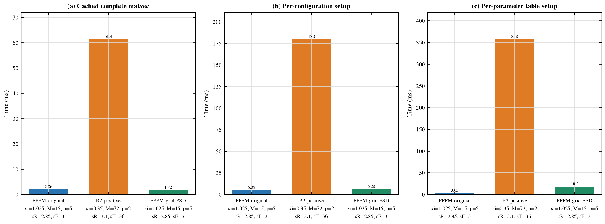

图 8：主 1e-4 档三方 complete action 与 setup 比较。


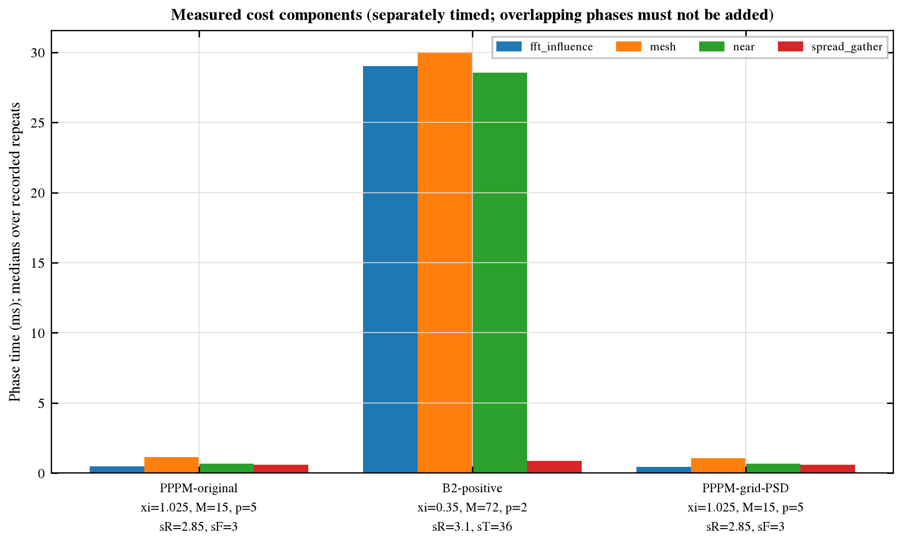

图 8b：主精度档各组件独立计时。

运行负载限制：Other system workloads remain active and are neither terminated nor controlled; see system_load.json, including chrome_crashpad when present.。逐轮系统负载和高 CPU 进程在 `results/system_load.json`；候选随机化与 paired blocks 有助于控制漂移，但不能消除外部负载不确定性。


## 7. 研究问题的证据边界


1. **新方案是否保证 long graph PSD？** 在精确算术、非负同权 spread/gather、对称新表与匹配 degree 下保证；上文给出结构证明。float64 的具体 residual 和 min eigenvalue 以已保存验证表为准。

2. **投影量多大？** 当前保存范围 max E_proj=0.04909；max 相对表 Fro 修正=0.1259。须结合 active/significant-negative 记录和 before/after 误差判断，不能把原误差当投影量上界。

3. **是否保阶？** p=2：新 q=1.938–2.087、原 q=1.938–2.087，新 fit 区域=inactive；p=3：新 q=2.961–3.023、原 q=2.961–3.023，新 fit 区域=inactive；p=5：新 q=12.11–12.16、原 q=5.11–5.202，新 fit 区域=mixed；p=7：新 q=26.22–26.27、原 q=7.527–7.623，新 fit 区域=mixed；p=9：新 q=5.915–6.077、原 q=10.38–10.5，新 fit 区域=active。上述 q 中 mixed-transition 值只是形式斜率，不能当作渐近收敛阶；投影 inactive 区间可与原 PPPM 对照，active 区间需单独看 correction。本实验不证明任意参数下始终高阶，也不把所有方案先验归为二阶。

4. **同精度最快已测时间？** 新方案 1.823 ms，Original 2.059 ms，B2 61.41 ms；新/Original 耗时比 0.8851，新/B2 耗时比 0.02968。这里只比较同批主 1e-4 约束下的最快已测配置。

primary 轮次中新方案相对 Original 的时间差受到搜索路径不同影响，不作为 PSD 投影本身加速的证据。Original @ grid winner 已通过独立九配置约束验证，其准确性与同批时间以上述交叉复核表及最终确认表为准。

5. **是否值得替代 B2？** 在本次主档 cached action 上，新方案更快；具体是否替代还取决于上表 setup/内存和位置更新频率，此结论限于所测模型、精度和硬件，不扩展为所有工作负载的推荐。


## 8. 未完成项与可恢复命令


主实验的上述可检查数据项已齐备；额外精度档仍按 frontier 中 N/A 状态逐项说明。

以下命令均从仓库根目录运行；accuracy/search 先完成并退出，再启动最终同批计时。accuracy 与 search 带检查点跳过已有点；计时若已有 final 输出会拒绝覆盖，复跑请使用新的 `--output` 目录并明确让绘图/报告读取该轮数据。


```bash
python3 benchmarks/method_A_clustered/validation_exp1/deconv_psd_comparison/test_grid_psd.py 2>&1 | tee benchmarks/method_A_clustered/validation_exp1/deconv_psd_comparison/results/tests_grid_psd.log
python3 benchmarks/method_A_clustered/validation_exp1/deconv_psd_comparison/run_accuracy.py sweeps --workers 2
python3 benchmarks/method_A_clustered/validation_exp1/deconv_psd_comparison/run_accuracy.py convergence --workers 2
python3 benchmarks/method_A_clustered/validation_exp1/deconv_psd_comparison/run_xi_sweep.py --workers 2
python3 benchmarks/method_A_clustered/validation_exp1/deconv_psd_comparison/run_search.py coarse
python3 benchmarks/method_A_clustered/validation_exp1/deconv_psd_comparison/run_search.py local
python3 benchmarks/method_A_clustered/validation_exp1/deconv_psd_comparison/run_search.py boundary
python3 benchmarks/method_A_clustered/validation_exp1/deconv_psd_comparison/table_audit.py
python3 benchmarks/method_A_clustered/validation_exp1/deconv_psd_comparison/merge_diagnostics.py
python3 benchmarks/method_A_clustered/validation_exp1/deconv_psd_comparison/analyze_regimes.py
# 等待 accuracy/reference/search workers 全部结束后：
python3 benchmarks/method_A_clustered/validation_exp1/deconv_psd_comparison/run_timing.py --rounds 5 --reps 7
python3 benchmarks/method_A_clustered/validation_exp1/deconv_psd_comparison/cross_winner.py
python3 benchmarks/method_A_clustered/validation_exp1/deconv_psd_comparison/archive_primary_timing.py
python3 benchmarks/method_A_clustered/validation_exp1/deconv_psd_comparison/run_timing.py --main-confirmation --rounds 5 --reps 7
python3 benchmarks/method_A_clustered/validation_exp1/deconv_psd_comparison/merge_frontiers.py
python3 benchmarks/method_A_clustered/validation_exp1/deconv_psd_comparison/plot_results.py
python3 benchmarks/method_A_clustered/validation_exp1/deconv_psd_comparison/report_generator.py
python3 benchmarks/method_A_clustered/validation_exp1/deconv_psd_comparison/finalize_audit.py
python3 benchmarks/method_A_clustered/validation_exp1/deconv_psd_comparison/report_generator.py
```


顺序执行和恢复也可使用 `run_all.py --workers 2`；该入口会跳过已保存 archive 与已完成 confirmation，避免再次移动归档或覆盖完整计时批次。阶段恢复参数见 README。

结果索引：`results/sweeps.csv`、`convergence.csv`、`mesh_rate_fits.csv`、`search.csv`、`xi_sweep.csv`（共同参数下的 xi 受控补充扫描）、`validation.csv`/`validation_summary.csv`、`final_timing_raw.csv`/`final_timing.csv`、`best_configuration.csv`、`frontier.csv`（按误差档合并；两批原始 frontier 位于 `accuracy_time_frontier.csv` 与 `primary_timing/accuracy_time_frontier.csv`）、`paired_speed_ratios.csv`、`table_setup_raw.csv`、`config_setup_raw.csv`、`components_raw.csv`、`memory.csv`、`timing_protocol.json`。`figures/plot_data/` 是逐图绘制统计源 CSV，`plot_status.json` 保留缺数据/跳图原因。

本报告未替换全局最优证明、任意参数高阶证书或跨模型结论；没有把未测结果、不可行点或外推时间写成实测。
