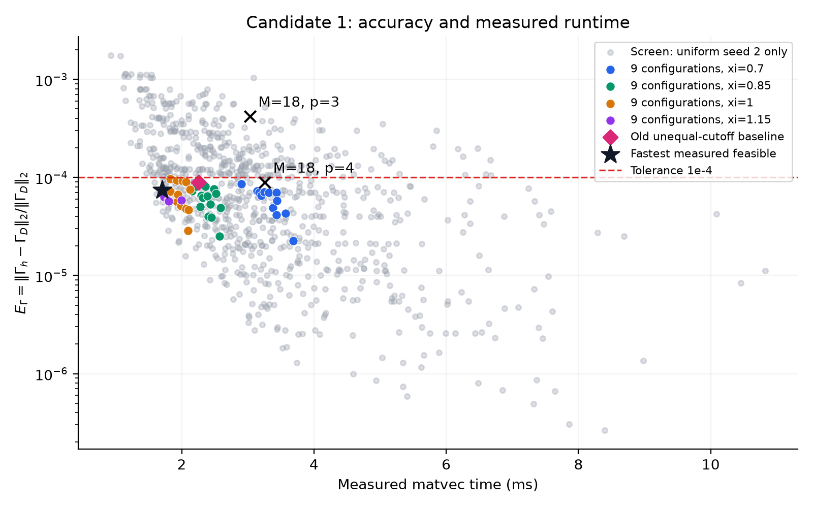
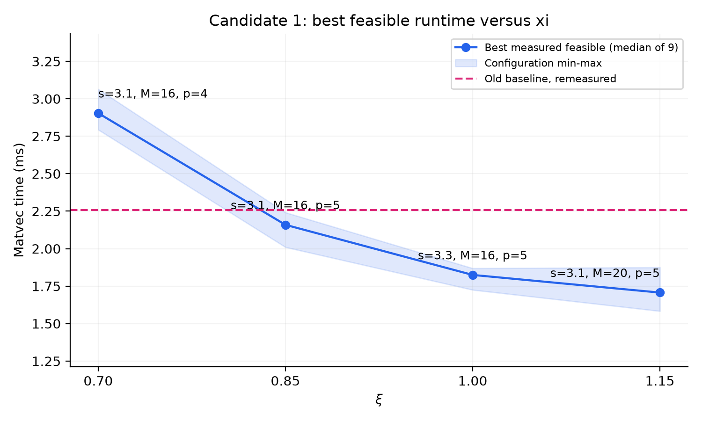

# Candidate 1 联合参数优化（EΓ ≤ 10⁻⁴）

最快实测可行参数为 **(s, ξ, M, p)=(3.1, 1.15, 20, 5)**，九组最大 EΓ=7.44174641e-05，matvec=1.706958 ms。

## 指定的小测试

| ξ | s_R=s_F 请求值 | M | p | 九组最大 EΓ | 达标数 | matvec 中位数 (ms) |
|---|---|---|---|---|---|---|
| .85 | 3.2 | 18 | 3 | 0.000418679882 | 0/9 | 3.030875 |
| .85 | 3.2 | 18 | 4 | 8.89195794e-05 | 9/9 | 3.255209 |

以上均为本次实际计算，误差来自完整稠密算子的谱范数，并非 action error 或旧图读数。小测试时间采用 2 warmup + 15 次重复。

## 物理条件、reference 与实现

- 仅 Candidate 1，θ=0，N=256、ρ=.75、κ=.7、c=1；原有 uniform/moderate/strong 各 seeds 1/2/3。
- 只使用 Γ_D。初始本地 exp_refs_c1 中仅有 strong seed1 的 κ=2 缓存，完整文件名搜索未发现所需九份 κ=.7 缓存。
- 先评估已有 references.csv：κ=.7 每份约 11–13 秒，R_D=55；因此只重建本次九份，未启动 Experiment 1 refs 全扫描。
- 通过原有 direct_periodic.annulus_tensors(g=exp(-.7*r)/r) 直接周期求和；R_D=55，保留与原实验相同的 8 个半径，记录收敛与解析尾界。
- 新建缓存只含 G_D 和收敛记录，位于 git-ignored 的 raw/exp_refs_c1；references.csv 保存位置 hash、缓存 SHA256、norm、实际耗时和截断误差界。
- 旧 CSV 的 norm 仅用于选择重建半径；所有本次误差均由重建的完整 Γ_D 矩阵计算。与旧 norm 的差异亦保存。
- 复用 E.MeshCache、E.ThetaOp、E.evaluate、C.median_time/C.tstats；搜索稠密组装复用 E.real_dense、mode_pair_matrix_fast 和 lap_full。
- E.evaluate 旧接口要求 GLF 参数，此处传入 Γ_D 两次，并删除 vsLF/ref_floor 兼容字段；未计算或使用 LatticeFriction reference。
- 没有修改 PPPM、B-spline、FFT、influence、邻居图、degree 或 self cancellation，也没有重新运行 Experiment 1/2。

## 搜索与自适应规则

- 按用户指定网格先 ξ=.85，再 ξ=.70/1.00/1.15，共 864 组请求参数。822 组 mesh 合法，473 组通过 uniform seed2 的精确谱误差初筛。
- s_R=s_F=s 是请求值；k_c 按原有 shell snapping，因此实现的 sF_eff 可能略小于 s。每个 CSV 均保留实际 cutoff。
- 每个 s 内优先小 p、小 M，检查所有 M（不会在第一个可行 M 停止）；非法 mesh 立即排除。
- 初筛失败只凭实际完整谱误差排除：单个配置超过门槛即无法满足九组约束。
- 对初筛通过者，在全部九组配置上各测 3 warmup + 7 次 matvec，用九个中位数的中位数排序。
- 每个 ξ 从实测最快者开始做完整九组 E.evaluate 验证；一组误差失败即停止该候选。至少保留三个可行候选，同时验证首个可行者初筛时间 1.20 倍内的所有候选。
- 所有完整可行候选进入串行随机交错终选计时：每配置 7 轮，每轮每候选 3 warmup + 7 次样本（49 次），每轮候选顺序随机化。
- 目标统计量是九个配置各自 matvec 中位数的中位数；最大误差必须对九个配置取最大值。单线程，无并行 worker。
- “最快”表示本次离散网格、自适应筛选与实测终选中的最快值；未把较大 M/p 的成本当作单调函数，也不声称连续参数全局最优。短计时排序存在噪声，20% 终选带用于降低漏选风险。

## 各 ξ 最佳可行配置

| ξ | s | M | p | sF_eff | 最大 EΓ | matvec (ms) | 总 setup (ms) | images 中位数 |
|---|---|---|---|---|---|---|---|---|
| 0.7 | 3.1 | 16 | 4 | 3.012106 | 8.59832902e-05 | 2.904125 | 13.677208 | 34832 |
| 0.85 | 3.1 | 16 | 5 | 3.083738 | 7.26055462e-05 | 2.159125 | 10.521625 | 19435 |
| 1 | 3.3 | 16 | 5 | 3.272615 | 9.73727283e-05 | 1.824708 | 9.902000 | 14701 |
| 1.15 | 3.1 | 20 | 5 | 3.077903 | 7.44174641e-05 | 1.706958 | 8.386250 | 8325 |

## 最佳候选的九组验证

| configuration | EΓ | matvec (ms) | min eigenvalue on Range(Π) | symmetry | momentum |
|---|---|---|---|---|---|
| uniform_N256_s2_rho0.75 | 6.7906611e-05 | 1.728042 | 2.73072656 | 2.07e-17 | 4.8e-18 |
| strong_N256_s1_rho0.75 | 6.42839582e-05 | 1.726917 | 2.14362577 | 1.97e-17 | 6.05e-18 |
| uniform_N256_s1_rho0.75 | 6.97159414e-05 | 1.596333 | 2.7052724 | 2.09e-17 | 5.41e-18 |
| uniform_N256_s3_rho0.75 | 6.94849192e-05 | 1.583417 | 2.76608729 | 2.09e-17 | 4.91e-18 |
| moderate_N256_s1_rho0.75 | 7.44174641e-05 | 1.590708 | 2.63938867 | 2.02e-17 | 5.01e-18 |
| moderate_N256_s2_rho0.75 | 6.85307064e-05 | 1.624625 | 2.54761233 | 2.04e-17 | 5.34e-18 |
| moderate_N256_s3_rho0.75 | 6.89170033e-05 | 1.706958 | 2.52369329 | 1.99e-17 | 5.17e-18 |
| strong_N256_s2_rho0.75 | 6.67222357e-05 | 1.875125 | 2.1419311 | 1.98e-17 | 5.61e-18 |
| strong_N256_s3_rho0.75 | 7.12528102e-05 | 1.716625 | 2.16987258 | 1.99e-17 | 6.09e-18 |

所有最终候选 mesh 均合法、PSD 均通过；最优候选 min λ=2.1419311，symmetry 最大 2.09e-17，momentum 最大 6.09e-18，matrix-free/dense 差异最大 2.35e-15。

## 与旧配置比较及速度原因

旧基准保留 (ξ,s_R,s_F,M,p)=(.85,3.2,3.1,18,4)。本次重算最大 EΓ=8.95728184e-05；同机随机交错 matvec=2.256958 ms。

最优候选相对本次旧基准 **1.32221×**，时间下降 **24.369%**。逐配置配对加速比中位数 1.32221×。

历史 1.87 ms 与本次最优时间的数值比为 1.09552×；历史与本次运行环境/负载可能不同，主要速度结论采用同机重测基准。

计时波动：最佳候选在九组配置上的最大样本相对 IQR 为 24.27%。次快的实测候选为 xi1.15_s3.2_sf3.2_M20_p5，时间 1.737542 ms，领先幅度 1.79%。因此最优标签指本次统计量最小者，不能把邻近候选的细微次序解释为跨运行环境稳定的性能结论。

| 候选 | s | ξ | M | p | images | real H (ms) | mesh H (ms) | matvec (ms) |
|---|---|---|---|---|---|---|---|---|
| xi0.7_s3.1_sf3.1_M16_p4 | 3.1 | 0.7 | 16 | 4 | 34832 | 2.133667 | 0.680750 | 2.904125 |
| xi0.85_s3.1_sf3.1_M16_p5 | 3.1 | 0.85 | 16 | 5 | 19435 | 1.159250 | 0.884000 | 2.159125 |
| xi1_s3.3_sf3.3_M16_p5 | 3.3 | 1 | 16 | 5 | 14701 | 0.893417 | 0.883541 | 1.824708 |
| xi1.15_s3.1_sf3.1_M20_p5 | 3.1 | 1.15 | 20 | 5 | 8325 | 0.526500 | 1.160792 | 1.706958 |
| old_baseline | 3.2 | 0.85 | 18 | 4 | 21359 | 1.337750 | 0.837458 | 2.256958 |

相对旧配置，最优候选 r_c 从 3.764706 变为 2.695652，images 中位数从 21359 变为 8325。实测 real H 从 1.337750 ms 变为 0.526500 ms；mesh H 从 0.837458 ms 变为 1.160792 ms。这两项的平衡决定完整 matvec 的实际速度。

real H 与 mesh H 是对原算子对应函数分别测量，二者中位数之和不要求精确等于独立测量的完整 matvec。p 的 spread/gather 成本约随 p³ 增长，FFT 成本依赖 M³ 及实际 FFT 因子；ξ 增大会减小 r_c=s/ξ 与 real-space images，却通常提高 mesh 精度需求。最终采用实际 matvec 排序。

最优候选 setup 分解：mesh=3.944458 ms、particle setup=4.456375 ms，总 setup=8.386250 ms。参数 kernel 首次初始化、reference 构建和稠密误差验证不属于 setup/matvec。setup 为三个独立构建的中位数；未使用 reference 缓存读取时间冒充 setup。

## 图与文件



灰点为 uniform seed2 初筛（单配置误差和时间），彩点为最终九组最大误差及九组运行时间；黑叉为指定小测试，星号为最佳候选。灰点不能解释为九组可行。



- results/search.csv：全部 864 组请求、mesh validity、初筛误差与时间；search_timing.csv：逐样本时间。
- results/validation.csv 与 validation_summary.csv：完整或遇失败提前停止的验证、九组完成标志。
- results/final_timing_raw.csv、final_setup_raw.csv：终选全部逐样本数据；final_timing.csv：逐配置统计。
- results/final_summary.csv、best_by_xi.csv、best_configuration.json：最终汇总。
- results/references.csv、reference_convergence.csv、provenance.json、commands.log、audit_checks.json 以及根目录 run.log：缓存来源、误差界、环境、命令和数据审计。
- 原 Experiment 1/2 文件不变；raw references 不纳入 Git。

## 重现

```sh
python3 benchmarks/method_A_clustered/validation_exp1/joint_parameter_optimization/run_joint_optimization.py all --rebuild-necessary-refs
python3 benchmarks/method_A_clustered/validation_exp1/joint_parameter_optimization/summarize_results.py
```

已有精确匹配缓存时不会重建。search/validate 自动续跑；要独立重复搜索，应将本目录 results 另存后运行。timing 阶段会重新计时并替换本次优化自身的计时文件。
