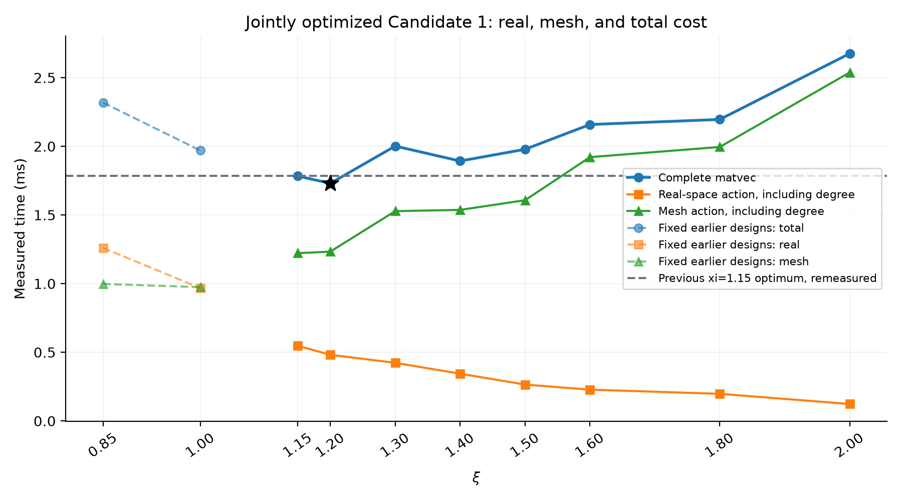
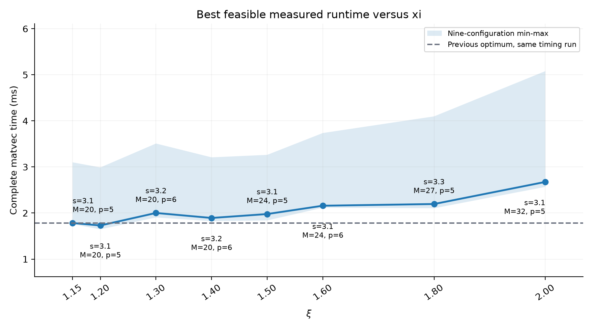
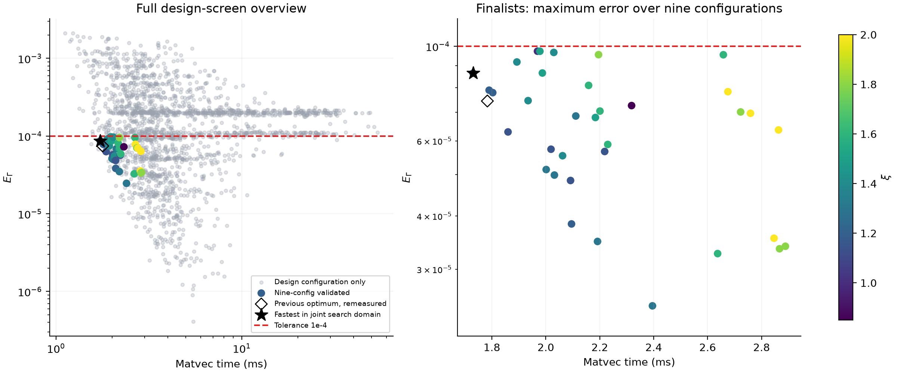

# Candidate 1：ξ 向右扩展的联合参数优化

本次联合搜索域内最快实测可行参数为 **(ξ,s,M,p)=(1.2,3.1,20,5)**，最大 EΓ=8.64831418e-05，完整 matvec=1.730084 ms。

近场=0.481458 ms，mesh=1.232833 ms，setup=10.484625 ms。

ξ=1.15 的旧最优固定为 (s,M,p)=(3.1,20,5)，同次交错重测=1.783250 ms；加速 **1.03073×**，耗时降低 2.981%。历史 1.707 ms 仅作来源记录，速度比采用本次重测。

逐配置配对加速比中位数=1.03732×；对九个配对配置重采样的 95% bootstrap 区间为 [1.00116, 1.04814]。该区间反映配置间变异，不代表所有系统负载下的保证。

最优 ξ 位于本次离散搜索内部。以下表格用于检查右侧回升；结果不构成连续参数全局最优证明。

## 每个 ξ 的最快可行组合

| ξ | s | M | p | sF_eff | max EΓ | real (ms) | mesh (ms) | complete (ms) | real/mesh |
|---|---|---|---|---|---|---|---|---|---|
| 1.15 | 3.1 | 20 | 5 | 3.077903 | 7.4417464e-05 | 0.547083 | 1.221542 | 1.783250 | 0.4479 |
| 1.2 | 3.1 | 20 | 5 | 3.089087 | 8.6483142e-05 | 0.481458 | 1.232833 | 1.730084 | 0.3905 |
| 1.3 | 3.2 | 20 | 6 | 3.188035 | 5.1406638e-05 | 0.423209 | 1.527584 | 2.001375 | 0.2770 |
| 1.4 | 3.2 | 20 | 6 | 3.194821 | 9.1861177e-05 | 0.343792 | 1.536750 | 1.892750 | 0.2237 |
| 1.5 | 3.1 | 24 | 5 | 3.099971 | 9.7341765e-05 | 0.264708 | 1.607250 | 1.978000 | 0.1647 |
| 1.6 | 3.1 | 24 | 6 | 3.090507 | 8.0968025e-05 | 0.227750 | 1.920917 | 2.158625 | 0.1186 |
| 1.8 | 3.3 | 27 | 5 | 3.294269 | 9.5568594e-05 | 0.197291 | 1.994917 | 2.195417 | 0.0989 |
| 2 | 3.1 | 32 | 5 | 3.098160 | 7.8253504e-05 | 0.123292 | 2.537416 | 2.675041 | 0.0486 |

## 近远场平衡

这里的“平衡”以完整实测 matvec 最小为准；两个部分的绝对时间相等不是优化的必要条件。增大 ξ 同时缩短实空间半径，并增加 Fourier modes 和满足精度所需的 mesh/assignment 成本。M、p 是离散变量，FFT 的实际成本还受网格因子影响。

本次各 ξ 最优点和固定诊断对照中，real/mesh 最接近 1 的点为 ξ=1（balance_control_xi1），比值 0.9923；其完整时间为全体最优的 1.1381 倍。 在联合搜索域 ξ≥1.15，各 ξ 的最佳点均由 mesh 占用更多时间；固定 ξ=1.0 对照接近等时，但完整时间更长。

| ξ 变化 | real 节省 (ms) | mesh 新增 (ms) | 完整时间变化 (ms) |
|---|---|---|---|
| 1.15 → 1.2 | 0.065625 | 0.011291 | -0.053166 |
| 1.2 → 1.3 | 0.058249 | 0.294751 | 0.271291 |
| 1.3 → 1.4 | 0.079417 | 0.009166 | -0.108625 |
| 1.4 → 1.5 | 0.079084 | 0.070500 | 0.085250 |
| 1.5 → 1.6 | 0.036958 | 0.313667 | 0.180625 |
| 1.6 → 1.8 | 0.030459 | 0.074000 | 0.036792 |
| 1.8 → 2 | 0.073999 | 0.542499 | 0.479624 |

从最快点 ξ=1.2 增至 1.3 时，real 节省 0.058249 ms，mesh 新增 0.294751 ms，完整 matvec 增加 0.271291 ms。这里已出现 mesh 新增成本超过近场节省的区域；各部分独立测量，差值不要求精确相加。

按追加要求继续检查 ξ=1.5 右侧：ξ=1.6 为 2.158625 ms（相对 ξ=1.5 耗时变化 +9.13%）；ξ=1.8 为 2.195417 ms（相对 ξ=1.5 耗时变化 +10.99%）；ξ=2 为 2.675041 ms（相对 ξ=1.5 耗时变化 +35.24%）。本次测试未发现更右侧的收益。

额外诊断对照采用上次已验证的固定设计，不在本次重新优化其 s/M/p。它们也重新通过了九组验证，并与本次候选在同一计时轮中测量。

| 固定对照 ξ | s | M | p | real (ms) | mesh (ms) | complete (ms) | real/mesh |
|---|---|---|---|---|---|---|---|
| 0.85 | 3.1 | 16 | 5 | 1.259792 | 0.997500 | 2.318000 | 1.2629 |
| 1 | 3.3 | 16 | 5 | 0.966792 | 0.974333 | 1.969084 | 0.9923 |

固定 s=3.1、M=20、p=5 的精度/合法性对照（初筛配置 uniform seed2），用于检查增大 ξ 后为何必须改变 M 或 p：

| ξ | mesh valid | 初筛 EΓ | 排除原因 |
|---|---|---|---|
| 1.15 | True | 6.7906611e-05 | 初筛通过 |
| 1.2 | True | 7.90565142e-05 | 初筛通过 |
| 1.3 | True | 0.000113205603 | infeasible: exact design error exceeds tolerance |
| 1.4 | True | 0.000167967059 | infeasible: exact design error exceeds tolerance |
| 1.5 | False | 未计算 | Nyquist: largest retained \|m_a\| = 10 >= M/2 = 10 |
| 1.6 | False | 未计算 | Nyquist: largest retained \|m_a\| = 11 >= M/2 = 10 |
| 1.8 | False | 未计算 | Nyquist: largest retained \|m_a\| = 12 >= M/2 = 10 |
| 2 | False | 未计算 | Nyquist: largest retained \|m_a\| = 13 >= M/2 = 10 |

real 和 mesh 各自包括 DS·X、Dm·X 的 degree 项。每轮随机化候选及三个计时 phase 的顺序；分别调用现有 op.real_H、mesh.apply 和 op.apply。显式验证 real(X)+mesh(X) 与完整 op.apply(X) 相对差小于 1e-12。独立测得的中位数不要求精确可加。

## 搜索、验证与计时方法

- 仅 θ=0，N=256、ρ=.75、κ=.7、c=1，原有 uniform/moderate/strong 各三个 seed。九份 Γ_D 的 SHA256 与上次一致，未重新计算 reference。
- ξ=[1.15, 1.2, 1.3, 1.4, 1.5, 1.6, 1.8, 2.0]；s=[2.9, 3.0, 3.1, 3.2, 3.3, 3.4, 3.5, 3.6, 3.8, 4.0]；M=[16, 18, 20, 22, 24, 27, 30, 32, 36, 40, 45, 48, 54, 60, 64]；p=[3, 4, 5, 6, 7]。共 6000 组请求，s_R=s_F=s，请求 Fourier cutoff 按原算法 snapping。
- 修改并复用原 run_joint_optimization.py 的搜索、验证与计时函数；未新增 run_xi_extension.py，未改 PPPM 算法。
- 先按实际单配置 matvec 时间筛选。最终复查时，只有 5 个样本的最短时间仍超过该 ξ 已知精度初筛通过者中位数的 2 倍，才跳过其稠密误差计算；记录 status=runtime pruned，不能将其理解为精度不合格。ξ≤1.6 初轮采用 1.6 倍中位数门槛，随后复查所有因此跳过的组合；search_prior_attempts.csv 保留初轮记录。追加的更右侧 ξ 直接采用最终门槛。
- 其余组合计算 uniform seed2 的完整谱误差；通过者按单配置速度取至少 32 个及最快者 1.4 倍内候选，在九组配置上测 7 次并按九组时间中位数排序。
- 每个 ξ 对九组时间最快者进行完整 E.evaluate 验证：至少三个可行者。各轮时间带见 provenance 快照；最终重新排名时覆盖首个可行者 1.12 倍时间范围。失败候选提前停止，不进入最终列表。
- 为避免批次负载漂移影响旧、新候选排名，重测全部精度初筛通过者的设计配置时间，再重测短名单的九组时间；不混用旧批次短名单时间。已经通过的精度验证可复用。
- 最终近邻复核合并每个 ξ 按当轮九组短名单时间、完整验证时间各前 2 个，以及上一完整终选中实测前 2 个，始终包含旧最优和两个固定诊断对照。与旧基准参数完全相同的候选合并为基准，避免将重复测量噪声误报成参数改进。
- 所有终选都满足九组最大 EΓ≤1e-4、mesh 合法、PSD、symmetry、momentum 及 matrix-free/dense 一致性。
- 最终复核采用单线程、串行；每个候选每配置 9 轮×11 次。每轮 phase 顺序随机；同一 phase 的每次重复内随机化候选顺序。每块先 3 warmup，每次单独测量前再 warmup 1 次，减少候选轮换导致的缓存差异。三个 phase 均保留逐样本数据。setup 独立构建三次，分别记录 mesh 和 particle setup。
- 目标统计量为九个配置各自中位数的中位数。自适应时间剪枝及有限网格会限制全局结论，全部跳过原因在 search.csv 中保留。

计时波动：最佳点最大相对 IQR=52.95%。相近候选的细小时间差应视为本次实测排序。ξ=1.15–1.2 构成低耗时区域；约 3% 的差距不足以支持唯一且精确的连续参数最优点结论。

## 最佳候选的九组结果

| configuration | EΓ | real (ms) | mesh (ms) | complete (ms) | λmin on Range(Π) |
|---|---|---|---|---|---|
| uniform_N256_s2_rho0.75 | 7.90565142e-05 | 0.620041 | 1.881333 | 2.989041 | 2.73073348 |
| strong_N256_s1_rho0.75 | 8.35280829e-05 | 0.827250 | 1.549750 | 2.864041 | 2.14362653 |
| uniform_N256_s1_rho0.75 | 8.25476784e-05 | 0.442333 | 1.230834 | 1.692250 | 2.70527067 |
| uniform_N256_s3_rho0.75 | 8.41336768e-05 | 0.453458 | 1.187834 | 1.645875 | 2.76610766 |
| moderate_N256_s1_rho0.75 | 8.58775355e-05 | 0.470625 | 1.223333 | 1.722750 | 2.63939279 |
| moderate_N256_s2_rho0.75 | 7.93972974e-05 | 0.480709 | 1.243375 | 1.797542 | 2.54763196 |
| moderate_N256_s3_rho0.75 | 7.74252443e-05 | 0.481458 | 1.209959 | 1.701250 | 2.52371273 |
| strong_N256_s2_rho0.75 | 7.77885647e-05 | 0.503416 | 1.232833 | 1.730084 | 2.14192775 |
| strong_N256_s3_rho0.75 | 8.64831418e-05 | 0.534125 | 1.343125 | 1.930041 | 2.16987214 |

最佳候选 symmetry≤2.2e-17，momentum≤5.8e-18，matrix-free/dense≤2.3e-15。

## 图与数据







results/ 保存 search.csv、search_timing.csv、validation.csv、validation_summary.csv、final_timing_raw.csv、final_setup_raw.csv、final_timing.csv、final_summary.csv、best_by_xi.csv、near_far_tradeoffs.csv、best_configuration.json、references.csv、reference_convergence.csv、provenance.json、audit_checks.json。

先前完整计时保存在 timing_pass_*，因用户追加更右侧搜索而停止的中间六点计时保存在 timing_partial_*，转接记录为 right_extension_transition.json。结论只使用根目录 final_timing* 的最终共同计时，不能把中间轮次样本混合为独立重复。

上次的 24 份 CSV/JSON/报告/图/log 均已逐文件核验 SHA256 保持不变。本次输出目录独立，historical_artifact_hashes.json 保存清单。

## 重现命令

```sh
python3 benchmarks/method_A_clustered/validation_exp1/joint_parameter_optimization/run_joint_optimization.py all --xi-extension --runtime-prune-factor 2 --include-balance-controls --xis 1.15 1.2 1.3 1.4 1.5 1.6 1.8 2.0 --output-dir benchmarks/method_A_clustered/validation_exp1/joint_parameter_optimization/xi_extension_20261023
python3 benchmarks/method_A_clustered/validation_exp1/joint_parameter_optimization/run_joint_optimization.py validate timing --xi-extension --runtime-prune-factor 2 --refresh-shortlist-times --validation-band 1.12 --finalists-per-xi 2 --timing-top-measured 2 --include-balance-controls --xis 1.15 1.2 1.3 1.4 1.5 1.6 1.8 2.0 --output-dir benchmarks/method_A_clustered/validation_exp1/joint_parameter_optimization/xi_extension_20261023
python3 benchmarks/method_A_clustered/validation_exp1/joint_parameter_optimization/summarize_results.py --xi-extension --output-dir benchmarks/method_A_clustered/validation_exp1/joint_parameter_optimization/xi_extension_20261023
```

实际命令见 results/commands.log。若扩大 ξ 范围，实际网格以 provenance.json 为准。重复 timing 会将上一轮新实验计时存入 timing_pass_* 子目录。
