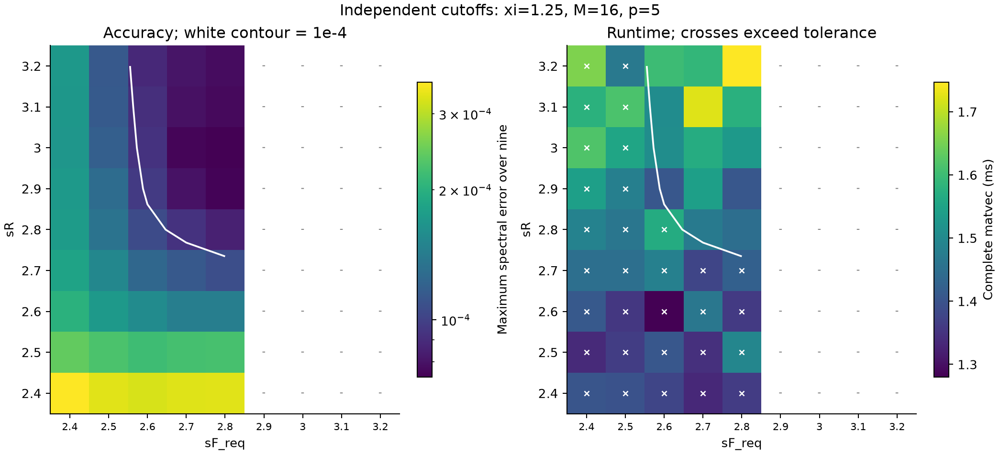
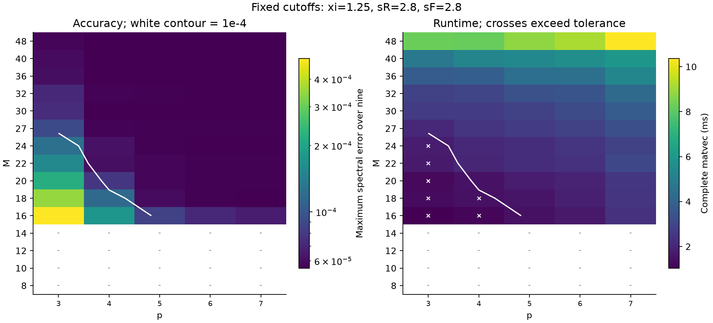
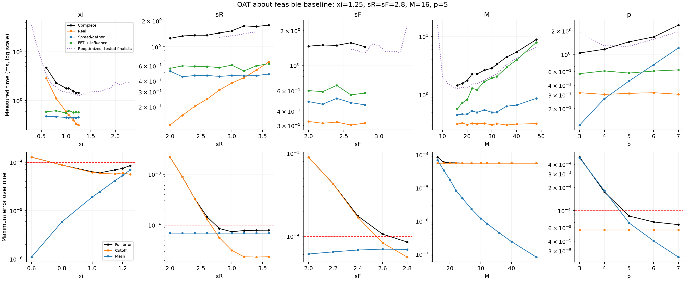
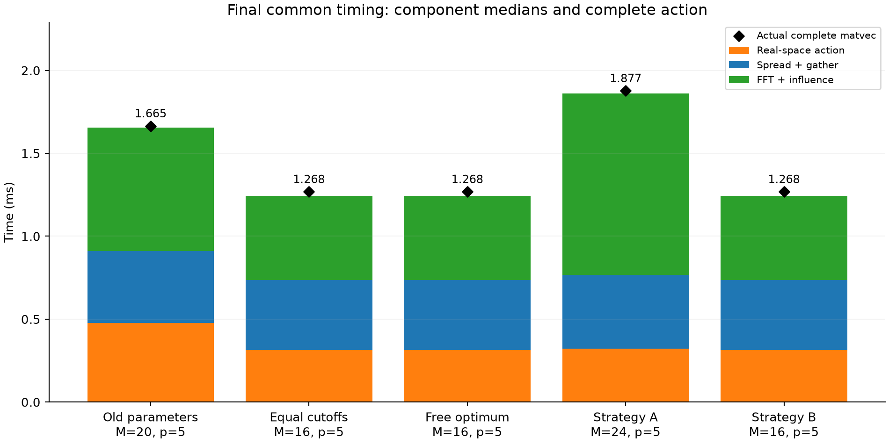

# κ=0.2：理论指导、精度约束的联合参数优化

本次最快 tested-grid configuration 为 **(ξ,sR,sF_req,M,p)=(1.25,2.8,2.8,16,5)**；实际 sF_eff=2.7623135，最大 EΓ=8.51354478e-05，cached complete matvec=1.268417 ms。这是自适应离散搜索中的实测最优，未证明全局最优。

固定 Candidate 1（θ=0）、N=256、ρ=0.75、κ=0.2、c=1；使用原九组粒子位置。所有比较使用新生成的 κ=0.2 独立 unsplit direct periodic Γ_D。κ=0.7 的旧矩阵和历史 1.730 ms/8.65e-5 未用于本次精度或加速比。

## 三个主要对照

| 对照 | ξ | sR | sF_req / effective | M | p | max EΓ | real ms | mesh ms | complete ms | setup ms |
|---|---|---|---|---|---|---|---|---|---|---|
| 旧参数在κ=.2重测 | 1.2 | 3.1 | 3.1 / 3.089087 | 20 | 5 | 1.5154272e-05 | 0.478500 | 1.185708 | 1.665167 | 9.988666 |
| 强制sR=sF | 1.25 | 2.8 | 2.8 / 2.762313 | 16 | 5 | 8.5135448e-05 | 0.312625 | 0.946416 | 1.268417 | 9.604292 |
| 五参数独立 | 1.25 | 2.8 | 2.8 / 2.762313 | 16 | 5 | 8.5135448e-05 | 0.312625 | 0.946416 | 1.268417 | 9.604292 |

旧参数在本次物理条件下满足精度。自由搜索相对旧参数加速 1.31279×，耗时变化 -23.826%；相对本次等 cutoff 最佳配置加速 1.00000×。

## Reference、核和理论初始化

现有本地副本中未发现 κ=.2 缓存，因此只生成九份必要 reference。每份调用原 direct_periodic.annulus_tensors，以 g(r)=exp(-.2r)/r 直接累加到 R_D=190，并保存八个半径的收敛记录和认证尾界≤1e-13。三进程构建，各进程单线程；所有构建任务结束后才进行最终计时。新旧物理状态的 cache key 不同，加载时核对 κ、c、位置 hash 和来源。历史 κ=.2 的范数仅用于选取求和半径和事后交叉核对，没有替代矩阵数据。

理论公式、条件及 Landau/Fast DPD 文稿适用范围见 stage1_theory.md。Landau 原文控制自由空间系数误差，其结论不能直接转化为周期谱算子证书。本次没有固定三项预算，也没有用保守理论界永久排除候选。

生产 Fourier 系数与加密积分、短程闭式与积分的数值一致性见 coefficient_audit.json。最终候选的 BR/BF/BM、真实 Γ_D 归一化及对角块下界见 final_theory_bounds.csv；quadrature 项是数值估计。

## 实际误差分解

| 最佳候选，九组分别取最大值 | relative spectral norm |
|---|---|
| E_R | 4.55231927e-05 |
| E_F | 2.3871674e-05 |
| E_M | 6.93030271e-05 |
| E_cutoff | 5.61137534e-05 |
| E_G | 8.51354478e-05 |
| far_split_residual | 3.78053721e-15 |

ER 使用 sR_far=8 的直接短程算子；EF 使用 sF_far≈7 的独立 mesh-free Fourier 算子作为无限 cutoff 的数值近似。无限极限的分割重构残差已记录并检查<1e-10。EM 严格比较同一 rc、kc 和同一 reciprocal shells 上的 PPPM 与 mesh-free 算子。Ecutoff 则直接比较该 mesh-free 总算子与独立 Γ_D。

error_decomposition.csv 同时保存矩阵误差相加的 telescope residual、ER+EF+EM 与真实总误差的比值。不同配置的最大值可能出现在不同配置上；谱范数的和不等于总误差，不能通过相减标量误差来推断某个分量。

## 降低 M、p：两种策略

以下两点固定同一个 ξ、sR、sF，只改变 M、p。Strategy A 在实测可行点中要求 max EM≤0.1 max Ecutoff；Strategy B 采用该 M/p 平面在最终共同计时中最快的已测可行点。最终性能均来自共同交错计时。

| 策略 | M | p | max Ecutoff | max EM | max EΓ | spread/gather ms | FFT ms | mesh ms | complete ms |
|---|---|---|---|---|---|---|---|---|---|
| A | 24 | 5 | 5.6113753e-05 | 4.9334121e-06 | 5.6545392e-05 | 0.444417 | 1.093292 | 1.546417 | 1.877125 |
| B | 16 | 5 | 5.6113753e-05 | 6.9303027e-05 | 8.5135448e-05 | 0.425000 | 0.506750 | 0.946416 | 1.268417 |

B 相对 A 的 mesh 耗时降低 38.799%，完整加速 1.47990×；总误差增加 +2.8590056e-05。这些数字才是固定 cutoff 的 mesh 分辨率收益，不能把五参数全部调整后的速度差都归因于 M/p。

各 p 的最小已测可行 M 与最快 M：

| p | 最小已测可行 M | 最快已测 M | max EΓ | complete ms（诊断批次） |
|---|---|---|---|---|
| 3 | 27 | 27 | 9.0642644e-05 | 2.085375 |
| 4 | 20 | 20 | 7.8959429e-05 | 1.506250 |
| 5 | 16 | 16 | 8.5135448e-05 | 1.448250 |
| 6 | 16 | 16 | 7.118851e-05 | 1.675458 |
| 7 | 16 | 16 | 6.5784394e-05 | 2.374041 |

Plateau 诊断采用显式阈值：EM≤0.1 Ecutoff 且 |EΓ/Ecutoff−1|≤10%；EM≥0.2 Ecutoff 标记为开始显著。这里使用各量九组最大值的比值作为平面摘要，逐配置数据另存。

| p | cutoff plateau 的 M | mesh 显著影响区的 M | 精度超标的 M |
|---|---|---|---|
| 3 | 无 | 16;18;20;22;24;27;30;32;36;40;48 | 16;18;20;22;24 |
| 4 | 36;40;48 | 16;18;20;22;24;27 | 16;18 |
| 5 | 24;27;30;32;36;40;48 | 16;18;20 | 无 |
| 6 | 22;24;27;30;32;36;40;48 | 16;18 | 无 |
| 7 | 20;22;24;27;30;32;36;40;48 | 16 | 无 |

允许 ξ、sR、sF 重新调整后的 order 对照如下。“最小 M”来自全部九组验证通过的搜索点；“最快”来自最终共同计时，二者不是同一目标。

| p | 全搜索最小已测可行 M | 共同计时最快 (ξ,sR,sF_req,M) | max EΓ | complete ms |
|---|---|---|---|---|
| 3 | 12 | (1.25,2.8,2.8,27) | 9.0642644e-05 | 1.898166 |
| 4 | 8 | (1.3,2.8,3.3,20) | 9.2633302e-05 | 1.289458 |
| 5 | 8 | (1.25,2.8,2.8,16) | 8.5135448e-05 | 1.268417 |
| 6 | 10 | (1.25,2.8,2.8,16) | 7.118851e-05 | 1.565458 |
| 7 | 10 | (1.25,2.8,2.8,16) | 6.5784394e-05 | 1.955709 |

上表限定固定 baseline 的 cutoff 平面，最小 M 是已测试离散值，不是所有整数或所有 cutoff 的理论最小值。M/p heatmap 与数据包含不合法和误差超标的点，未将它们选择性删除。高分辨率 EΓ 是否趋近 Ecutoff、低分辨率 EM 是否开始占据误差余量，可直接从图 2/3 及 mesh_tradeoff.csv 检查。

## OAT 与重新优化的敏感性

OAT 保持 baseline 的其余四个参数固定；每个合法点完整检查九组误差，计量 real、spread/gather、FFT+influence、mesh total 和 complete。parameter_sensitivity.csv 保存参数相对变化、节省毫秒和相对耗时变化。Reoptimized sensitivity 使用最终共同计时的全部可行候选，固定一个参数值后取其余参数已测组合中的最低成本；它不是每个连续参数值的全局重优化。两类曲线在图 3 中分别显示。

| 参数 | OAT可行点的最佳相对耗时改善 | 对应绝对节省 ms | 测试范围 |
|---|---|---|---|
| xi | 0.702% | 0.010167 | 0.6–2 |
| sR | -0.000% | -0.000000 | 2–3.6 |
| sF | -0.000% | -0.000000 | 2–3.6 |
| M | -0.000% | -0.000000 | 8–48 |
| p | -0.000% | -0.000000 | 3–7 |

在本次指定 OAT 范围内，最大可行降时来自 xi；这不是对不同单位的数值导数排名，采样跨度和离散合法性会影响结论。此处不足1%的名义改善小于本轮计时波动，不能据此认定 ξ 微调产生确定加速。

各 OAT 曲线合法端点的工作量与耗时变化如下。端点可能精度超标，误差列明确保留；上面的“最佳改善”表只使用满足精度的点。

| 参数 | 合法端点 | 近场 images | retained modes | real ms | spread/gather ms | FFT ms | max EΓ |
|---|---|---|---|---|---|---|---|
| xi | low=0.6 | 40688 | 203 | 2.86996 | 0.47604 | 0.58979 | 0.0001271193 |
| xi | high=1.25 | 4822 | 1935 | 0.31492 | 0.45337 | 0.57412 | 8.513545e-05 |
| sR | low=2 | 1718 | 1935 | 0.12371 | 0.52200 | 0.56162 | 0.002166655 |
| sR | high=3.6 | 10058 | 1935 | 0.66671 | 0.48267 | 0.63633 | 7.907122e-05 |
| sF | low=2 | 4822 | 739 | 0.32567 | 0.48425 | 0.60304 | 0.0008978348 |
| sF | high=2.8 | 4822 | 1935 | 0.31492 | 0.45337 | 0.57412 | 8.513545e-05 |
| M | low=16 | 4822 | 1935 | 0.31492 | 0.45337 | 0.57412 | 8.513545e-05 |
| M | high=48 | 4822 | 1935 | 0.32063 | 0.86725 | 7.86867 | 5.611451e-05 |
| p | low=3 | 4822 | 1935 | 0.32108 | 0.12329 | 0.56450 | 0.0004953422 |
| p | high=7 | 4822 | 1935 | 0.30667 | 1.20829 | 0.63075 | 6.578439e-05 |

ξ 的 OAT 保持 M、p 固定：rc=sR/ξ 缩短、retained modes 增加，但 FFT 仍在同一完整 M³ 网格上执行，不能据此声称其 FFT 工作量按 ξ³ 增加。重新优化的 ξ 曲线才包含为满足精度/Nyquist 而提高 M/p 的阶梯成本。sR 直接改变 images 和 real 时间；sF 改变误差、modes 及最小合法 M，在固定 M/p 的完整网格 FFT 中不产生对应的稀疏 FFT 加速。M 改变网格工作量而固定 p³ stencil 大小；p 改变 spread/gather 工作量及 transfer error，而固定 M 下 FFT 尺寸不变。实际变化量以上表和完整 OAT 数据为准。

## 成本模型与瓶颈

以非负最小二乘拟合 TR≈CR Npairs+C0R、Tspread/gather≈CP Np³+C0P、TFFT≈CF M³log(M³)+C0F。FFT 计时包含 influence 乘法和 inverse FFT。模型只解释本实现的实测成本，不能代替目标函数。

| phase | 秒/工作量系数 | 固定秒数 | R² | 相对残差中位数 |
|---|---|---|---|---|
| real | 6.828996e-08 | 0 | 0.9596 | 0.0726 |
| spread_gather | 1.487965e-08 | 4.44908e-05 | 0.8340 | 0.1265 |
| fft | 5.348837e-09 | 0.0004663135 | 0.9690 | 0.1191 |

最快候选：real=0.312625 ms，spread/gather=0.425000 ms，FFT+influence=0.506750 ms，mesh total=0.946416 ms。real/mesh=0.3303，主要被测阶段为 FFT+influence。

旧参数的最大被测阶段为 FFT+influence，优化后为 FFT+influence。最终计时中 real/mesh 最接近1的可行点是 (ξ,sR,sF_req,M,p)=(0.9,2.8,2.8,16,4)，比值 1.0055，完整 1.555083 ms，为最快时间的 1.2260 倍。

组件的独立中位数不要求精确相加。real 与 mesh total 各含对应的缓存 degree 乘法；spread/gather 和 FFT 不含 degree。用于组件计时的表达式逐项复用原 Mesh.apply，并与原 mesh.apply 校验；优化指标始终是未经改写的 op.apply cached action。

重新优化后的 ξ 切片（每个 ξ 只取最终计时中最快的已测可行组合）：

| ξ | sR | sF_req | M | p | real ms | mesh ms | complete ms |
|---|---|---|---|---|---|---|---|
| 0.3 | 2.9 | 3 | 12 | 4 | 34.580417 | 0.580458 | 34.991792 |
| 0.4 | 2.9 | 3.1 | 12 | 4 | 13.391750 | 0.582250 | 14.068709 |
| 0.5 | 2.9 | 3 | 12 | 4 | 5.844334 | 0.583292 | 6.712292 |
| 0.6 | 2.8 | 3.4 | 12 | 4 | 2.634791 | 0.581125 | 3.281208 |
| 0.7 | 2.8 | 3.4 | 12 | 4 | 1.592792 | 0.582750 | 2.228416 |
| 0.8 | 2.8 | 2.9 | 12 | 5 | 1.084875 | 0.773084 | 1.878875 |
| 0.9 | 2.8 | 2.8 | 16 | 4 | 0.761709 | 0.757542 | 1.555083 |
| 1 | 3 | 3 | 16 | 4 | 0.702375 | 0.753291 | 1.479625 |
| 1.05 | 2.8 | 2.8 | 16 | 5 | 0.495625 | 0.945584 | 1.467333 |
| 1.1 | 2.9 | 2.8 | 14 | 5 | 0.493541 | 0.876084 | 1.381584 |
| 1.15 | 2.8 | 2.8 | 16 | 5 | 0.379166 | 0.941792 | 1.362583 |
| 1.2 | 2.9 | 2.7 | 16 | 5 | 0.396542 | 0.943416 | 1.348458 |
| 1.25 | 2.8 | 2.8 | 16 | 5 | 0.312625 | 0.946416 | 1.268417 |
| 1.3 | 2.8 | 3.3 | 20 | 4 | 0.285500 | 0.994958 | 1.289458 |
| 1.35 | 2.8 | 2.8 | 18 | 5 | 0.249208 | 1.094042 | 1.360625 |
| 1.4 | 2.8 | 2.8 | 18 | 5 | 0.238458 | 1.095500 | 1.356083 |
| 1.5 | 2.9 | 2.9 | 22 | 4 | 0.209958 | 1.308458 | 1.530625 |
| 1.6 | 2.8 | 3.1 | 24 | 4 | 0.161750 | 1.351750 | 1.539208 |
| 1.7 | 3.1 | 2.7 | 24 | 4 | 0.190917 | 1.350083 | 1.538792 |
| 1.8 | 2.9 | 2.9 | 24 | 5 | 0.131458 | 1.545416 | 1.692625 |
| 1.9 | 2.8 | 2.8 | 27 | 4 | 0.103708 | 1.692542 | 1.802333 |
| 2 | 3.1 | 3.1 | 32 | 4 | 0.115417 | 2.205833 | 2.327292 |
| 2.1 | 2.9 | 2.9 | 30 | 4 | 0.088375 | 2.000791 | 2.096917 |
| 2.2 | 3 | 3.1 | 32 | 4 | 0.087875 | 2.216167 | 2.324375 |
| 2.3 | 3 | 3.1 | 32 | 4 | 0.082291 | 2.237375 | 2.301750 |

实际搜索 ξ 范围 0.3–2.4。最佳 ξ=1.25 位于已搜索范围内部；这些非穷举切片可显示右侧成本回升或阶梯变化，但不证明连续问题的全局最小值。

## 搜索、验证与计时方法

搜索共记录 5112 个不同请求，其中 262 个通过全部九组精度；最终 53 个物理候选进入共同长计时。报告的最快点取自最终共同计时中的已验证可行候选。顺序为 equal-cutoff coarse slices、独立 sR/sF 平面、局部五参数与 mesh/order 耦合细化、边界/ξ 复查、九组验证和 sensitivity 平面。所有实际参数、shell、合法性及排除原因在 joint_candidates.csv。理论界从未作为永久排除条件。单配置精度超标可直接排除全九组目标；通过单配置者必须另行检查九组，不能将初筛通过误称可行。

单配置初筛可与 reference 生成重叠，初筛时间仅用于临时引导。九份 reference 完成后，按随机顺序重测全部初筛通过者再排名。敏感性分析后又进行了五参数耦合细化，随后连续重测 diagnostics 和最终候选。首次批次有长时间间隔，其原始数据和首版报告保留在 results/ 的 timing_pass、diagnostic_pass 和 first_summary 目录；结论使用最后一批共同交错计时。最终连续批次用 caffeinate -i 避免 idle sleep，不排除系统其他负载。setup 单独独立构建三次，不含 reference、稠密验证或参数核首次初始化。

OAT、M/p 和 cutoff 平面的诊断计时采用3轮×5次，候选每次重复随机排序，并保存逐样本数据。最终候选采用下述更长的计时；两批用于不同分析，不能直接把两个批次的绝对时间相减当作收益。diagnostic_protocol.json 和 timing_protocol.json 保存开始时间、总时长和每配置检查点。

最终每候选每配置 99 个样本（9轮×11次），候选每次重复随机排序，phase每轮随机排序；每块先warmup3次、每个样本前再warmup1次。单线程环境变量和 threadpool_limits(1) 一致。目标统计量是九个配置各自中位数的中位数。最大相对 IQR=42.46%。

本轮环境：macOS-27.0.1-arm64-arm-64bit，CPU arm、逻辑 CPU 8；Python 3.11.5、NumPy 2.4.6、SciPy 1.17.1。最终验证、setup 和共同计时总计 18.21 分钟；每配置检查点另存 protocol。OMP、OPENBLAS、MKL、VECLIB、NUMEXPR、BLIS 均限制为1线程。

自由候选相对旧参数的配对配置/轮次 block-bootstrap 95% 加速区间为 [1.27864,1.35637]；区间完全大于1，支持本次环境中的加速。 该区间只描述本机本轮，是候选选择后的条件估计，未作多重比较校正，不保证其他机器或系统负载。

最佳候选九组均通过 mesh validity、PSD（平移零空间正交补上的最小λ=67.7344049）、symmetry≤5.76e-18、translation nullspace≤1.05e-18、matrix-free/dense≤1.24e-15。

## 图与复现









```sh
cd benchmarks/method_A_clustered/validation_exp1/theory_guided_joint_optimization
python3 build_references.py --workers 3
python3 theory.py
python3 run_optimization.py all
python3 analyze_optimization.py all
python3 summarize_results.py
python3 post_sensitivity_refinement.py
caffeinate -i python3 analyze_optimization.py diagnostics timing --refresh-diagnostics
python3 summarize_results.py
```

已有 reference 和候选自动恢复；从头运行时应先等 reference 构建命令完成。caffeinate 是 macOS 的防 idle sleep 前缀，其他平台可省略。重复最终 timing 会将上次本实验的计时归档，不覆盖历史 Experiment 1/2、joint optimization、xi extension。环境、git版本、Python/NumPy/SciPy、BLAS线程和源文件hash见 results/ 中 provenance 与 audit_checks；命令及进度日志一并保存。

## Discussion

**Q1. 谁主导误差？** 最快点九组 max Ecutoff=5.6113753e-05、max EM=6.9303027e-05，逐配置 EM/Ecutoff 范围 [1.077,1.26]。mesh 不能忽略，误差分量处于可比较的尺度。 ER/EF/EM 的矩阵方向及抵消决定真实 EΓ，不能把范数直接相加当作等式。

**Q2. 之前 M、p 是否过大？** 旧参数 M=20,p=5 在 κ=.2 重测为 1.665167 ms；本次最优 M=16,p=5，完整 1.268417 ms。网格点数为旧参数的 0.5120 倍，assignment 工作量 Np³ 为旧参数的 1.0000 倍；它们是工作量比，不是直接的时间比。固定 cutoff 的 A→B mesh 降时为 38.799%，完整加速 1.47990×。是否过度分辨率应以这些本次数据判断，不能把 κ=.7 的选参认作错误。较小 M/p 的精度失败、合法性限制和每个 p 的最小已测 M 均保留在图2和CSV。

**Q3. 哪个参数最敏感？** 在本次合法且满足精度的 OAT 采样范围内，成本跨度最大的是 M（跨度 7.380709 ms，相对 baseline 509.629%）；从 baseline 出发，xi 可带来最大实测相对降时（0.702%，0.010167 ms）。两种排名回答不同问题，且依赖所测范围。重新优化曲线还允许其余参数变化；两者及成本模型需同时看，不能比较原始数值导数。

**Q4. 最优是否允许 mesh error 接近 cutoff error？** 最优逐配置 EM/Ecutoff 为 1.077–1.26；A/B 对照将误差变化与纯 mesh 速度收益分开。允许 mesh 消耗余量是否有益由上表实测决定，没有人为要求三项误差相等。

**Q5. 放开 sR=sF 更快吗？** 自由/等cutoff 的完整时间分别为 1.268417/1.268417 ms，加速比 1.00000×，配对区间 [1.00000,1.00000]；参数分别为 (ξ,sR,sF_req,M,p)=(1.25,2.8,2.8,16,5) 与 (ξ,sR,sF_req,M,p)=(1.25,2.8,2.8,16,5)。自由搜索的第一名恰好也是等 cutoff 配置，因此两列是同一次测量；[1,1] 并非两个独立算法等速的统计证据。 这是已测候选中的对比。

**Q6. 主要瓶颈和下一步？** 最快点主要被测阶段是 FFT+influence，应优先优化该阶段的实现/数据移动，再以实际 complete action 复核收益。real/mesh=0.3303，两部分相等不是最优必要条件。

**Q7. 理论尺度覆盖实际区域吗？** sqrt(log(1/ε))≈3.035，而最优 sR=2.8、sF_eff=2.762313。该尺度指导了包含更小 cutoff 的宽初始区域；严格保守界与实际谱误差并不等价。κ=.2 的大零模提高了全算子归一化范数，离散shell、配置几何、aliasing与矩阵抵消还会改变实际最优位置。最终 BR/BF/BM 及 quadrature 估计另表给出，不混作实测误差。

**Q8. 改善超过计时波动吗？** 相对旧参数加速 1.31279×，配对配置/轮次 bootstrap 95% 区间 [1.27864,1.35637]。本轮区间完全大于1，支持实测加速。 单个最小时间不是结论依据；全部重复样本、IQR和环境均已保存。
